# Novidades do Usinix

O que mudou em cada versão, da mais nova para a mais antiga. Os arquivos para baixar ficam na
[página de versões](https://github.com/usinix/usinix/releases).

**Como as versões são numeradas** (a 1.0 é a primeira versão final; as anteriores eram beta):

- `X.Y.0`: entrou ferramenta nova ou mudou o jeito de usar alguma coisa (ex.: 1.1.0).
- `X.Y.Z`: correções e ajustes pequenos, sem ferramenta nova (ex.: 1.0.1).
- `-beta` no fim: versão de teste antes da final; guarde cópia dos seus arquivos.

<!--
  Este arquivo alimenta a página usinix.com.br/novidades.html (lida direto do GitHub).
  A cada versão: uma seção "## X.Y.Z — dd/mm/aaaa" (betas: "## X.Y.Z beta — dd/mm/aaaa").
  Mudança que altera a tela: imagem em .github/images/novidades/X.Y.Z.webp e, logo abaixo do título,
  a linha .
-->
## 1.28.0 — 22/11/2026

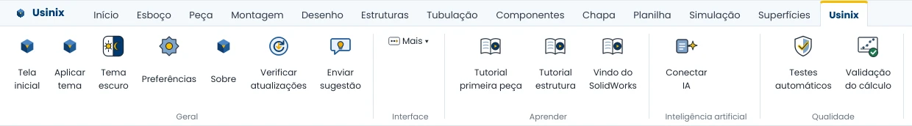

### Geral

- **Botão Verificar atualizações** na aba Usinix (também no menu Ajuda): a mesma verificação do Sobre, a um
  clique. Nada é instalado sem você confirmar.
- **Pacotes que se atualizam junto:** um pacote externo instalado na pasta do usuário pode se registrar para
  atualizar na mesma janela do Usinix (UsinixExtensoes.registrar_atualizacao). A janela mostra tudo o que tem
  versão nova, e um clique instala o pacote e depois segue com o Usinix.

## 1.27.3 — 22/11/2026

### Geral

- **PDF com texto selecionável no Windows:** o Usinix instala a fonte Poppins na conta do usuário (sem pedir
  administrador). O texto dos relatórios e das folhas em PDF saía como desenho, sem seleção nem busca. Vale a
  partir da segunda abertura do Usinix nesta versão.

### Simulação

- **Figuras de resultado:** só o resultado aparece; a peça sólida não fica mais em cinza por cima das cores.

### Conexão com IA

- **Ferramentas novas no assistente:** o servidor que o assistente roda é atualizado sempre que a conexão liga.
  Antes ficava a cópia da primeira conexão, e as ferramentas das versões novas não apareciam. Depois de atualizar,
  feche e abra o assistente uma vez.

## 1.27.2 — 21/11/2026

### Simulação

- **Figuras do relatório:** a barra de cores do FreeCAD não aparece mais ao lado da nova em MPa ou mm quando o
  Windows usa escala de tela de 125 % ou 150 %.

### Desenho

- **PDF de folha que nunca foi aberta:** o Usinix abre a folha e espera as vistas antes de gravar. O PDF saía com as
  vistas fora do lugar e sem a legenda (também por macro ou pela conexão com IA).
- **Nota de usinagem:** o furo axial é indicado pela ponta do diâmetro ("na ponta do Ø20"), não por esquerda ou
  direita, e o rasgo de chaveta ganha a posição ("a 10 do degrau" ou "a 10 da ponta do Ø30").

### Conexão com IA

- A folha nova criada pela IA já fica aberta.

## 1.27.1 — 21/11/2026

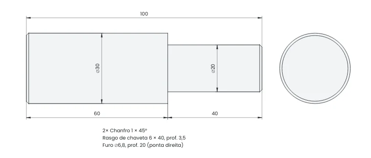

### Geral

- **Ao abrir um arquivo:** as rotinas de abertura (nome antigo, resultado grande escondido, cache das folhas e das
  propriedades) voltam a rodar. O FreeCAD 1.1 não avisa o fim da abertura aos complementos em Python.

### Estruturas

- **Material da barra:** o material da estrutura também vai para o material da barra. Massa, lista e conferência
  da folha não mostram mais "sem material".

### Simulação

- **Esqueleto no eixo real:** as linhas vão para o centroide de cada barra (contorno "Meio direito" 20 mm para
  dentro) e os nós continuam ligados. A diferença de altura entre os eixos fica em Excentricidades.
- **Duplicar análise:** a cópia mantém os mesmos rótulos, sem "001".
- **Seção sem linhas escolhidas:** vale para as linhas que sobram, como lê o CalculiX. O relatório deixa de mostrar
  "0 trechos".
- **Figuras do relatório:** a barra de cores sai em MPa ou mm, com vírgula decimal.
- **Verificador:** o aviso "material ligado só a parte da peça" não aparece mais no modelo de vigas.

### Desenho

- **Peça torneada:** a nota de usinagem traz os chanfros (1 × 45°), o rasgo de chaveta (largura × comprimento,
  profundidade) e os furos axiais (rosca M8 do recurso Furo, ou ⌀ e profundidade).
- **Escala automática:** passa para a escala normalizada também quando o TechDraw recalcula sozinho.
- **Conferência da folha:** avisa vista em cima de outra vista (ou das cotas dela) e carimbo com material quando o
  modelo não tem material.
- **Vistas fora de 1:1:** a área ocupada por uma vista em 1:2, 1:5 etc. era calculada com o dobro do tamanho. Isso
  afastava as anotações e mudava o centro dos detalhes.

### Conexão com IA

- A lista de ferramentas é atualizada no assistente quando o Usinix é atualizado com o assistente aberto.

## 1.27.0 — 21/11/2026

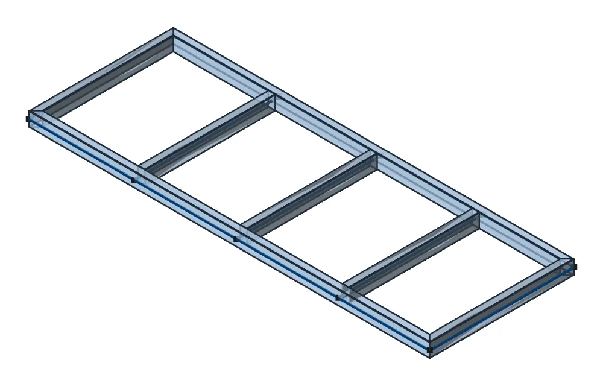

### Estruturas

- **Barra interna centrada:** a fixação lateral do grupo padrão (esquerdo/direito) vale para o contorno. As
  travessas internas ficam centradas na linha e os vãos saem iguais quando as linhas estão igualmente espaçadas
  (antes cada travessa ia para um lado: 535 / 495 / 535 / 535).
- **Grupo pela barra:** as barras vão para um grupo escolhidas pelo nome (Barra015) ou pelo rótulo, não pelo
  índice da linha no esboço.

### Simulação

- **Esqueleto da estrutura:** linhas das barras para o estudo de vigas, partidas nos cruzamentos e ligadas à
  estrutura. Mudou a estrutura, o esqueleto acompanha, e a bancada avisa que a malha e o resultado ficaram
  velhos (também quando só a posição das barras muda).
- **Duplicar análise:** cópia do estudo (material, seções, apoios, cargas, malha e solver) para outro caso, com
  os mesmos rótulos no relatório.
- **Carga na ponta:** força vertical para baixo no ponto do modelo de barras mais distante dos apoios, com a
  massa informada por quem calcula.
- **Reação por nó:** apoio com poucos pontos (parafusos, correntes) sai no relatório nó a nó, além da soma.
- **Relatório:** legenda das figuras em MPa e mm, como o texto; fonte Poppins garantida no PDF.
- **Verificador do assistente:** reconhece o estudo de vigas e não acusa mais "peça sem sólido", "faces que não
  existem" nem "malha sem elementos de volume".

### Desenho

- **Escala do carimbo pelas vistas:** a legenda mostra a escala das vistas, ou "INDICADA" quando há mais de uma.
- **Escalas normalizadas:** a escala automática do TechDraw fora da série (1:13,3) vira a normalizada logo
  abaixo.
- **Conferência da folha ao gravar o PDF:** escala e material do carimbo contra o modelo, vista ou anotação que
  invade a legenda ou passa da margem.
- **Isolar sólido para desenho:** num corpo com peças iguais modeladas juntas, desenha só uma, sem esconder o
  corpo na árvore.
- **Modelo de folha antigo:** "Prumo_..." passa a apontar para o modelo do Usinix mesmo quando o arquivo antigo
  ainda existe no disco.

### Conexão com IA

- Ferramentas novas: grupo das barras, esqueleto MEF, conferir folha, grupo de vistas numa folha existente,
  isolar sólido, duplicar análise, carga na ponta e salvar (com nova tentativa quando a sincronização do Drive
  segura o arquivo).

## 1.26.1 — 21/11/2026

### Correções

- **Capa dos relatórios em PDF:** título comprido diminui a fonte até caber na faixa da capa; a terceira linha
  saía cortada.
- **Cabeçalho das páginas do relatório:** nome de peça ou estrutura comprido termina em reticências antes da
  logo do canto direito, em vez de passar por baixo dela.

## 1.26.0 — 21/11/2026

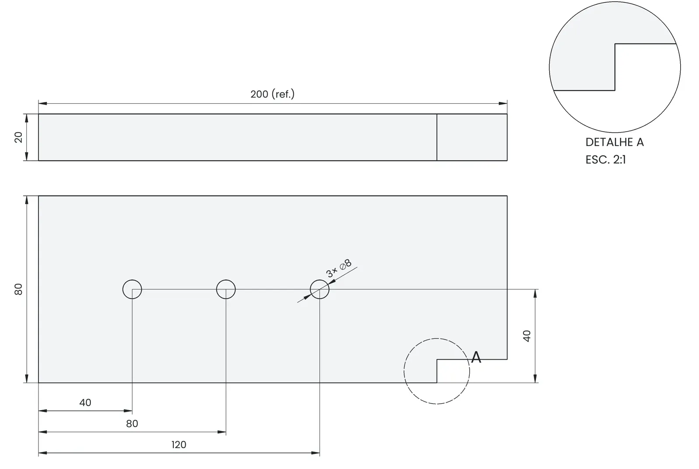

### Desenho

- **Vista de detalhe** (aba Desenho): escolha uma aresta ou vértice da vista e o Usinix cria o detalhe
  ampliado com a letra seguinte (A, B, C…, sem I e O), o círculo na vista de origem e a legenda "DETALHE A /
  ESC. 2:1" embaixo. O detalhe vai para o lugar livre da folha mais perto da vista, sem cair sobre vistas,
  cotas ou a legenda; se não houver espaço, sai menor.
- **Texto da cota:** acrescenta texto em volta do número medido por modelo — "4× {valor}", "{valor} (ref.)",
  "{valor} ±0,1", "{valor} H7"… O número continua medido; "{valor}" sozinho volta ao original.
- **Folha da chapa com os dados de fabricação:** tabela com espessura, medida planificada, número de dobras,
  raio interno, fator K e a tabela de onde ele saiu (família e r/t). Na legenda, o material vem com a espessura
  ("ASTM A36 · chapa 3 mm").
- **Peça torneada comprida:** sem a isométrica quando ela derrubava a escala (eixo de 315 mm sai 1:2 num A4,
  antes 1:5). A corrente de trechos fecha com o comprimento total mesmo com chanfro na ponta.

### Estruturas

- **Contraventamento só de tração:** a diagonal só sai quando a compressão passa da carga de flambagem dela
  (Euler, no comprimento todo). Diagonal rígida (perfil W, por exemplo) continua trabalhando com a pouca
  compressão do encurtamento dos pilares, e o cálculo não fica mais trocando diagonais até o limite de ciclos.
  Se ainda assim não estabilizar, o resultado traz um aviso.
- **Placas e reforços antigos sem material** passam a usar o material da estrutura na lista de materiais e no
  Excel (antes, "material a definir").

### Simulação

- **Estudo salvo em versão anterior** que já passou pela convergência: a nova rodada parte do tamanho da
  primeira malha da série, não da malha mais fina guardada.
- **Arquivo com resultado de malha muito grande** (mais de 150 mil nós) abre com o resultado escondido, para o
  programa não ficar parado desenhando; aparece pela árvore quando quiser.

## 1.25.0 — 21/11/2026

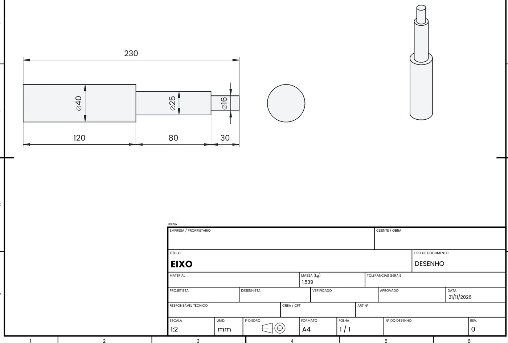

### Desenho

- **Peça torneada:** sai com o comprimento de cada trecho em corrente, além do comprimento total e dos
  diâmetros. Os textos de diâmetro não se sobrepõem, e o diâmetro maior não se repete na vista do círculo. Eixo
  modelado em pé é desenhado deitado, em escala maior (1:2 onde antes saía 1:5), e a vista superior, que
  repetia a frontal, fica de fora.
- **Cotas com texto de 3 mm** nas folhas novas (antes, 5 mm). Quem já mudou o tamanho nas Preferências
  continua com o seu.
- **Ícones novos** de novo arquivo, de mostrar/ocultar e do arquivo na árvore do projeto.

### Correções

- **Peça de chapa na lista e no DXF:** a planificação criada pela folha da chapa tirava a peça da lista de
  materiais e do DXF em lote. Objetos de apoio (planificação, cópia da barra para a folha, análise da estrutura)
  não contam mais como "pai" da peça.
- **Contraventamento só de tração com vento:** não dá mais mecanismo no nó do cruzamento do X. A diagonal
  comprimida perde só o esforço normal (a flexão segura o cruzamento), e as duas metades de uma diagonal partida
  no cruzamento ligam e desligam juntas. A diagonal tracionada agora leva a força (antes ficava com máximo 0).
  Na instabilidade de 2ª ordem, a mensagem diz o primeiro nó que cede.
- **Fixador:** só aceita borda de furo (círculo fechado com parede côncava). O arco de um canto arredondado
  não vira mais "furo" com parafuso na quina.
- **Massa na legenda da folha:** componentes da biblioteca ficam fora da soma, como na lista de materiais
  ("+ catálogo" na legenda). A janela de propriedades de massa lista o que ficou fora.
- **Convergência da malha:** parte sempre do tamanho escolhido para o estudo, e não da última malha refinada.
  Avisa antes quando a malha mais fina passaria de 150 mil nós.
- **Placa de base e reforço** sem material escolhido recebem o material da estrutura.
- **Estudo antigo:** avisa quando o material gravado no estudo difere do de mesmo nome na biblioteca (os aços
  estruturais passaram de 203 para 200 GPa na 1.24.0).
- **Cargas:** carga acima do bom senso também aparece quando a análise de 2ª ordem para por instabilidade.
- **Conectar IA:** fechar o documento ativo e abrir outro na mesma chamada não dá mais erro de transação. A
  descrição da ferramenta de estado não afirma mais que a conexão está desligada.
- **Barra de cores −0,5 a +0,5** não volta mais ao reabrir um estudo.

## 1.24.0 — 20/11/2026

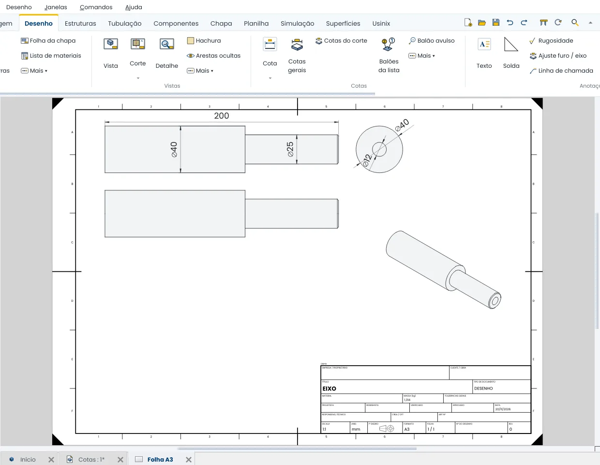

### Novo

- **Validação do cálculo (aba Usinix › Qualidade):** o Usinix resolve casos clássicos de solução conhecida e
  compara com a fórmula da resistência dos materiais: viga em balanço, biapoiada e biengastada, coluna em 2ª
  ordem (P-Δ), frequência natural de viga, barra tracionada e viga em balanço em elementos finitos sólidos
  (estática e frequência). Cada caso é montado do zero e calculado com o mesmo motor das bancadas. O relatório
  em PDF traz, para cada caso, o modelo, a fórmula, o valor de referência, o valor do Usinix, a diferença e a
  tolerância, junto com as versões do Usinix, do FreeCAD e do CalculiX, para anexar à documentação técnica.

### Correções

- **Cotas automáticas em peça torneada:** eixo, bucha, anel e polia recebiam "altura" e "profundidade" de caixa, e
  o chanfro virava diâmetro. Agora a peça de revolução é cotada como se faz à mão: o diâmetro de cada trecho na
  vista longitudinal, o comprimento total ao longo do eixo e, na vista do círculo, o diâmetro maior, o furo
  central e a furação. Chanfros e degraus não viram furo.
- **Escala da folha:** a frontal, a superior e a lateral podem deixar a isométrica no canto vazio, embaixo da
  lateral. Com isso, peças que saíam em 1:5 cabem em 1:2. Entrou o arranjo "Frontal e lateral", sem a
  isométrica, para peças compridas.
- **Lista de materiais na folha:** a coluna se alarga conforme o texto, e o texto não invade mais a coluna do
  lado. Texto muito longo é abreviado na folha; a planilha e o Excel trazem o texto inteiro.
- **Balões:** não ficam mais um em cima do outro quando várias peças estão do mesmo lado da montagem.
- **Legenda da montagem:** a massa acompanha a troca de material de uma peça que está em outro arquivo.
- **Parafusos, porcas e arruelas:** com vários iguais no documento, o nome "M10 × 35" virava "M10 × 001" e
  mudava a medida na lista e nos balões. Agora os repetidos ficam "M10 × 35 (2)". O mesmo vale para as cotas.
- **Interferência:** parafuso num furo roscado (corpo M10 num furo de broca 8,5) não aparece mais como
  interferência. Com "mostrar contatos", aparece como rosca engatada.
- **Biblioteca de materiais:** entraram os bronzes SAE 65 (C90700) e SAE 660 (C93200), para buchas e mancais.
- **Conectar IA:** a lista de materiais da IA vê a montagem que está numa folha. Nova ferramenta `fixador`
  coloca parafuso, porca ou arruela num furo existente. Código que fecha o documento ativo não dá mais erro
  no fim.
- **Contraventamento só de tração:** um X com as duas diagonais comprimidas só pelo peso (sem carga lateral) não
  é mais tratado como mecanismo.
- **Simulação (MEF):** quando a tensão máxima não converge entre as duas malhas mais finas, o resultado sai com
  aviso, e não mais "ok". O aviso sugere ler a tensão um pouco longe do apoio.
- **Cargas da análise de barras:** a unidade está escrita na propriedade: kN na carga pontual e na carga em nó,
  kN/m na carga distribuída. Os campos `valor_kN` e `barra` (com a numeração da tela, a partir de 1) também são
  aceitos. Carga acima do bom senso (por exemplo, digitada em N) gera aviso no cálculo. Nas rótulas, "B5"
  indica a barra 5 da tela.
- **Esqueleto alterado:** se o esboço ganhou linhas e a estrutura não foi atualizada, o cálculo avisa quais
  linhas estão sem barra.
- **Tubulação:** um diâmetro que não existe na linha dá uma mensagem com os diâmetros disponíveis e não deixa
  mais um objeto vazio no documento. A lista de corte e a tabela do isométrico usam o mesmo arredondamento.
- **DXF do piso:** a chapa perfurada, expandida ou xadrez sai com um texto dizendo que vem pronta de fábrica e
  que só o contorno vai para o corte.
- **Aços estruturais da biblioteca:** módulo de elasticidade de 200 GPa, o mesmo da análise de barras. Antes era
  203 GPa, e o mesmo aço dava rigidez diferente na simulação e na análise de barras.
- **Componentes da biblioteca** (compressor, motor, extintor...) entram na lista de materiais sem massa calculada,
  com a observação "ver catálogo do fabricante". O sólido é só representativo.
- **Conectar IA:** quando uma ferramenta falha e é desfeita, as peças afetadas são recalculadas e não ficam com
  a forma do erro.

## 1.23.0 — 20/11/2026

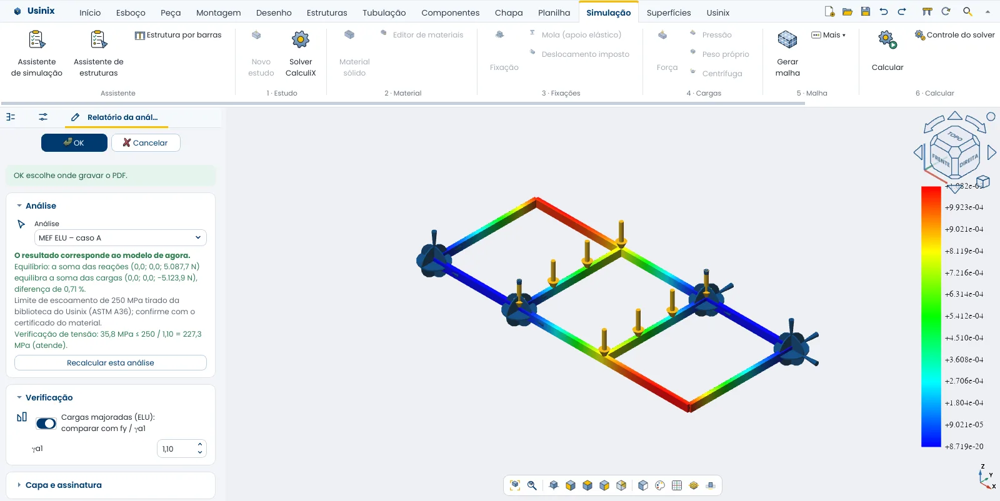

### Novo

- **Relatório da análise (Simulação › 8 · Relatório):** gera o relatório completo, em PDF, de uma análise montada à
  mão na bancada, não só das feitas pelo assistente. Escolha a análise e o painel mostra se o resultado vale para o
  modelo de agora, confere o equilíbrio e compara a tensão com fy / γa1 (cargas majoradas) ou com o fator de
  segurança. O PDF traz capa, modelo com apoios e cargas, materiais, seções das barras, apoios, cargas com a direção
  escrita, malha e solução, resultados com as vistas de tensão e deslocamento, reações de apoio com a soma
  comparada às cargas, verificação, premissas, conclusão e assinatura. Cliente, projeto, responsável, CREA e ART
  ficam em **Capa e assinatura**.
- **Bancada Simulação no tema Usinix:** os botões da faixa e os itens da árvore (estudo, solver, material, seção,
  apoios, cargas, malha, resultados) ganharam ícones no mesmo desenho das outras bancadas. Nas restrições novas,
  o símbolo dos apoios sai em azul e o das cargas em âmbar.
- **Resultado desatualizado:** se você mudar carga, apoio, material, seção, malha ou geometria depois de calcular,
  o painel avisa que o resultado é de um modelo anterior e só libera o relatório depois de **Recalcular esta
  análise**.

### Correções

- **Tração em barra com furos (cálculo por barras):** a resistência à tração é calculada com a área bruta, sem
  descontar os furos. Agora, quando uma barra com furos de Trabalhos na barra fica tracionada, o cálculo e a memória
  avisam para conferir a ruptura na seção líquida.
- **Legenda de cores sobrando:** a escala de cores de um resultado antigo (de −0,5 a +0,5) ficava na tela depois de
  mostrar outro resultado ou de reabrir o arquivo. Agora ela some.
- **Lista de materiais, massa, interferência e DXF em lote:** a peça que tinha vista numa folha de desenho sumia da
  lista e do DXF (e, com tudo em folhas, a lista saía vazia). Os sólidos de apoio das folhas das barras entravam na
  lista e no Excel como peças, aumentando a massa. As duas coisas foram corrigidas.
- **Barras com e sem furos:** viravam uma linha só na lista de materiais. Agora são itens separados, com a furação
  na observação, como na lista de corte.
- **Viga biapoiada na análise por barras:** rótula com rolete dava erro de mecanismo porque nada segurava o giro da
  viga no próprio eixo. Há dois apoios novos, **Apoio simples (garfo)** e **Rolete com garfo (vertical)**, e a
  mensagem de mecanismo explica o giro livre e indica esses apoios.
- **Material da estrutura:** um nome escrito de outro jeito ("ASTM A572 Gr.50") fazia a análise cair em ASTM A36
  sem aviso na tela. Agora o nome é corrigido para o da biblioteca e, se o material não existir, a análise avisa
  em destaque.
- **Aviso da placa:** saía com a unidade repetida ("39.0 mm mm"); agora sai "39,0 mm".
- **Tubulação de aço:** entraram reduções concêntricas que faltavam no catálogo, como 4" × 2", 3" × 1 1/2" e
  2" × 1".
- **Conectar IA:** o assistente mostrava só a ferramenta "estado" quando era aberto antes do Usinix; agora a lista
  completa fica guardada e o assistente é avisado quando ela muda. A captura de imagem funciona mesmo com uma folha
  de desenho na frente, e a lista de materiais não sai mais vazia em peças usadas numa simulação. As folhas feitas
  pela IA não saem mais com "verificado" e "aprovado" preenchidos: esses campos ficam para quem revisar.
  Também pela IA, a estrutura recebe o ponto de fixação do perfil e só aceita material da biblioteca, e os furos
  com parafusos informam quantos parafusos entraram em cada barra.

## 1.22.2 — 20/11/2026

### Correções

- **Tamanho do texto das cotas:** mudar o padrão nas preferências não mudava as cotas do desenho aberto, só as feitas
  depois, e o desenho continuava com 5 mm. Agora as cotas que estão no tamanho padrão acompanham a mudança na hora,
  também nos desenhos abertos; uma cota que você mudou à mão fica como está.
- **Preferências › Desenho técnico:** cartão novo com os dois tamanhos lado a lado, **Texto das cotas** e **Texto do
  nome das vistas**. No FreeCAD eles ficam em abas diferentes, e o "Tamanho do rótulo" da aba Geral vale só para o
  nome das vistas, não para as cotas.

## 1.22.1 — 20/11/2026

### Correções

- **Painel "Comando" vazio ao abrir o programa:** em alguns computadores, com a tela inicial na frente, o painel de
  comando aparecia sozinho à esquerda, vazio. Isso acontecia quando o programa demorava a terminar de carregar e
  reabria o painel depois que a tela inicial já tinha escondido os painéis. Agora o painel de comando só aparece com
  um comando aberto (um esboço, uma extrusão, um assistente) e some quando ele termina.

## 1.22.0 — 19/11/2026

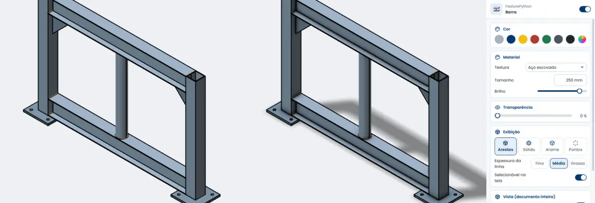

### Novidades

- **Aparência com material e efeitos de vista.** O painel Aparência ganhou dois cartões:
  - **Material:** textura na peça (aço escovado, concreto, madeira, fibra de carbono, plástico texturizado ou uma
    imagem sua), com o tamanho da repetição, e o **brilho** do material, de fosco a polido. A textura fica guardada
    dentro do arquivo e vale só na vista 3D: a cor da peça continua a mesma nos desenhos.
  - **Vista (documento inteiro):** **Sombra no chão**, a sombra suave do modelo num chão invisível, e **Realce de
    cantos**, que escurece cantos, furos e encostos e deixa a forma mais fácil de ler. Os dois vêm desligados e
    ficam gravados em cada arquivo. O realce pesa na vista em montagens grandes; a imagem salva pelo programa
    sai sem os efeitos (para registrá-los, use a captura de tela).
- Os efeitos e as texturas usam o motor do complemento [ShowRoom](https://github.com/oficinerobotica/ShowRoom),
  de OficineRobotica (LGPL-2.1), incorporado com o crédito.

## 1.21.1 — 17/11/2026

### Correções

- **Arredondar o encontro entre duas peças:** dava para arredondar só arestas de uma peça, então não havia como pôr
  um raio de concordância entre uma barra da estrutura e uma chapa apoiada nela. Agora, com arestas ou faces das duas
  peças selecionadas, o **Arredondar** (na faixa ou no menu do botão direito) une as peças e arredonda só o encontro
  entre elas. As peças originais ficam guardadas dentro da união. Também dá para escolher duas ou mais peças direto
  no **Arredondamento automático**. Se as peças não se encostam ou o raio não cabe, o Usinix avisa e não deixa
  nada pela metade.

## 1.21.0 — 16/11/2026

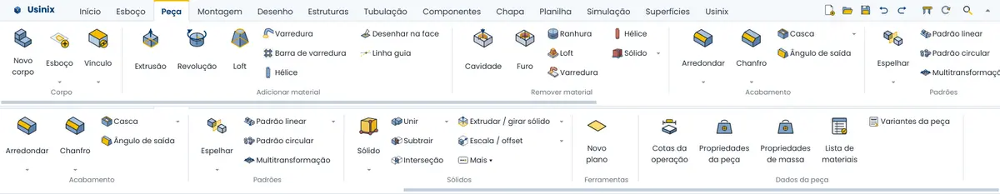

### Mudanças

- **Tudo com o nome Usinix:** o nome antigo saiu do módulo, dos comandos, das preferências, das propriedades dos
  objetos, da biblioteca de materiais e das pastas. Arquivos, preferências e atalhos de teclado das versões
  anteriores continuam valendo: o Usinix converte sozinho ao abrir.
- **Desta vez, atualize pelo pacote completo** (instalador, portátil ou AppImage): a atualização só do complemento
  não serve para esta versão. Em **Ajuda → Sobre → Verificar atualizações** o Usinix oferece o pacote certo.

### Aba Peça sem ferramentas repetidas

- **Recalcular** foi para a barra do topo, ao lado de Medir, e vale em todas as abas.
- **Vínculo** virou um botão grande só, com vínculo de subforma, vínculo de forma e clonar no menu da setinha.
- **Arredondar** traz o arredondamento automático no menu; **Padrão linear** traz a matriz de furação.
- **Sólido** traz também as primitivas soltas (caixa, cilindro, tubo... fora da peça) e **Unir** traz a booleana
  entre peças.
- Saíram da aba Peça o grupo Eixo, ponto, sistema (fica o **Novo plano**), a Booleana e Peça pelas guias. Verificar
  geometria e Sólido das faces ficam só na aba Superfícies e Validar esboço, na aba Esboço.
- **Modelo com regras** foi para a aba Componentes.
- O último grupo da aba Peça agora se chama **Dados da peça**; na aba Usinix, **Geral**.

### Faixa

- **Nomes que voltam aos poucos:** ao alargar um grupo arrastando o divisor, os nomes das ferramentas voltam
  coluna a coluna (antes só voltavam com o grupo inteiro aberto).

### Correção

- **Paleta de vistas:** com a folha aberta, as vistas novas entravam fora do grupo, no canto da folha, e as vistas
  sumiam ao serem clicadas (às vezes o programa fechava).

## 1.20.0 — 15/11/2026

### Mudanças

- **Vasos de pressão, escadas e proteções de máquina NR-12** saem do Usinix por enquanto: são ferramentas que
  geram memória de cálculo e memorial de entrega, e passam por uma rodada maior de testes e validação antes de
  voltar. Os arquivos feitos nas versões anteriores com esses objetos abrem mostrando as formas, mas esses objetos
  não são recalculados.
- A aba Estruturas fica só com o que é de estrutura (perfis, cantos, reforços, pisos, solda e cálculo).

### Faixa

- **Abas de pacotes em destaque:** as abas acrescentadas por pacotes instalados à parte aparecem com o cabeçalho
  azul e o filete amarelo.
- **Aba nova no lugar certo:** quem arrastou as abas para outra ordem recebe as abas novas ao lado da vizinha de
  sempre, não no fim da faixa.
- Botão de comando de pacote sem barra nem menu aparece na faixa (a aba do pacote saía vazia).

## 1.19.2 — 15/11/2026

### Correções e ajustes

- **Escada:** os degraus não ficam mais marcados "por recalcular" depois de cada recálculo.
- **Painéis que abrem ao clicar:** OK depois de o painel já ter seguido sozinho não roda a ferramenta de novo.
- **Pacotes de ferramentas adicionais:** o Usinix passa a aceitar pacotes instalados à parte, que acrescentam
  ferramentas à faixa, tipos de escada e a marca da empresa nos relatórios em PDF e nas folhas de desenho.

## 1.19.1 — 15/11/2026

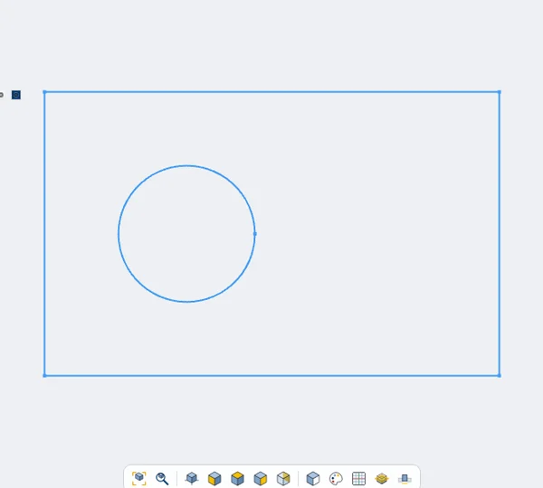

### Correção

- **Sair do esboço podia fechar o programa:** quando o esboço mudava durante a edição e você saía dele (Esc,
  Fechar ou Cancelar), o Usinix às vezes caía. A queda vinha de dentro do FreeCAD, na ligação entre a cor das faces
  do esboço e o material delas; essa ligação foi refeita no código do programa (C++).

## 1.19.0 — 15/11/2026

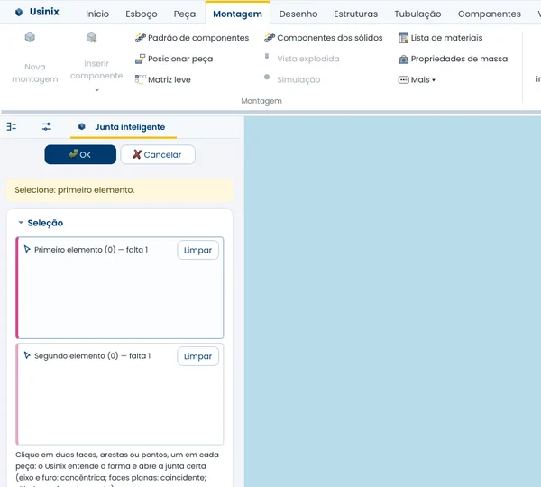

### Clicou, abriu

- **A ferramenta abre as configurações ao clicar**, como a Extrusão. As que antes exigiam escolher as peças
  primeiro (e não faziam nada sem isso) agora abrem um painel que diz o que escolher, mostra o que já foi escolhido
  e roda sozinho quando a escolha fica completa (duas faces, duas arestas...). Vale para Subtrair/Unir/Interseção,
  Clonar, Verificar geometria, Validar esboço, Cotas da operação, Fixar peça, Posicionar peça, Medir X, Y, Z,
  Isolar, Matriz leve, Atualizar estrutura, as ferramentas da Chapa (aba, dobra, bainha, recorte, alívio,
  planificar...), Estender face e Curva de concordância, as anotações do Desenho (corte, detalhe, hachura, linha de
  chamada, linhas de centro, roscas, símbolo de solda...) e a malha, o solver e os resultados da Simulação.
- **Montagem:** as restrições (juntas), Inserir componente, Resolver e Vista explodida funcionam com a montagem
  fechada: o clique abre a montagem sozinho e segue. A **Junta inteligente** abre o painel com o primeiro e o
  segundo elemento; no segundo clique, a junta certa abre.
- **Desenho e Simulação:** com a folha (ou o estudo) no projeto, as ferramentas já aparecem; o clique abre a folha
  ou ativa o estudo. Havendo um só solver, malha ou resultado, ele já vem escolhido.
- Sem montagem, folha ou estudo no projeto, o aviso diz onde criar.

### Peça e vista 3D

- Aba Peça › Ferramentas: **Recalcular** grande, ao lado de Novo plano; Verificar geometria, Validar esboço e
  Booleana pequenos, em três linhas.
- **Grade com dois modos:** o primeiro clique põe a grade no chão (como antes); o segundo, a **grade frontal
  infinita**, de frente para a tela, ocupando a área de trabalho inteira e acompanhando o zoom; o terceiro desliga.

## 1.18.0 — 14/11/2026

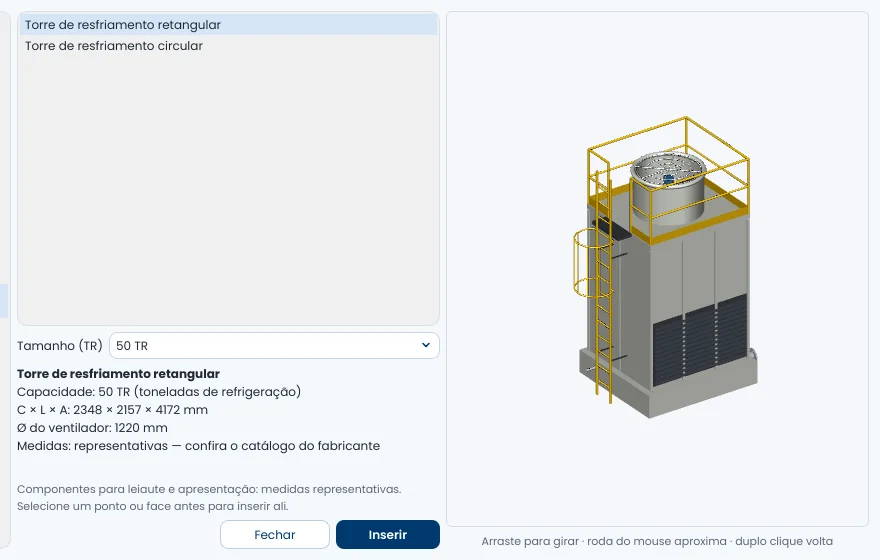

### Componentes

- **Prévia do componente na janela:** ao escolher o modelo e o tamanho, aparece o desenho em 3D, com as cores e
  os acabamentos, antes de inserir. Arraste para girar, use a roda do mouse para aproximar e o duplo clique para
  voltar à vista inicial.
- A janela monta o componente uma vez só para a prévia, as medidas e a inserção (mais rápida ao trocar de
  tamanho e ao inserir).

## 1.17.1 — 14/11/2026

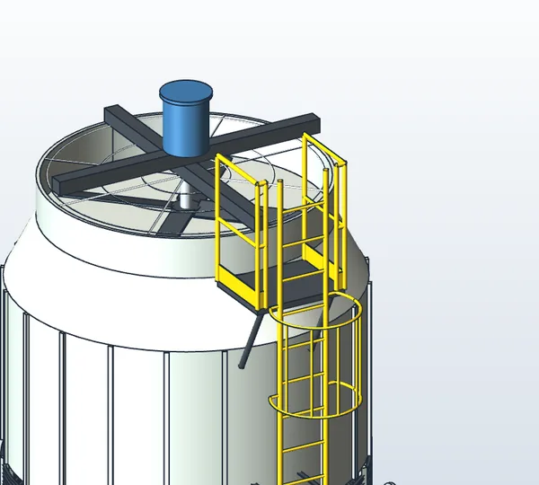

### Componentes (correções conferidas em todos os modelos novos)

- **Escadas:** presas no casco (antes ficavam soltas, com os afastadores no ar) e afastadas da bacia; chegam a
  uma plataforma ou patamar com passagem no guarda-corpo (torres de resfriamento, reservatório tipo coluna,
  taça e torre metálica); a gaiola termina na chegada e os montantes da gaiola são tubos.
- **Tubos e flanges:** curvas de verdade nas mudanças de direção (antes os trechos se encontravam quebrados);
  flanges com o furo central e os furos dos parafusos; bocas livres vazadas; válvulas gaveta flangeadas no meio
  da linha (reservatório tipo coluna e tanque horizontal, cuja saída agora é lateral e não encosta no chão).
- **Peças soltas:** hélice e motor das torres ligados pelo eixo, vigas do motor apoiadas na borda da chaminé,
  guarda-corpo do teto da coluna e da taça apoiado no teto, gaiola do IBC até o palete e alça do galão presa
  no gargalo. Todos os modelos novos passam por uma verificação automática de peças soltas.

## 1.17.0 — 14/11/2026

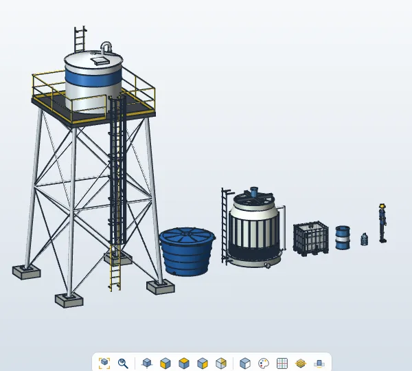

### Componentes

- **Reservatórios de água:** caixa d'água de polietileno (310 a 10 000 L), reservatório elevado tipo taça
  (15 a 200 m³, com fuste, passarela, escada e balizamento), reservatório metálico tipo coluna (20 a 300 m³),
  reservatório elevado sobre torre metálica de quatro pés (5 a 30 m³) e tanque horizontal sobre berços
  (5 a 60 m³).
- **Galões, tambores e IBC:** galão de água de 10 e 20 L (translúcido), bombona plástica de 50 a 200 L, tambor
  metálico de 100 e 200 L e contêiner IBC de 1 000 L na gaiola, sobre palete.
- **Torres de resfriamento:** retangular (50 a 400 TR) e circular (10 a 150 TR), com bacia, venezianas,
  ventilador com tela e motor, tubulação de água, escada e guarda-corpo.
- Na aba Componentes entraram os botões Reservatórios, Galões e tambores, Torres de resfriamento, Içamento e
  Combate a incêndio. As medidas são representativas, para leiaute: confira o catálogo do fabricante.

## 1.16.0 — 13/11/2026

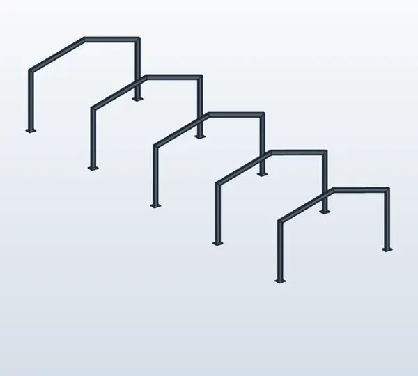

### Estruturas

- **Padrão de estrutura** (aba Estruturas): repete a estrutura soldada inteira em linha ou em volta de um eixo
  (vários pórticos, mesas iguais), com a quantidade e o espaçamento como no padrão linear: "Distância entre
  eles" ou "Distância total". A direção vem de uma aresta ou face, ou dos eixos X, Y e Z. As cópias acompanham
  a original (mudou a original, mudam todas) e a lista de materiais e a lista de corte contam todas.
- A Matriz leve, com uma estrutura selecionada, abre o Padrão de estrutura (antes gerava uma matriz vazia).

### Desenho

- **Símbolo de solda arrastável:** a linha de chamada não vem mais travada (sem o cadeado). Arraste o símbolo
  ou a linha: a linha de referência e o símbolo andam juntos e a ponta da seta fica na aresta; se passar para
  o outro lado, a linha de referência vira. Desfazer volta.
- A seta da solda cai na aresta escolhida também em vista ampliada (numa vista 2:1 ela caía no dobro da
  distância, fora da peça), e a linha de chamada sai para o lado que tem espaço na folha.

## 1.15.2 — 13/11/2026

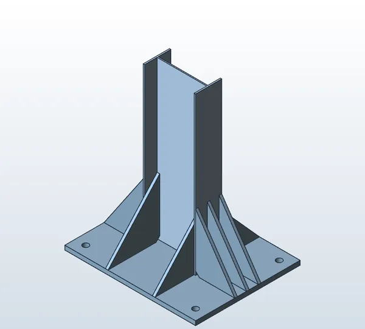

### Estruturas

- **Vários enrijecedores de uma vez:** no Reforço (mão-francesa e enrijecedor da placa de base) entrou a seção
  "Vários reforços (padrão linear)", com a quantidade de chapas e o espaçamento, como no padrão linear:
  "Distância entre eles" (de uma chapa à próxima) ou "Distância total" (da primeira à última), sempre de eixo a
  eixo das chapas. Com distância 0, o Usinix distribui as chapas na largura do perfil, as das pontas rentes às
  faces; no lado da alma de um perfil I, elas ficam entre as mesas. O grupo segue a posição escolhida (centro,
  frente ou trás). Avisa quando as chapas se sobrepõem ou passam da largura do perfil.
- A lista de materiais conta cada chapa (quantidade e massa de uma chapa) e a solda soma o cordão de todas.

### Testes automáticos

- Rodar a bateria não abre mais o navegador (o endereço de "Enviar sugestão" e outros links só é anotado).

## 1.15.1 — 13/11/2026

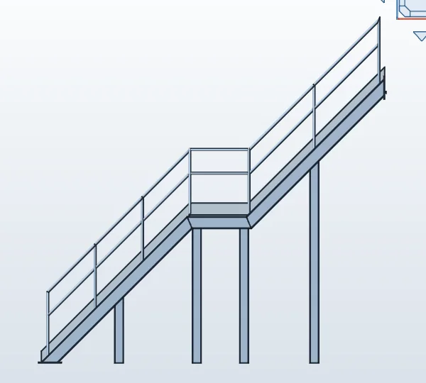

### Escada

- **Pés de apoio:** escolha "Apoiada nas pontas" ou "Com pés de apoio". Com pés, vai um par sob as vigas em cada
  ponta de patamar e, com o vão máximo preenchido, pés intermediários nos lances. O perfil dos pés é qualquer um
  do Usinix (W, I, U, cantoneira, tubo redondo, quadrado ou retangular); o topo do pé é cortado no plano do
  fundo da viga inclinada e a verificação de interferência não acusa nada. Cada pé tem chapa de base com 4
  furos para chumbador (espessura e furo das chapas de fixação), que entra na lista de materiais; dá para
  desligar.
- **Comprimento do patamar** conferido no texto da NR-12 (Anexo III, 11 e / 12 e: plataforma de descanso de
  0,60 m no mínimo): o painel não aceita menos e a conferência acusa patamar curto.

## 1.15.0 — 13/11/2026

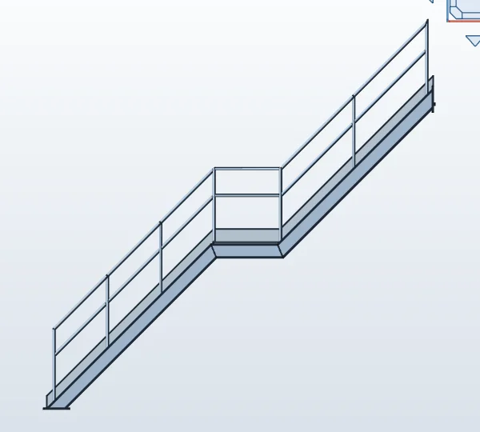

### Estruturas

- **Enrijecedor da placa de base:** o Reforço agora aceita uma barra e a placa onde ela apoia (placa de base,
  chapa ou face plana de um corpo). Escolha os lados do perfil — os quatro, dois ou um — e a perna sobre a placa
  (0 = até a borda). Mudou a placa ou o perfil, os enrijecedores acompanham.
- **Estrutura sobre arestas de um corpo:** selecione as arestas (Ctrl + clique) e clique em Estrutura soldada; o
  esqueleto sai das arestas, ligado ao corpo, e todas as linhas já começam com barra.
- **Tabela de furos** com os furos e recortes de Cortar barras: onde (alma, mesas), distância da ponta,
  transversal, Ø ou medidas do recorte e de que corte veio.

### Escada

- **Patamares:** ligue "Dividir em lances com patamar" e a escada se divide em lances de até 3 000 mm (NR-12,
  Anexo III, 11 e / 12 e), com patamar entre eles. As vigas seguem horizontais sob o patamar; guarda-corpo e
  rodapé continuam por ele.
- **Chapas de fixação:** chapa deitada no pé de cada viga e chapa em pé no topo, com furos; entram na lista de
  materiais.
- Rodapé por dentro da largura útil e pé do montante cortado no plano da viga (antes encostavam com
  interferência).

### Faixa

- O grupo que você alarga arrastando o divisor volta com a mesma largura.

### Componentes com mais detalhe

- **Todos os componentes redesenhados:** peças de revolução lisas, cantos arredondados, furação e porcas nos
  flanges, volantes com raios, motor com aletas, chaveta, pés e caixa de ligação aparafusada, grades, painéis e
  manômetros. Metal brilha, tinta fica fosca e vidro fica transparente.
- **Caldeira em escala real:** a de 2 000 kg/h fica com cerca de 3 m de altura e 6 m de comprimento com o
  queimador (antes saía pequena); a chaminé segue à parte, só a saída de gases com flange fica no modelo.
- **Pessoa de 1,70 m** como padrão (1,60, 1,80 e 1,90 m continuam), com colete refletivo e capacete com aba.
- **Trole** no formato do trole de 0,5 t de catálogo: placas em escudo dobradas, quatro rodas com aba, rebites,
  eixo central com porca e olhal de carga.
- **Içamento** (categoria nova): talha elétrica de corrente, talha elétrica de cabo de aço com trole e talha
  manual de corrente.
- **Combate a incêndio** (categoria nova): extintor portátil, extintor no suporte de piso com placa, extintor
  sobre rodas, hidrante de parede simples e duplo e abrigo de mangueira simples e duplo. Alturas e medidas
  representativas (conferir NBR 13714 e a IT do Corpo de Bombeiros).

### Normas conferidas (catálogo ABNT/Confea, 13/11/2026)

- **Furo para parafuso:** Trabalhos na barra usa o furo-padrão da ABNT NBR 8800:2024 (Tabela 14): M16 → 18,
  M20 → 22, M22 → 24, M24 → 27, M27 → 30, M30 → 33 e d + 3 acima disso. Antes era d + 1,5 mm, da edição de 2008.
  Abaixo de M16 a tabela não dá valor e o Usinix usa d + 2 mm (a checar); quem gravou uma folga própria nas
  preferências continua com ela.
- **Perfis I e U:** as bitolas da ABNT NBR 15980:2024 (Tabelas A.2 e A.3) foram conferidas e sete delas corrigidas
  (diferenças de décimos de milímetro e na massa). As bitolas que não estão na norma (I de 8" para cima, U de
  12", entre outras) vêm do catálogo do fabricante e dizem isso na descrição.
- **Escada:** a viga padrão passa a ser o U 8" × 17,10 (NBR 15980); o I 8" não está na norma.
- **Parafuso allen:** b, dk, k e s de M3 a M24 conferem com a ABNT NBR 10112:2010.

## 1.14.0 — 10/11/2026

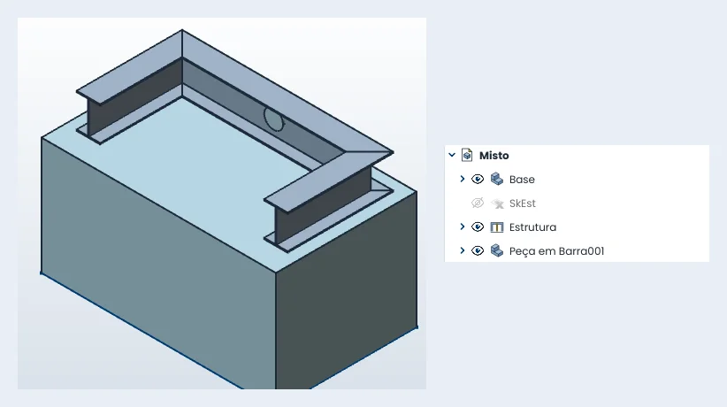

### Corpos e estruturas juntos

- **Peça na face** (aba Estruturas e botão direito da barra): clique numa face plana de uma barra, chapa ou corpo
  — a alma da viga, a aba da cantoneira, o tampo da base — e o Usinix cria uma peça nova com essa face como
  referência ligada e abre o esboço já sobre ela, com a origem no meio da face. Para batente, suporte de escada,
  chapa de ligação, orelha, calço. Se a barra ou o corpo mudam, a peça acompanha.
- **Estrutura apoiada no corpo:** com o esqueleto desenhado numa face de um corpo, as barras saem encostadas na
  face (perfil fixado na base ou no topo), sem entrar no corpo. Mudou o corpo, a estrutura acompanha.
- **Cortar barras:** aviso quando a ferramenta atravessa a barra inteira e a divide em pedaços.
- Interferência, lista de materiais e folha de montagem tratam corpos, estruturas e peças juntos.

### Dados das pranchas nas Preferências

- **Preferências › Dados das pranchas:** empresa, projetista, desenhista, verificado, aprovado, responsável
  técnico e CREA/CFT. O que estiver ali vai preenchido na legenda de toda prancha nova; em cada prancha ainda dá
  para mudar, e a mudança fica só naquela prancha. Os dados ficam só neste computador (não vão junto com o
  programa) e o botão "Limpar os dados" apaga tudo.

### Esboço novo e grade

- **Planos no meio da tela:** no Novo esboço, os planos de origem vão para o centro da vista em qualquer modelo
  (antes só no modelo vazio, e às vezes ficavam fora do meio). Numa vista de topo, frente ou lado, a vista vai
  para a isométrica, onde os três planos aparecem.
- **Sem tranco ao escolher o plano:** o giro até o plano e o deslize até a origem do esboço agora são um
  movimento só, mais curto (cerca de 0,4 s), sem a parada no meio.
- **Botão Grade na barra de vistas**, embaixo da vista 3D, ao lado de Aparência: liga e desliga a tela
  quadriculada. Fica destacado quando a grade está ligada, e a dica mostra o tamanho do quadrado.

## 1.13.0 — 10/11/2026

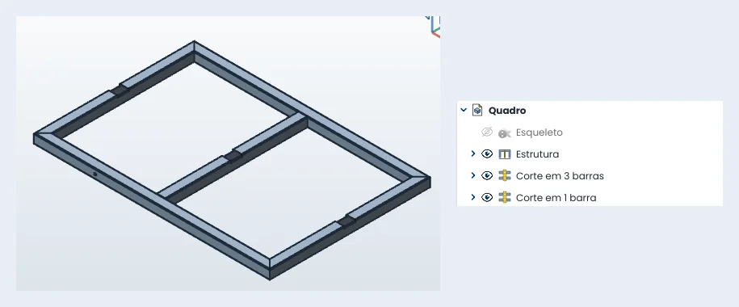

### Cortar barras (corte com escopo)

- **Cortar barras** (aba Estruturas, ao lado de Trabalhos na barra, e no botão direito da barra ou da estrutura):
  corte ou furo feito **uma vez** e aplicado em **várias barras**, como o escopo do recurso no SolidWorks.
- **Ferramenta:** qualquer sólido (cilindro, caixa, extrusão, peça) ou um **esboço fechado**, que vira sozinho uma
  extrusão que atravessa a estrutura.
- **Escopo:** escolha as barras (clicar numa estrutura pega todas as barras dela) ou deixe vazio para o corte
  pegar todas as barras que a ferramenta atravessa.
- **Tudo ligado:** moveu a ferramenta ou mexeu no esboço, as barras se refazem; apagou o corte, as barras voltam
  inteiras. A ferramenta fica dentro do corte na árvore; duplo clique edita.
- A folha de cada barra e a lista de materiais já saem com o recorte.

## 1.12.0 — 10/11/2026

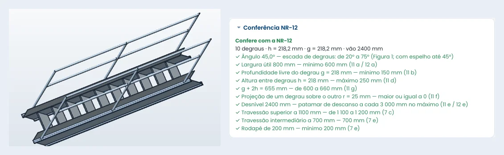

### Escada industrial

- **Escada** (aba Estruturas › Acessos): informe o desnível, o ângulo, a largura útil e o perfil das vigas, e o
  Usinix monta **num objeto só** as duas vigas (banzos), os degraus (grade de piso, chapa xadrez dobrada ou com
  espelho), o guarda-corpo com montantes, travessão superior e intermediário, e o rodapé.
- **Degraus calculados:** a quantidade e a altura saem do desnível, com g + 2h perto de 630 mm; dá para fixar o
  número de subidas.
- **Vigas certas:** a altura da viga fica no plano da escada e as pontas saem cortadas na horizontal no piso e
  no topo, sem ajuste à mão.
- **Edição por duplo clique** (ou no painel Propriedades): muda o desnível, o ângulo, a largura ou um perfil e a
  escada inteira se refaz. Posição do pé e giro em planta no próprio painel.
- **Conferência ao vivo pela NR-12, Anexo III** (Portaria MTP n.º 4.219/2022): ângulo pela Figura 1, largura útil,
  profundidade e altura dos degraus, g + 2h, patamar a cada 3,00 m e guarda-corpo (1,10 m a 1,20 m,
  intermediário a 0,70 m, rodapé de 0,20 m).
- **Lista de materiais:** vigas e tubos pela lista de corte; degraus e rodapés pela quantidade.
- **Conectar IA:** ferramenta nova `escada`.

## 1.11.1 — 10/11/2026

### Correções

- **Instalar no Claude Desktop:** as versões novas do Claude Desktop para Windows guardam a configuração em
  `%LOCALAPPDATA%\Claude-Data\claude_<código>`, e o botão não gravava ali — o Usinix não aparecia nos servidores
  locais. Agora essa pasta vem primeiro. Novo botão **Outro arquivo…** para escolher à mão o arquivo que o Claude
  abre em Configurações › Desenvolvedor › Editar configuração (a escolha fica guardada).

## 1.11.0 — 10/11/2026

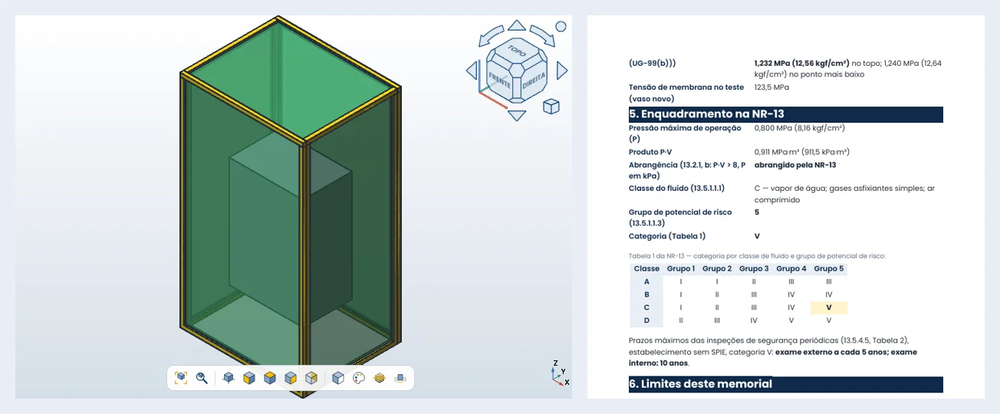

### Proteções de máquina (NR-12)

- **Proteção NR-12** (aba Estruturas › Segurança de máquinas): grade ou enclausuramento com quadro de tubo e tela
  (malha quadrada, fenda ou chapa perfurada), com ou sem teto. Escolha o ponto de perigo no modelo e o Usinix
  mede a distância e a altura sozinho.
- **Verificação ao vivo pela ABNT NBR ISO 13857:2021:** abertura da tela (Tabela 4, ou Tabela 5 onde há crianças),
  alcance por cima da proteção (Tabela 2, ou Tabela 1 para lesão leve) e folga inferior para pés e pernas
  (Tabela 7). A tela fica verde quando tudo confere e vermelha quando não, e o painel diz a maior malha que serve.
- **Relatório das proteções** e item na lista de materiais com massa estimada.

### Memorial NR-13 do vaso

- **Memorial NR-13** (aba Vasos): PDF A4 com identificação, dados de projeto, espessuras pelo ASME VIII-1, PMTA,
  teste de pressão, enquadramento na NR-13 (grupo de potencial de risco e categoria, com a Tabela 1 marcada),
  prazos máximos das inspeções periódicas e campo de assinatura com CREA e número da ART. Os dados ficam salvos
  no vaso.
- Enquadramento conferido no texto da NR-13 da Portaria MTP n.º 1.846/2022, retificada em 20/10/2022.

### Conectar IA

- Ferramentas novas: `distancias_seguranca`, `protecao_nr12` e `memorial_nr13`.

### Removido

- **Sombras na vista 3D:** davam erro de violação de acesso em algumas placas de vídeo no Windows. O botão saiu
  da barra de vistas.

## 1.10.0 — 10/11/2026

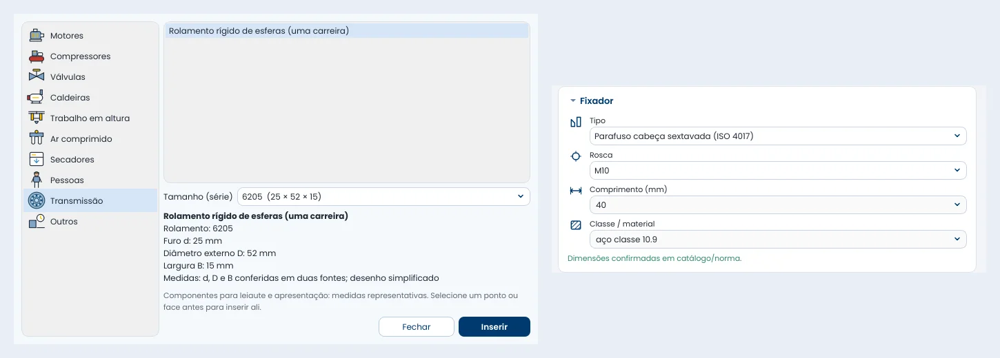

### Bibliotecas brasileiras

- **Classe do fixador em lista:** parafuso 4.6, 5.8, 8.8, 10.9 e 12.9; porca classe 5, 8, 10 e 12;
  arruela 200 HV e 300 HV; com zincado, galvanizado a fogo e inox A2/A4. Ao trocar o tipo, a classe vai para a
  equivalente (parafuso 10.9 → porca classe 10). Ainda dá para digitar outra.
- **Rolamentos:** nova categoria Transmissão em Componentes (botão Rolamentos na aba Componentes), com rolamentos
  rígidos de esferas das séries 60, 62 e 63 (furo de 10 a 60 mm). Medidas d, D e B conferidas em duas fontes;
  desenho simplificado, para leiaute e lista de materiais.
- **Perfis de aço:** barras redondas, quadradas e chatas conferidas na ABNT NBR 16683:2018 (versão corrigida de
  23/04/2020, em vigor); as quatro barras chatas que estavam "a conferir" agora têm a massa da norma. Perfis U
  enrijecido conferidos na ABNT NBR 6355:2012 (em vigor).
- **Folha ABNT:** a NBR 16752:2020 (em vigor) segue como padrão, com margens, quadro e legenda de 180 mm
  conferidos na norma. A NBR 10068 aparece como cancelada em 2020 e fica só para continuar desenhos antigos.

### Conectar IA

- **Instalar no Claude Desktop com um clique:** em Usinix › Conectar IA, o botão acha o arquivo de configuração
  do Claude Desktop (também na versão da Microsoft Store), guarda uma cópia, acrescenta só a entrada do Usinix e
  confere o arquivo antes de salvar. Arquivo com erro não é tocado. Se a conexão estiver desligada, oferece ligar
  agora e sempre ao abrir. Ninguém precisa editar arquivo à mão.

## 1.9.1 — 10/11/2026

### Novidades

- **Editar anotação com duplo clique:** o duplo clique numa anotação de texto da folha abre a janela com o
  texto, a altura da letra e a cor, como nos campos da legenda. Também pelo botão direito › Editar anotação.
- **Busca de peças na Paleta de vistas:** o mesmo campo de busca da Nova folha ABNT; marque a peça na lista,
  sem ir à árvore.

### Correções

- **Vistas em português na árvore:** as vistas do grupo aparecem como Frontal, Superior, Lateral direita,
  Isométrica superior direita (antes Front, FrontTopRight, Frente, Topo…), com os mesmos nomes da faixa.
- **Listas do painel Propriedades em português:** o tipo da vista e outras listas do desenho técnico.

## 1.9.0 — 10/11/2026

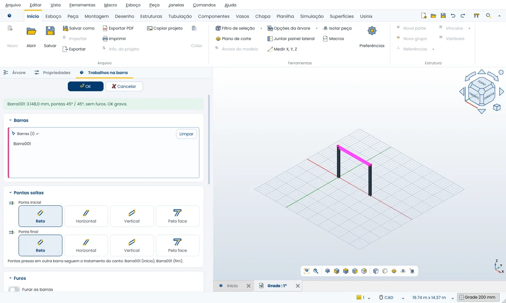

### Acabamento

### Novidades

- **Grade na área de trabalho:** botão Grade na barra inferior liga e desliga um quadriculado no chão (plano
  XY), com os eixos X e Y. O quadrado acompanha o tamanho do modelo (10 mm numa peça pequena, metros num galpão)
  e o botão mostra a medida. A grade não é selecionável e não vai para o arquivo.
- **Menu Comandos:** tudo o que está na faixa também fica no menu de cima, organizado pelas mesmas abas e
  grupos, em qualquer bancada.
- **Nomes iguais aos das abas:** o menu do esboço passa a se chamar Esboço (não Desenho) e o do desenho técnico,
  Desenho.
- **Barra que acompanha a face:** a barra cortada pela face de outra peça recalcula sozinha quando essa peça
  muda. Se a peça for apagada, vale o plano gravado no corte, com aviso no relatório.

### Correções

- **Cotas gerais na folha de uma montagem:** o botão dava erro ("'NoneType' object has no attribute 'Views'")
  quando a folha mostrava uma montagem ou um corpo. Agora cota normalmente.
- **Botões com o nome cortado:** nos painéis, opções como "Horizontal" e "Pela face" apareciam como
  "Hor…tal" e "Pe…ce". Agora o nome quebra em duas linhas ou a letra diminui um pouco, e os botões ficam
  da mesma altura.
- **Cotas soltas na árvore:** as cotas das folhas novas apareciam na raiz do documento; agora ficam dentro da
  vista que medem.

## 1.8.0 — 10/11/2026

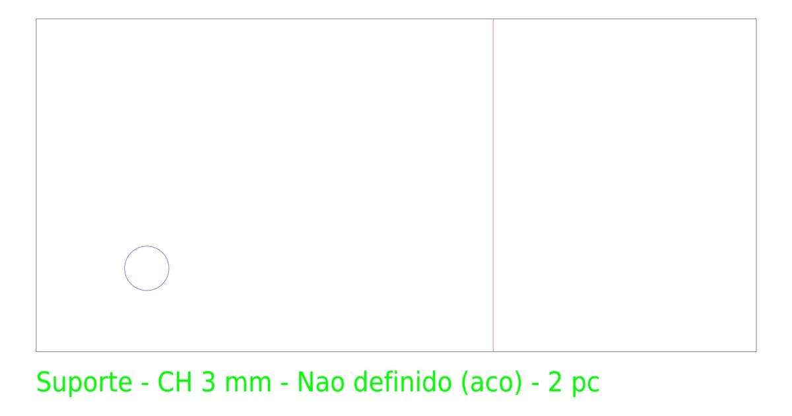

### Do modelo para a fábrica

### Novidades

- **DXF de todas as chapas (abas Chapa e Desenho):** planifica todas as chapas da montagem e grava um DXF por
  chapa diferente, com as camadas CONTORNO, FUROS, DOBRAS e TEXTO (peça, espessura, material e quantidade). O
  nome do arquivo já diz a espessura e a quantidade. Chapas iguais saem num arquivo só.
- **Exportar para Excel (abas Estruturas e Desenho):** planilha .xlsx com a lista de materiais, a lista de corte,
  a lista de soldas e um resumo para orçamento: massa por material, área externa para pintura e comprimento de
  solda modelado. Os números ficam como números, prontos para somar.
- **Peças iguais pela forma:** na lista de materiais, peças sem código com a mesma forma contam juntas, mesmo
  giradas ou em outro lugar. A peça espelhada continua separada.
- **Corte "pela face" acompanha a face:** a ponta da barra cortada pela face de outra peça segue quando essa peça
  muda.
- **Botão direito por tipo:** folha, barra, estrutura, parafusamento, chapa, vaso, tubulação e montagem mostram
  as ações que fazem sentido para eles.
- **Conectar IA:** ferramentas para exportar o Excel e os DXF das chapas.

## 1.7.0 — 10/11/2026

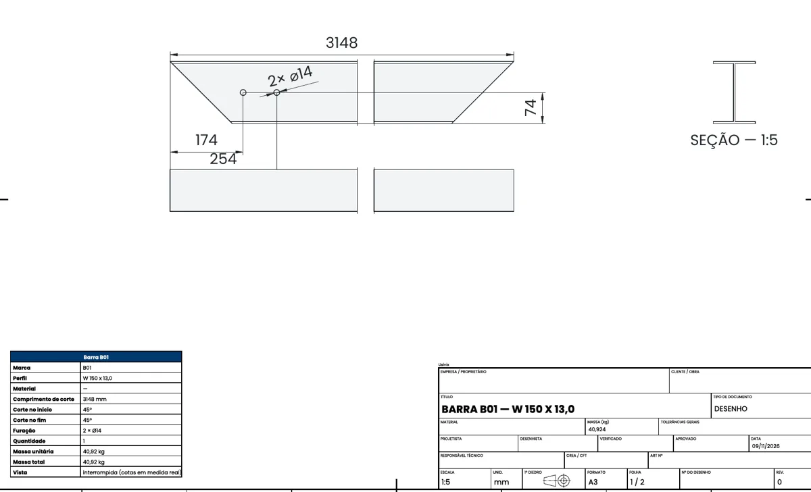

### Folha pronta

### Novidades

- **Cotas gerais com a furação:** além do comprimento, altura e profundidade, a folha ganha um ⌀ por grupo de
  furos iguais ("4× ⌀14") e a posição de cada linha e coluna de furos a partir do canto. Vale no botão Cotas
  gerais, na Paleta de vistas e nas Folhas em lote.
- **Balões da lista (aba Desenho):** um balão numerado em cada peça da montagem, na isométrica, com o mesmo
  número do item da lista de materiais. Quando a lista muda, os números acompanham.
- **Folhas das barras (abas Estruturas e Desenho):** uma folha por barra diferente da estrutura, com marca
  (B01, B02…), vista pela alma e por cima, seção ampliada, comprimento, furação cotada e tabela com perfil,
  ângulos das pontas, quantidade e massa. Barra comprida sai com vista interrompida e as cotas em medida real.
- **Folha da chapa (abas Chapa e Desenho):** a peça de chapa planificada com as cotas e a furação, as linhas
  de dobra, a isométrica ao lado e a tabela com espessura, desenvolvimento, dobras e fator K. A planificação
  acompanha a peça quando ela muda.
- **Conectar IA:** novas ferramentas para o assistente cotar a folha, pôr balões, fazer as folhas das barras e
  a folha da chapa.

### Correções

- **Cotas gerais em peça redonda:** a vista de topo de um eixo não ficava mais esperando o cálculo terminar.

## 1.6.0 — 09/11/2026

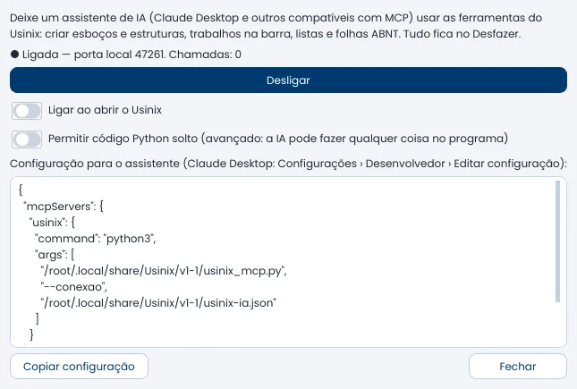

### Conecte uma IA ao Usinix

### Novidades

- **Usinix › Conectar IA:** o Claude Desktop e outros assistentes compatíveis com MCP passam a usar as
  ferramentas do Usinix. Peça em português e ele monta: esboço de linhas, estrutura com perfis do catálogo,
  trabalhos na barra (cortes de ponta, furos, parafusos), lista de corte, lista de materiais e folha ABNT; ele
  também vê a vista 3D para conferir e pode desfazer.
  - A janela mostra a configuração pronta para colar no assistente (botão Copiar). No Windows usa o Python
    que já vem no Usinix: não precisa instalar nada.
  - Segurança: vem desligada e só liga no botão (ou ao abrir, se marcar); aceita só o próprio computador,
    com código secreto; recusa pedidos de páginas da internet; código Python solto fica desligado, a não
    ser que você marque a opção. Cada ação da IA é um passo do Desfazer.
  - Passo a passo no site: https://usinix.com.br/ia.html

### Correções

- **Esboço em modo limpo:** clicar num canto agora mostra as restrições das duas linhas que chegam nele (o
  canto são dois pontos ligados por coincidência; antes contava só o ponto clicado).

### Observação

- A atualização baixa o **instalador completo** (traz parte nova do programa). No Linux, baixe o AppImage novo.

## 1.5.0 — 09/11/2026

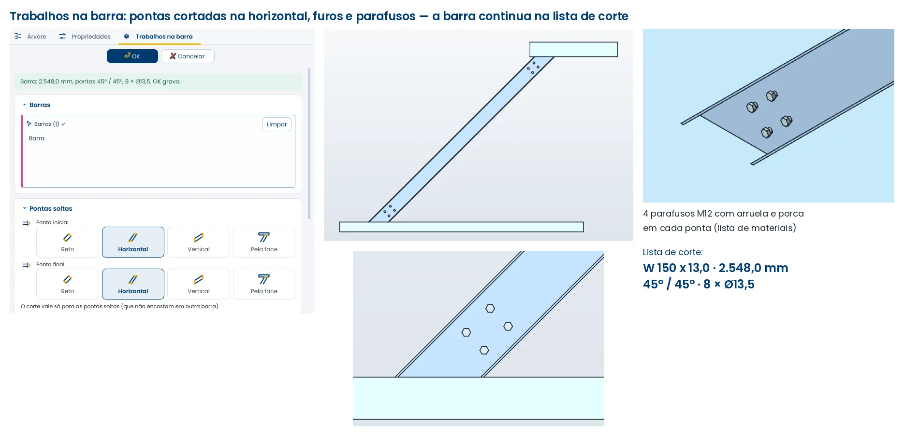

### Trabalhos na barra: cortes de ponta, furos e parafusos

### Novidades

- **Estruturas › Trabalhos na barra:** a barra da estrutura recebe os trabalhos da serralheria sem deixar de ser
  barra (continua na lista de corte, com os cantos e a análise).
  - **Corte das pontas soltas:** reto (como antes), horizontal, vertical ou pela face de outra peça (a barra é
    aparada ou prolongada até a face plana escolhida: piso, laje, chapa). Ex.: banzo de escada a 45° com
    apoio no piso e chegada na laje cortados na horizontal. Ponta presa em outra barra segue o canto.
  - **Furos na alma ou nas mesas:** distância da ponta (do início, do fim ou das duas), quantidade,
    espaçamento, uma ou duas filas, distância entre filas e deslocamento. Escolhendo o parafuso (M8 a M30),
    o diâmetro sai com a folga (1,5 mm, nas preferências).
  - **Parafuso, arruela e porca nos furos:** com o comprimento escolhido do catálogo para a barra, a peça
    presa junto (chapa, cantoneira), a arruela e a porca. Entram na lista de materiais.
  - Prévia no desenho enquanto mexe no painel; reabrir numa barra já trabalhada traz o que está gravado.
- **Lista de corte com a furação** de cada barra (ex.: "8 × Ø13,5").
- **Estruturas › Tabela de furos:** cada furo com onde fica, distância da ponta, posição transversal, Ø e
  parafuso. Com uma folha de desenho aberta, a tabela vai para a folha.

- **Nova folha ABNT: escolha a peça no próprio painel.** Lista com tudo que pode ir para o desenho (peças,
  corpos, montagens, estruturas) e uma busca; não precisa mais ir à árvore selecionar e voltar.
- **Duplo clique na folha (na árvore) abre os campos do carimbo** para editar título, número, desenhista,
  revisão etc. Também no botão direito da folha: "Editar legenda".
- **Desenho mais leve:** linhas no grupo 0,35 mm (antes 0,70 mm, pesado no A4/A3) e textos das cotas, dos
  rótulos e do carimbo na fonte Poppins, a mesma do Usinix.
- **Sem bolinhas nos cantos das vistas:** os pontos dos vértices só aparecem com o mouse sobre a vista (para
  pegar pontos de cota). Quem preferir o jeito antigo: preferência VerticesAlwaysVisible do Desenho técnico.

### Correções

- **Esboço em modo limpo:** clicar num canto mostrava só as coincidências; agora mostra também a horizontal,
  a vertical e as demais restrições das linhas que chegam nele.
- **Preferências das bancadas em português:** Desenho técnico, Simulação, Chapa e Gerenciador de complementos
  ainda tinham muitas opções em inglês.

### Observação

- Esta versão traz partes novas do programa (desenho, folha, esboço), então a atualização baixa o
  **instalador completo**. No Linux, baixe o AppImage novo na página de versões.
- Folhas já feitas mantêm as linhas e a fonte de antes; as vistas novas saem no estilo novo.

## 1.4.2 — 09/11/2026

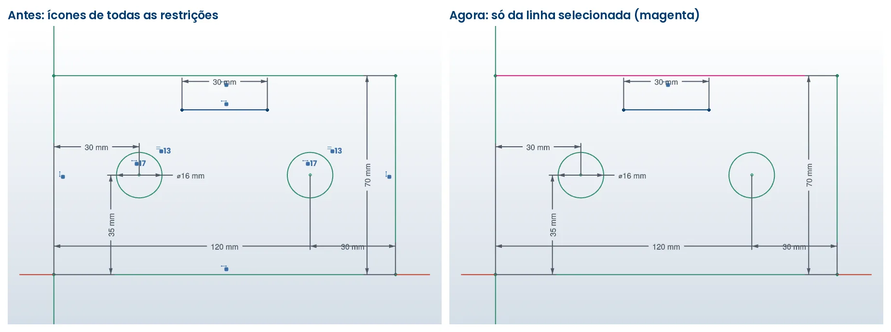

### Esboço mais limpo e atualização que reabre sozinha

### Novidades

- **Esboço em modo limpo:** os ícones das restrições (horizontal, igual, coincidente...) só aparecem para a linha
  ou o ponto selecionado; as cotas continuam sempre à vista. Sem nada selecionado, o desenho fica só com as
  cotas. Para ver todos como antes: Preferências do Usinix, cartão Esboço, desligue "modo limpo".
- **Seleção em magenta:** linhas e pontos selecionados ficam em magenta, bem diferente das cores do desenho.
- **Mais Usinix, menos Prumo:** o tema se chama "Usinix Claro" e as pastas da atualização, "Usinix-atualizacao"
  e "Usinix-complemento".

### Correções

- **Atualizar e reabrir:** o botão dizia que ia abrir a versão nova, mas no Windows o Usinix não abria de novo
  e era preciso abrir à mão. Agora ele reabre sozinho; se o programa antigo demorar a fechar, abre depois de
  90 s assim mesmo. O resultado fica anotado em `atualizacao.log`.
- **Número da versão na tela de abertura:** na primeira abertura depois de atualizar, a imagem ainda mostrava o
  número antigo. Agora a imagem nova é copiada na hora da instalação.
- **Esboço novo no centro, sem tranco:** a vista parava e pulava para a origem do esboço. Agora desliza logo
  depois de girar.
- **Linux (Mint 22, Kubuntu 24.04 e outros atualizados):** o Usinix podia fechar ao abrir, com falha na
  biblioteca de fontes que vinha junto. Agora usa a do sistema.
- **Primeira abertura sem o tema:** desde a 1.4.0, numa instalação nova, aparecia "falha ao carregar o
  branding" e a preparação inicial não terminava.
- **Esboço 3D:** arrastar a ponta de uma linha às vezes não começava (o clique caía na linha em vez do ponto).

### Observação

- Esta versão traz partes novas do programa (o modo limpo do esboço e a correção do Linux), então a
  atualização baixa o **instalador completo**, não só o complemento. No Linux, baixe o AppImage novo na
  página de versões.

## 1.4.1 — 08/11/2026

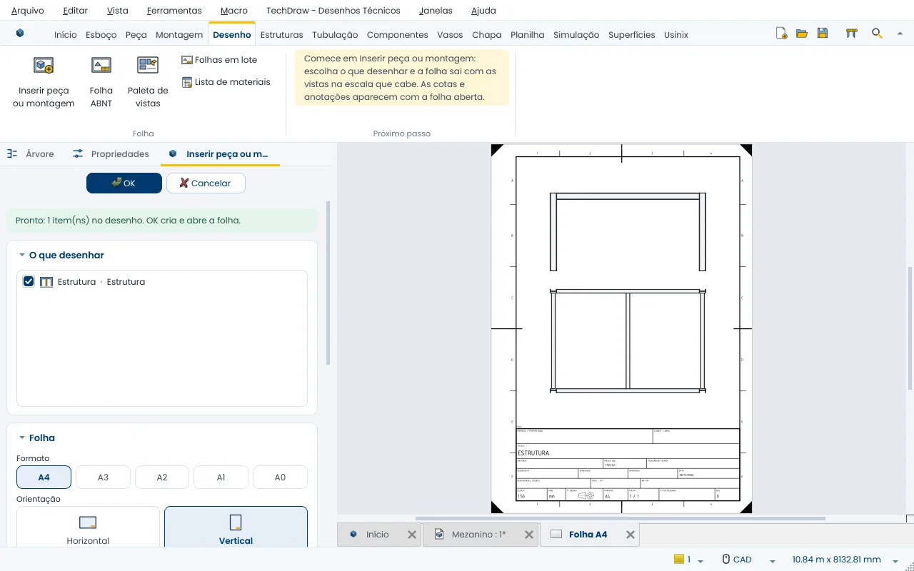

### Novidades

- **Desenho › Inserir peça ou montagem (primeiro botão da aba):** escolha numa lista o que vai para o desenho
  (peça, montagem, conjunto ou estrutura), sem precisar selecionar antes. No mesmo painel: folha nova ou a folha
  que está aberta, formato A4 a A0, orientação, quais vistas (em cartões com o desenho do arranjo) e a escala, que
  sai sozinha na maior que cabe.
- **Folha horizontal ou vertical em dois botões**, no painel novo e na Folha ABNT, e agora em todos os formatos
  (antes, folha em pé só no A4).
- **Ajuda › Enviar sugestão:** abre o formulário do site com a versão e o sistema já preenchidos (também na aba
  Usinix).

### Correções

- **Estrutura metálica maior que a folha:** as vistas superior e lateral eram calculadas antes de a folha receber a
  escala e ficavam em tamanho natural. Agora a escala vem primeiro e todas as vistas cabem.
- **Dutos de ar-condicionado no esboço 3D:** nas mudanças de direção fora do plano (subir e virar), trechos e
  curvas saíam uns deitados e outros em pé. A seção agora segue contínua por todo o traçado.

## 1.4.0 — 05/11/2026

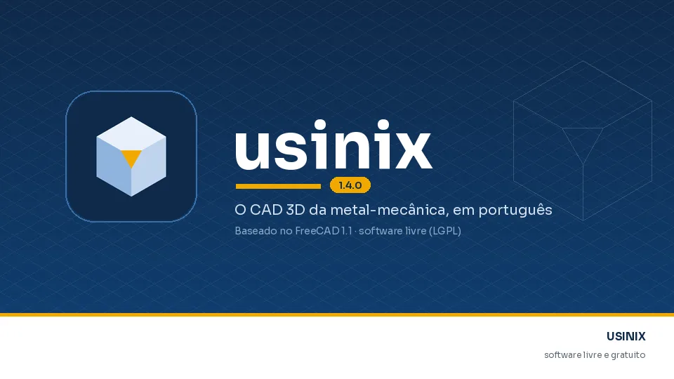

### O Prumo 3D agora se chama Usinix

- **Nome e marca novos:** Usinix, com logotipo novo (cubo isométrico com o canto chanfrado), ícone,
  tela de abertura e Sobre renovados. O programa passa a ser `Usinix.exe` (Linux: `usinix`).
- **Suas configurações vêm junto:** na primeira abertura, preferências, macros, materiais e bibliotecas
  do Prumo 3D são copiados para a pasta do Usinix. A pasta antiga não é apagada.
- **Desinstalar o Prumo 3D:** o instalador do Usinix encontra a instalação antiga e pergunta se quer
  removê-la (as configurações já foram copiadas antes).
- **Arquivos antigos abrem normalmente:** peças, estruturas, pisos e folhas feitos no Prumo 3D continuam
  abrindo e recalculando no Usinix.
- **Endereço novo:** o projeto está em github.com/usinix/usinix (o endereço antigo redireciona).

### Atenção

- Quem vem do Prumo 3D precisa do **instalador completo** desta versão; a atualização só do complemento
  vale a partir da 1.4.0.
- Na versão portátil (.7z) as configurações não são copiadas sozinhas no Windows: copie
  `%APPDATA%\Prumo3D` para `%APPDATA%\Usinix`, se quiser mantê-las.

## 1.3.1 — 04/11/2026

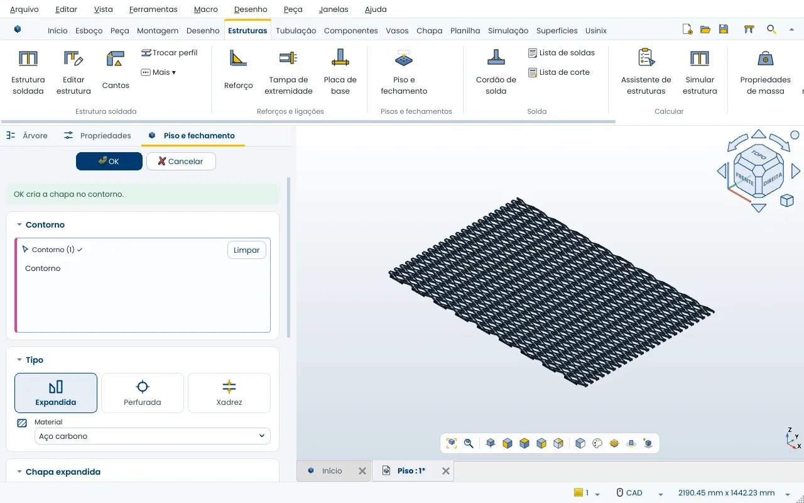

### Novidades

- **Piso e fechamento** (aba Estruturas, grupo Pisos e fechamentos): preenche um esboço fechado ou uma
  face plana com **chapa expandida**, **chapa perfurada (tela moeda)** ou **chapa xadrez**, em aço
  carbono, galvanizado, inox 304/316 ou alumínio.
  - Tela moeda: furo, passo e arranjo (60° ou reto); área aberta e peso calculados pela geometria; furos
    reais no modelo (até 1.000; acima disso, a textura do padrão).
  - Chapa expandida (malhas EXP e GME) e chapa xadrez pelo catálogo, com a fonte de cada valor;
    **medidas e pesos a checar** no catálogo do fabricante.
  - Padrão corta onde cair, com opção de centralizar; área e peso na lista de materiais.

## 1.3.0 — 04/11/2026

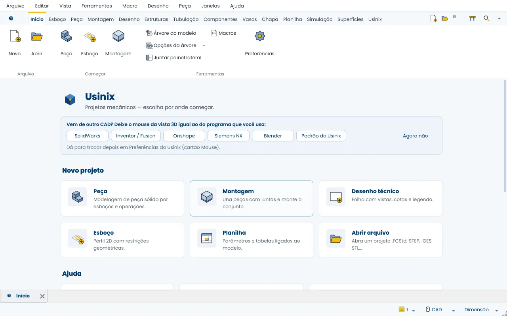

### O CAD 3D da metal-mecânica

O Usinix escolhe um lado: é para quem projeta, fabrica e inspeciona peças, máquinas, caldeiraria e
estruturas de aço.

- **Saíram do pacote** as bancadas que não são do ofício: arquitetura e BIM, usinagem CNC (CAM),
  robótica, OpenSCAD, nuvem de pontos, engenharia reversa, inspeção por malha e os importadores IDF e JT.
  Quem tem o Usinix instalado deixa de ter essas bancadas ao instalar esta versão.
- **Ficam por baixo**, sem aba: Draft (texto no esboço, Importar DXF, matriz em caminho) e Malhas (STL).
- **Simulação continua** com aba própria, junto com o Teste de pressão dos Vasos e o Assistente de
  estruturas.
- **Descrição nova** no Sobre, no relatório de simulação e no atalho do Linux.

## 1.2.9 — 04/11/2026

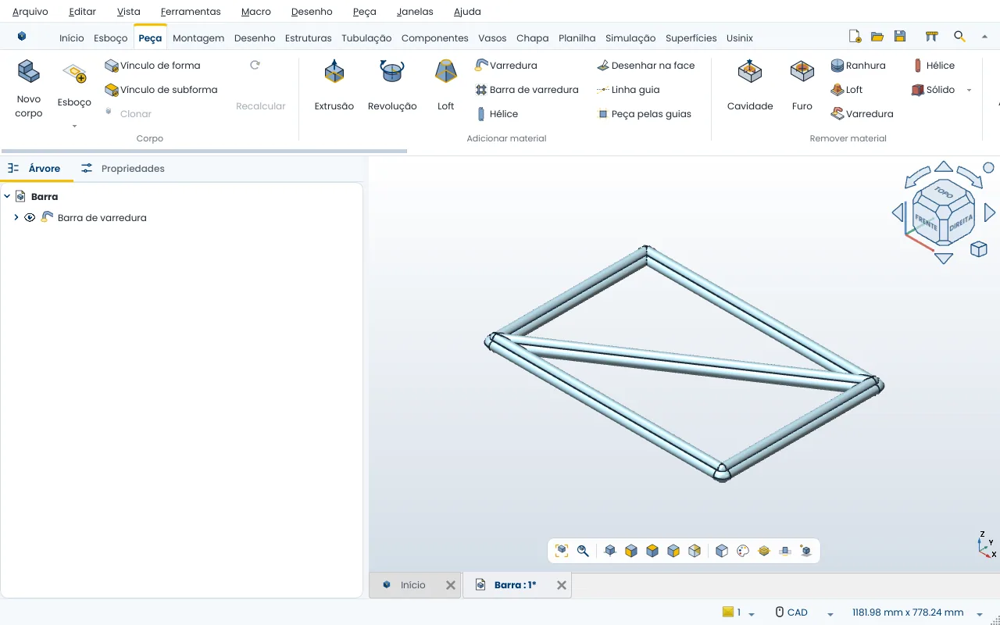

### Novidades

- **Barra de varredura com perfis novos:** sextavado (medida entre faces), oval (largura × altura) e
  quadrifólio (quatro lóbulos), maciços ou tubo, além do redondo e do quadrado.
- **Faixa superior com altura fixa:** a altura não se arrasta mais; o ajuste fica nos divisores entre os
  grupos (mais largo mostra os nomes, mais estreito só os ícones).

### Correções

- Barra de varredura: encontros sempre fechados, mesmo com pontas que quase se tocam ou com uma ponta
  encostada no meio de outra linha.

## 1.2.8 — 04/11/2026

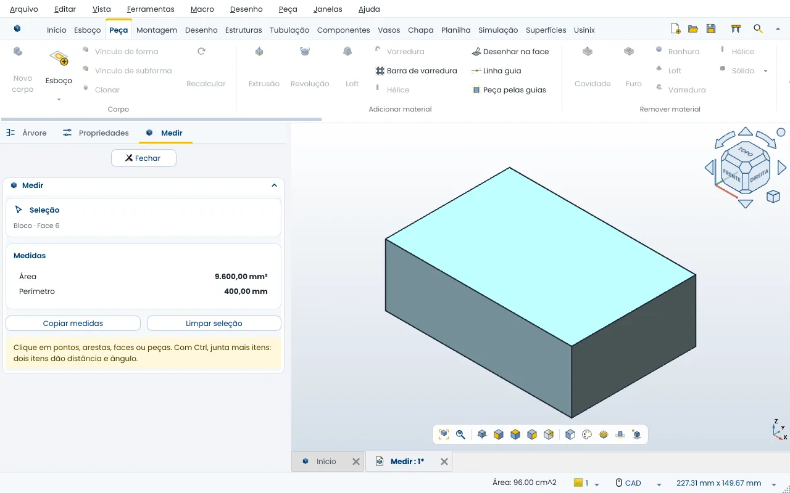

### Novidades

- **Medir em português:** painel novo que mede o que estiver selecionado, sem escolher modo — posição,
  comprimento, raio e diâmetro, área, volume, centro de massa, distância mínima com ΔX/ΔY/ΔZ, distância
  entre centros, ângulo e soma de comprimentos/áreas. A distância aparece numa linha amarela na vista.
- **Arredondar qualquer face:** face com cantos para fora e para dentro (como a do lado de um corte) não dá
  mais "BRep_API: command not done" — o Usinix faz em duas etapas, com o mesmo raio.
- **Aba Início:** Colar grande em Arquivo; Começar logo depois; o grupo Editar saiu.
- **Aba Peça:** a seção Modelagem direta saiu (Extrudar face saiu — a Extrusão faz o mesmo); Desenhar na
  face, Linha guia e Peça pelas guias foram para Adicionar material.
- **Painel lateral:** só Árvore e Propriedades; a Aparência fica no botão da barra de vistas.
- Ilustrações de "Como funciona" menores.

## 1.2.7 — 04/11/2026

### Novidades

- **Começar pela aba Início:** sem documento aberto, botões grandes **Peça**, **Esboço** e **Montagem**.
- **Aba Peça reorganizada:** Vínculo de forma, Vínculo de subforma e Clonar à vista (saíram do Mais);
  Recalcular grande com ícone do Usinix; Loft grande, com Varredura, Barra de varredura e Hélice em coluna;
  Modelagem direta logo depois de Adicionar material; Matriz de furação na setinha da Multitransformação.
- **Dutos de ar-condicionado dentro de Tubos e conexões:** linhas **Duto retangular** e **Duto redondo** de
  chapa galvanizada, ao lado das de água e aço, com as mesmas ferramentas (traçado, Esboço 3D, curvas,
  reduções e derivações). Medidas representativas, marcadas "a checar".
- **Mais fixadores** na aba Componentes: allen cabeça escareada (ISO 10642) e abaulada (ISO 7380-1), sem
  cabeça ponta copo (ISO 4029), porca baixa (ISO 4035), autotravante com náilon (DIN 985), flangeada
  (EN 1661 / DIN 6923) e cega (DIN 1587), arruela larga (ISO 7093-1), Phillips cabeça panela (ISO 7045) e
  autocravantes para chapa (porca e pino, tipo PEM). **Medidas nominais a checar contra a norma**; forma
  simplificada, sem rosca.
- **Aparência** abre em janela pelo botão da barra de vistas de baixo.

### Correções

- Esboço novo abre centrado na tela.
- Esboço 3D: a caixinha de comprimento aparece junto do cursor (antes ia longe com a escala do Windows).
- Aviso "Networkx dependency is missing" a cada abertura: o complemento traz a biblioteca.
- Adicionar / Remover material no painel podia clicar no OK errado (abria documento novo) e não reabria o
  painel na operação nova.
- Ícone da Matriz de furação faltando.
- Testes automáticos gravam o andamento em `PrumoTestes-andamento.log` (mostra onde parou se fechar).

## 1.2.6 — 03/11/2026

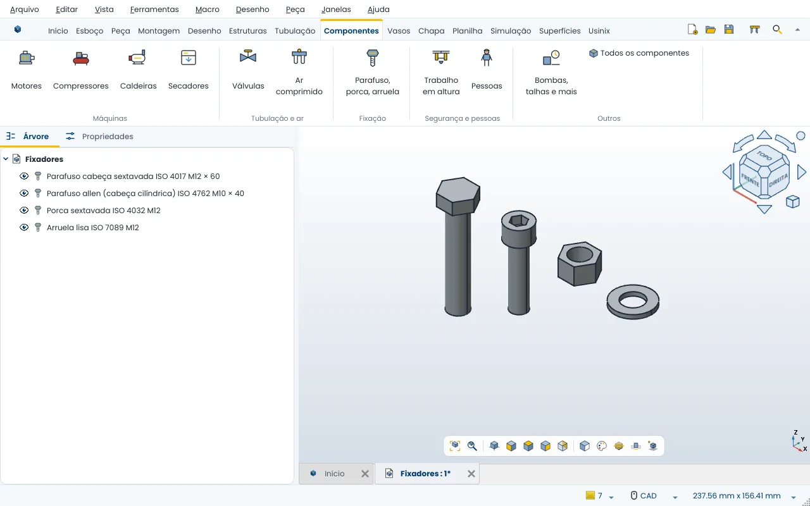

### Novidades

- **Aba Componentes:** modelos prontos que completam o projeto, para leiaute, interferência e apresentação.
  Escolha o modelo e o tamanho; trocar o tamanho depois redesenha. Categorias: motores elétricos (carcaças IEC
  63 a 315), compressores (pistão com reservatório e parafuso), válvulas flangeadas (esfera, gaveta, globo,
  retenção e borboleta, DN 15 a 300), caldeira flamotubular, secadores (refrigeração e adsorção), ar
  comprimido (filtro-regulador-lubrificador, purgador, reservatório), trabalho em altura (trole para viga I),
  pessoas (em pé com capacete e sentado) e outros (motobomba, ventilador, talha, quadro elétrico, extintor,
  palete). **As medidas são representativas;** onde vêm de tabela (carcaça IEC, flange PN 16, palete PBR) estão
  marcadas "a checar". Para projeto executivo, confira no catálogo do fabricante.
- **Parafuso, porca e arruela** passaram da aba Estruturas para a aba Componentes.
- **Dutos de ar-condicionado (HVAC)** na aba Tubulação: duto retangular, redondo e oval, retos e curvas,
  transições (redondo–oval, retangular–redondo, retangular–oval) e flexível, com flanges e isolamento. Peças
  paramétricas de **Francisco Rosa** (FreeCAD Parts Library, CC-BY 3.0), com painel em português; "Editar duto"
  muda bocas, comprimento ou ângulo, chapa, flanges e isolamento.
- **Modelagem direta** (ideias da bancada Direct, de Sergio Uhry, reescritas para o Usinix):
  - **Extrudar face** (aba Peça): a face plana vira o perfil de uma Extrusão; o contorno é copiado, sem ligar
    na face, para não quebrar quando a peça mudar.
  - **Desenhar na face:** peça nova com o esboço no plano da face, sem ligação com a outra peça.
  - **Linha guia** e **Peça pelas guias:** retas de referência a partir de uma aresta, deslocadas pela medida
    digitada; os cruzamentos viram pontos de encaixe; quatro guias viram a base de uma peça.
  - **Posicionar peça** (aba Montagem): face com face (encostadas) ou ponto com ponto.
  - **Isolar / restaurar peça** (também na barra de vistas) e **Medir X, Y, Z** (abas Início e Montagem).
  - **Matriz leve:** repetição por vínculos (o arquivo fica leve), por intervalo, vão livre ou dimensão total.
  - **Matriz de furação** (aba Peça, Padrões): o furo em colunas e linhas, sem duplicar o esboço.
- **Explosão animada** (aba Montagem, Apresentar; ideia da bancada Exploded Assembly, código novo): passos de
  explosão com as peças selecionadas, parafusos e porcas do Usinix girando enquanto saem da rosca, barra de 0 a
  100 %, Tocar, trajetórias, e Montada volta tudo exatamente ao lugar.

### Correções

- **Sombras saem durante a edição** (esboço, operação ou painel aberto) e voltam ao fechar: ao criar um esboço
  com as sombras ligadas apareciam planos e textos duplicados, sombra dos planos e um piso enorme. O piso agora
  só considera os sólidos (planos, eixos e esboços não contam).
- **Menu da setinha sem nomes repetidos:** Arredondar, Chanfro, Casca e Espelhar mostravam duas opções com o
  mesmo nome; agora "… na peça (corpo)" e "… sólido solto".
- **Caixa da tecla S e busca com ícone em todas as linhas** (as ferramentas com setinha saíam sem ícone).
- **Painel lateral:** Propriedades (ou outra aba) arrastada para outro lado ficava sem título e não dava para
  voltar. Agora o painel solto mostra o título para arrastar, e "Juntar painel lateral" (aba Início,
  Ferramentas) põe tudo de volta.
- **Tamanhos na aba Peça:** Recalcular, Verificar geometria, Validar esboço, Propriedades de massa e Lista de
  materiais em botão grande; Variantes da peça e Modelo com regras em botão pequeno.
- **Ícones no padrão do Usinix:** Barra de varredura (agora diferente da Varredura), Texto, Importar DXF e
  Matriz em caminho.
- **A faixa não muda de altura** ao trocar de aba em telas estreitas (perdia 2 px no modo mais compacto).

## 1.2.5 — 02/11/2026

### Novidades

- **Bancada instalada já ganha aba.** Um complemento instalado (ex.: Solar, Movie) aparece como aba na faixa logo
  ao abrir o Usinix, sem ir em Preferências nem escolher a bancada no menu; clicar na aba abre a bancada com as
  ferramentas dela.
- **Barra de varredura** (aba Peça, Adicionar material), como a do ZW3D: escolha o esboço (comum ou Esboço 3D) e
  cada linha vira uma barra, redonda ou quadrada, maciça ou tubo; as que se cruzam ou se encontram ficam unidas
  num sólido só (grade, xadrez, chapa expandida, gradil). Raio nos cantos opcional. No esboço comum, a barra
  quadrada fica com as faces paralelas ao plano. Duplo clique na árvore edita.
- **Botão "Novo plano" grande na aba Peça**, no grupo Ferramentas. Antes o plano ficava escondido dentro do
  botão pequeno Referências, que agora se chama "Eixo, ponto, sistema". As ferramentas do grupo (Booleana,
  Verificar geometria, Validar esboço) ficam à vista, sem o botão "Mais".
- **Novo esboço mostra os planos com os eixos X, Y e Z.** Na aba Esboço, a janela "Escolher orientação" troca o
  cubo por um desenho dos três planos com os eixos, com o plano escolhido em amarelo. Na aba Peça, o painel de
  escolha do plano mostra na vista 3D os planos e também os eixos X, Y e Z; com o corpo vazio, a vista vai para
  a isométrica, onde dá para clicar nos três planos.
- **Aba Peça sem ferramentas repetidas.** Arredondar, Chanfro, Casca e Espelhar apareciam duas vezes (em
  Acabamento/Padrões e de novo em Sólidos, "Acabamento de sólido"). Agora há um botão só para cada: o clique
  faz a operação no corpo, e a setinha do botão traz a versão para sólido solto. O botão "Booleana" de
  Sólidos também saiu, porque Unir, Subtrair e Interseção já estão ao lado.
- **Medir só no topo**, ao lado de Salvar (vale em todas as abas e não some mais com a janela estreita). Saiu
  das abas Início, Peça, Desenho, Estruturas, Vasos e Superfícies, onde estava repetido.
- **Folha ABNT só na aba Desenho** (saiu do grupo Usinix da aba Peça, onde estava repetida).
- **Sem botão "Mais" de uma opção só.** Quando o "Mais" de um grupo teria uma ferramenta só, ela aparece direto
  no grupo. Na aba Peça, Padrões mostra Multitransformação ao lado de Padrão linear e circular.
- **Recalcular na aba Peça**, no grupo Corpo, logo abaixo de Vínculo de forma (saiu da aba Início).
- **Ícones da aba Chapa no padrão do Usinix** (cores, contorno e destaque em âmbar como as demais abas).
- **Barra de vistas na vista 3D**, pequena, embaixo e no meio (como a barra flutuante dos outros CAD):
  enquadrar tudo e a seleção, isométrica, frontal, superior, direita (as outras vistas no menu ao lado),
  estilo de exibição, plano de corte e sombras. Aparece em toda vista 3D aberta. Com várias vistas abertas, o
  clique vale para a vista onde está a barra.
- **Planos com o nome de sempre no novo esboço:** "Plano XY: superior (planta)", "Plano XZ: frontal",
  "Plano YZ: lateral (direita)", na janela de orientação e na lista do painel da aba Peça. No SolidWorks e no
  Fusion a "frente" é o XY; aqui Z aponta para cima e a frente é o XZ.
- **Mouse como no programa que você já usa.** Na tela inicial (até a primeira escolha) e em Preferências do
  Usinix, cartão "Mouse da vista 3D": SolidWorks, Inventor / Fusion, Onshape, Siemens NX ou Blender. Girar,
  arrastar e aproximar a vista passam a ser como no programa escolhido, e a rodinha aproxima onde está o cursor.
- **Tecla S abre a caixa de ferramentas no cursor** (como no SolidWorks, Fusion e Onshape): com o mouse na vista
  3D, S mostra ali as ferramentas principais da aba e uma linha de busca para todas. Dentro do esboço o S
  continua sendo a relação Simétrica. Desliga em Preferências.
- **Busca (Ctrl+K) com os nomes de outros CAD:** entende os nomes do SolidWorks, ZW3D, Inventor e Fusion do guia
  "Vindo do SolidWorks" ("corte extrudado" acha Cavidade, "shell" acha Casca, "combine" acha Unir, "timeline"
  acha a Árvore do modelo).
- **Adicionar / Remover material no próprio painel** (Extrusão ↔ Cavidade, Revolução ↔ Ranhura, Loft, Varredura e
  Hélice). Errou a escolha? A chave no topo do painel troca a operação no lugar, sem apagar e refazer: mesmo
  esboço, medidas e fórmulas, mesma posição na árvore, e o que vinha depois (padrões, fórmulas que citavam a
  operação) passa a apontar para a nova. Os dois botões continuam na faixa.
- **A ferramenta segue a seleção:** selecionou uma aresta ou face de outro corpo e clicou em Arredondar, Chanfro,
  Padrão etc.? O Usinix ativa esse corpo (com aviso na barra de status) em vez de recusar com "a seleção não está
  no corpo ativo". Desliga com a preferência AtivarCorpoDaSelecao.
- **Escolha do perfil como num catálogo** (Estrutura metálica e Trocar perfil): a lista mostra a miniatura
  de cada seção com as medidas e a massa; ao lado, a prévia do perfil escolhido com as cotas do catálogo
  (altura, largura, espessuras, raio), massa e área. Busca por nome (ex.: "200 x 15").
- **Detalhes técnicos do perfil** (botão "Ver detalhes técnicos…"): desenho grande com todas as cotas,
  chamadas das espessuras, CG e grade, e as propriedades da seção (Ix, Iy, Wx, Wy, Zx, Zy, rx, ry, J)
  calculadas pelo Usinix.
- **Perfil customizado:** na família "Customizado", escolha o tipo (I, U, cantoneira, tubo quadrado,
  retangular ou redondo, barra chata, quadrada ou redonda) e digite as medidas. A massa sai pela geometria
  (aço, 7.850 kg/m³) e as medidas ficam guardadas no nome do perfil (ex.: "Customizado I 200 x 100 x 6,3 x 8"),
  então o arquivo abre igual em qualquer computador.
- **Grupo Vista saiu da aba Início:** as vistas ficam só na barra embaixo da vista 3D (a busca, Ctrl+K, continua achando).
- **Nenhum clique fica sem resposta.** Se a ferramenta não pode rodar agora (sem projeto aberto, sem a
  seleção que ela pede, com um esboço ou painel aberto, fora de um esboço) o botão continua com cara de
  desligado, mas o clique mostra um aviso embaixo da janela dizendo o porquê e o que fazer. Se a ferramenta
  roda e dá erro, o aviso mostra o erro (em português quando o Usinix conhece a mensagem). Vale para a faixa,
  a barra de vistas e a busca de comandos.
- **Abas reposicionáveis:** segure uma aba da faixa e arraste para mudar a ordem; a ordem fica gravada.
- **Sombras na vista 3D** (botão Sombras na barra de vistas, marca e desmarca; vem desmarcado). Marcado,
  as peças fazem sombra num piso discreto logo abaixo do modelo; a luz vem de cima, fixa em
  relação ao modelo, então a sombra não anda ao girar a vista. O piso acompanha o modelo ao recalcular e as
  vistas abertas depois também ficam com sombra. Seleção e clique nas peças continuam iguais. Em placa de vídeo
  fraca ou montagem muito grande pode deixar a vista mais lenta: aí é só desmarcar.

### Correções

- **Cota do desenho com erro que diz o porquê.** Antes: "Invalid selection - Det = 0". Agora: "Cota de ângulo
  na vista Vista (Edge2, Edge4): as arestas Edge2 e Edge4 são paralelas, não há ângulo entre elas", e avisa
  quando as referências mudaram depois que a vista foi atualizada. Uma cota de distância em referências que não
  servem agora dá erro em vez de ficar com uma medida sem sentido.
- **Busca de comandos não achava Arredondar, Chanfro, Casca e Espelhar da aba Peça** (botões com setinha).

- **Montagem: junta que não abria** com "Cannot access attribute 'clearUndo' of deleted object" depois de
  fechar uma montagem com o painel de junta aberto.
- **Textos do Usinix trocados de volta pelo inglês/português do FreeCAD** (ex.: "Sempre" em vez de
  "Sempre fixar") depois de abrir certas bancadas; o tradutor do Usinix volta para cima sozinho.

- **Tela de abertura com a versão antiga depois de atualizar só o complemento** (ex.: mostrava 1.2.0). O
  complemento agora leva a tela de abertura com a versão dele, e o Usinix a usa no lugar da que veio na
  instalação.
- **Aviso "Networkx dependency is missing" ao abrir (aba Chapa).** O planificador novo da Chapa precisa da
  biblioteca networkx, que não vinha no pacote; agora vem (e o empacotamento confere).

- **Ferramentas presas às bancadas antigas.** Chapa, Planilha (Nova planilha, tabela de fator K), Desenho,
  Montagem e Superfícies só passavam a existir depois de entrar na aba delas; antes disso a busca de comandos,
  o menu de contexto e os botões chamados de outro lugar não achavam a ferramenta. Agora o Usinix registra tudo
  logo ao abrir (sem trocar de aba), e cada ferramenta funciona de qualquer aba.

- **Aviso "Failed to disconnect (None) from signal linkActivated" no console** ao trocar o aviso do guia
  ilustrado. Era só barulho (nada parava de funcionar), mas não aparece mais.

- **Torneiras e trechos da tubulação não respondiam ao clique.** O painel da Tubulação parava de escutar a vista
  logo ao abrir: clicar nos trechos não escolhia nada e "Na ponta solta"/"No ponto clicado" não faziam nada.
  Agora escuta, e clicar no próprio tubo também escolhe o trecho (o traçado fica dentro dele). Apertar o botão da
  torneira antes de escolher pede o trecho e põe a torneira no clique seguinte.
- **Menus acentuados de bancadas externas apareciam quebrados** (ex.: Movie mostrava "Câmeras e Objetos" e
  "Animação"). O nome do menu era lido com a codificação errada quando a interface era retraduzida. Agora sai
  "Câmeras e Objetos", "Animação".

## 1.2.4 — 02/11/2026

### Correções

- **OpenCV (cv2) no computador de quem instala.** Na 1.2.3 o cv2 importava na máquina que monta o pacote, mas não
  no computador do usuário ("recursion is detected during loading of cv2 binary extensions"): os arquivos de
  configuração do cv2 guardavam o caminho da pasta de montagem. Agora os caminhos são relativos à pasta do próprio
  cv2, e o empacotamento recusa o pacote se sobrar caminho absoluto.

## 1.2.3 — 02/11/2026

### Novidades

- **Junta inteligente na montagem** (como no SolidWorks). Escolha duas faces, arestas ou pontos, um em cada peça,
  e clique em Junta inteligente (ou clique nela antes e depois nos dois elementos): o Usinix entende a forma e põe
  a junta certa, com a peça já no lugar — eixo e furo viram concêntrica; duas bordas redondas, concêntrica
  encostada (cabeça do parafuso no furo); duas faces planas, coincidente; cilindro ou esfera numa face plana,
  tangente; duas esferas, rótula. O painel mostra a junta escolhida e o porquê; dá para trocar antes do OK.
- **OpenCV (cv2) no pacote.** As bancadas que gravam e leem vídeo com o cv2 (ex.: Movie) voltam a funcionar; o
  pacote confere que o cv2 importa antes de sair.

## 1.2.2 — 30/10/2026

### Novidades

- **Esboço 3D: caixinha de comprimento junto do cursor**, como no esboço comum: mostra o comprimento ao vivo;
  é só digitar o número (com o cursor na vista) e teclar Enter: a linha fica com essa medida e a próxima sai do
  ponto novo.
- **Esboço 3D: ímãs.** Perto de um ponto do esboço o cursor gruda nele (e a ponta fica presa ao ponto); perto
  de uma linha, o ponto cai em cima dela; no eixo, a linha para alinhada com um ponto que já existe. Acaba a
  linha que passa raspando ou por cima da outra.
- **Tubulação ajusta o traçado às conexões.** Canto ou ramal desenhado fora dos ângulos que têm conexão na
  linha (até 20° de diferença) gira sozinho para o ângulo da conexão, sem mudar os comprimentos: no PVC e na
  rosca, joelho de 90° ou 45° e tê a 90°. Acontece ao criar a tubulação, ao dar OK no Esboço 3D que ela usa e
  ao trocar a linha; também há o botão **Ajustar traçado às conexões** no painel.
- **Aço: curva cortada.** Na linha de solda de topo, um canto de qualquer ângulo até 90° sai com a curva de 90°
  raio longo cortada no ângulo (na lista: "Curva 90° raio longo … cortada a 73,3°"), com as duas soldas.

### Correções

- **Aviso em inglês ao montar.** O "Ground Part?" que aparece ao inserir a primeira peça na montagem agora sai
  em português ("Fixar a peça?", com Sim, Sempre fixar, Nunca fixar e Não), assim como os avisos de salvar o
  documento antes de inserir peças de outro arquivo, "Alinhar peças" e "Escolha uma peça" da vista explodida.
- **Vistas no meio da folha.** Na Folha ABNT, na Paleta de vistas e nas folhas em lote, as vistas ficam no meio
  da faixa entre a legenda e o alto do quadro, com folga para as cotas, em vez de coladas no alto.
- **Publicação do Linux.** O AppImage passa a ser montado com uma versão fixa e conferida da ferramenta (a
  versão "contínua" mudou sem aviso em 29/10/2026 e travou a publicação da 1.2.1).

## 1.2.1 — 29/10/2026

### Novidades

- **Válvulas na linha de aço.** Na tabela da tubulação de solda de topo, a coluna **Válvulas a (mm)** aceita a
  distância e o tipo (ex.: `300 gaveta; 1200 retenção`): gaveta, globo, esfera (passagem reduzida) e retenção
  portinhola, flangeadas, classe 150 ou 300, com face a face da ASME B16.10-2022 (conferida em duas fontes).
  Cada válvula leva junta e estojos dos dois lados e o flange de pescoço do tubo; o corte desconta tudo.
  No isométrico, símbolo de cada tipo e cota em cadeia até a válvula (e até as juntas de desmontagem).
- **Catálogos de perfis oficiais na Estrutura** (trazidos da bancada Steel Structures, de Marcos Roberto da
  Silva, LGPL-2.1, com crédito em cada perfil): Gerdau tabela de bitolas 01/23 (W, HP, I, U, T e cantoneiras),
  Tuper 2024 (678 tubos quadrados, 1.190 retangulares e 1.131 redondos), Ue da NBR 6355:2012 (85) e barras
  redonda, quadrada e chata da NBR 16683:2018. O tubo Sch 40/80 passa a "confirmado" (B36.10M conferida em duas
  fontes). Tubos e Ue com os cantos e dobras arredondados: a área bate com a massa da tabela (antes, com
  canto vivo, os tubos grossos passavam 7 %, contra a segurança). Inércia conferida com a da NBR 6355 e com o
  sólido de cantos reais. T, tubo retangular, Ue e barras passam pela verificação da NBR 8800 pelo método
  geral; tubos e Ue avisam que são formados a frio (NBR 14762).
  - Desenhos já feitos não mudam: os I e U antigos (mesa estimada pela massa) e o metalon antigo ficam como
    eram, numa lista que só aparece para quem usa, e o aviso diz qual é o equivalente Gerdau.
  - Três U da Gerdau ficaram de fora (3" x 7,44, 10" x 30,80, 12" x 29,76): a própria fonte deixou em revisão.
- **Esboço 3D pelos eixos, como no ZW3D.** Do último ponto saem os eixos X (vermelho), Y (verde) e Z (azul):
  a linha segue o eixo para onde o mouse aponta, para o lado + ou −, e o eixo ativo fica em destaque; longe
  dos eixos a linha fica livre. Cada linha desenhada assim já sai com a restrição do eixo e a cota. Depois de
  desenhar, **duplo clique numa linha** abre a caixinha do comprimento (o que vem depois anda junto, sem
  deformar) e **arrastar a ponta** leva a linha para outro eixo. O painel mostra a situação do esboço: sem
  definição, subdefinido, não resolvido ou bem definido. Tab continua trocando para desenhar num plano.
- **Arredondamento automático** (aba Peça, Acabamento). Arredonda de uma vez todas as arestas de um tipo:
  cantos vivos para fora (quebrar canto), cantos para dentro (raio de concordância) ou todas; se quiser, só as
  paralelas a X, Y ou Z ou só as retas. As arestas escolhidas ficam em destaque antes do OK. Num Corpo vira um
  Arredondamento normal da árvore (editável depois). Raio grande demais avisa e não deixa nada pela metade.
- **Folhas em lote** (aba Desenho). Escolha a montagem, a estrutura ou as peças: sai uma folha ABNT por peça
  fabricada, com as vistas, a legenda da peça, "folha k / n", número do desenho com prefixo (ex.: DES-01) e as
  cotas gerais; peças iguais saem numa folha só com a quantidade no título. Se quiser, já salva o PDF de cada
  folha na pasta Folhas do projeto. Compradas, de referência, cordões de solda e tubulação ficam de fora.
- **Cotas do corte** (aba Desenho, Cotas). Na vista em corte: largura e altura do corte e o diâmetro (ou raio)
  de cada furo e arco cortado, de uma vez.

### Correções

- **Esboço: cota repetida e aviso sem motivo.** Com a ferramenta Cota, o aviso de "super-restrito" aparecia
  mesmo sem cota a mais e sobravam cotas repetidas (uma comandando e outra entre parênteses). O guarda de
  restrições mexia no esboço enquanto a ferramenta ainda mostrava a prévia da cota; agora ele espera a
  ferramenta terminar.
- **Faixa de ferramentas sumida.** Se a janela fosse salva com a faixa oculta, ela não voltava mais (não há
  menu para reativá-la). Agora a faixa sempre reaparece.
- **Queda ao redimensionar o quadro "Como funciona".** O desenho do quadro se redesenhava em cadeia a cada
  redimensionamento e podia derrubar o programa; agora só redesenha quando muda de tamanho.

## 1.2.0 — 29/10/2026

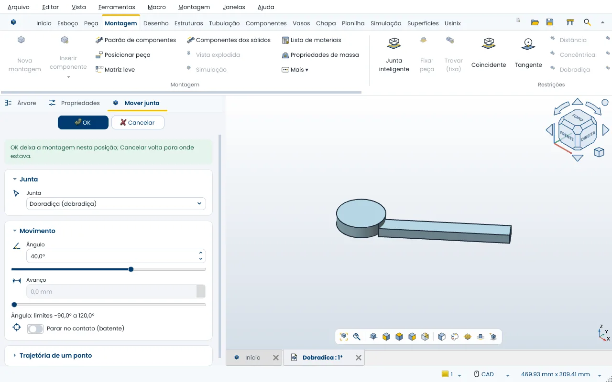

### Novidades

- **Atualização só do complemento (poucos MB).** A partir desta versão, cada versão nova publica também
  `Prumo3D_<versão>-complemento.zip` (cerca de 5 MB, contra centenas de MB do pacote completo). Em Ajuda →
  Sobre → Verificar atualizações, quando ele serve, o Usinix baixa só esse arquivo, confere o SHA-256,
  instala na pasta do usuário (sem pedir administrador) e oferece **Reabrir agora**. Proteções:
  - só aplica sobre a mesma base de FreeCAD e a partir do pacote completo mínimo; senão oferece o pacote
    completo, como antes;
  - se um pacote completo mais novo for instalado depois, ele volta a valer sozinho;
  - se a versão atualizada não abrir, o Usinix abre com a instalada na mesma hora e não tenta mais com ela;
  - "Copiar informações do sistema" diz qual está valendo.
  Quem está na 1.1 baixa o pacote completo uma última vez: o atualizador da 1.1 ainda não conhece o
  complemento.
- **Vasos: perímetro medido com fita métrica.** Em vaso existente não dá para medir o diâmetro por dentro:
  agora a medida do costado pode ser o perímetro externo, medido com fita em volta do vaso (é o padrão no
  painel). O Usinix calcula Ø externo = P/π e Ø interno = Ø externo − 2·t (com a espessura adotada ou, sem ela,
  a chapa comercial da mínima). A memória de cálculo mostra a conta. Projeto novo continua com o diâmetro
  interno.
- **Desenho: solda, rugosidade e ajuste furo/eixo em português.** As três telas agora seguem o padrão de
  cartões do Usinix, com o desenho de cada símbolo no botão:
  - *Solda*: clique na aresta, escolha o tipo (filete, V, meio-V, topo reto, U, J, cordão, tampão) e o lado
    (da seta, oposto ou os dois); a linha de chamada sai para fora da vista, com garganta, comprimento,
    solda em todo o contorno e solda de campo.
  - *Rugosidade*: qualquer processo, usinado ou bruto, Ra com a classe N ao lado; o símbolo fica sempre do
    lado de fora da superfície (embaixo e à direita vai numa linha de chamada, nunca de cabeça para baixo).
  - *Ajuste furo/eixo*: furo-base ou eixo-base com os ajustes preferenciais e o uso de cada um (H7/g6
    deslizante, H7/s6 prensado...). Mostra os afastamentos e a folga ou interferência, e grava a tolerância
    na cota escolhida. Tabelas ISO 286 até 500 mm conferidas célula por célula com a tabela do FreeCAD;
    confira na edição vigente da ABNT NBR 6158 antes de liberar o desenho.
  As ferramentas originais do FreeCAD continuam em "Mais".
- **Tubulação de aço carbono.** Três linhas novas no comando Tubos e conexões:
  - *Solda de topo SCH 40 e SCH 80*: tubos ASME B36.10M, curvas de raio longo, tês, tês de redução, reduções
    concêntricas e caps ASME B16.9 (a curva sai desenhada como curva). Flanges de pescoço ASME B16.5
    classe 150 ou 300 nas pontas soltas (bocal de equipamento) e em juntas de desmontagem no meio do trecho,
    com junta espiralada e estojos na lista. O tubo é cortado até a ponta de solda do pescoço, contando o
    ressalto de 2 mm e a junta. Conta as soldas de topo (inclusive emendas de barra).
  - *Roscada BSP*: tubo NBR 5580 classe M e conexões de ferro maleável (Tupy): cotovelos, tês, tês de
    redução, luvas, buchas (o sextavado entra no desconto), tampões e uniões nas juntas de desmontagem. A
    emenda de barra entra na lista como luva.
  - Medidas conferidas em duas fontes cada; o que diverge entre fabricantes aparece como aviso "a conferir".
    Materiais na lista são os típicos (A106 B, A234 WPB, A105, B7/2H): confira na especificação do projeto.
- **Folha isométrica.** Novo botão na aba Tubulação (e no painel da tubulação): folha A3 com o isométrico
  unifilar da linha, cota de eixo a eixo em cada trecho, balão com o número de cada peça, etiqueta P1, P2…
  em cada tubo, lista de material, lista de corte, soldas e observações. Chamado de novo, atualiza a mesma
  folha. Sai em PDF pelo Salvar PDF de sempre.
- **Montagem: batente de contato e trajetória de um ponto** (ideias do SolidCraft), no próprio Mover junta:
  - *Parar no contato*: com a opção ligada, a peça que gira ou desliza para ao encostar em outra, em vez de
    atravessar (procura o ponto de contato com precisão de centésimos). A mensagem diz em qual peça encostou.
  - *Trajetória de um ponto*: clique num vértice (ou aresta redonda) da peça que se move e em Traçar
    trajetória. O Usinix varre a junta na faixa dela (os limites ou uma volta), desenha a linha por onde o
    ponto passa e devolve a montagem para onde estava. Serve para conferir folga e curso. Com o batente
    ligado, a linha termina no contato. Cancelar tira as trajetórias.

## 1.1.0 — 29/10/2026

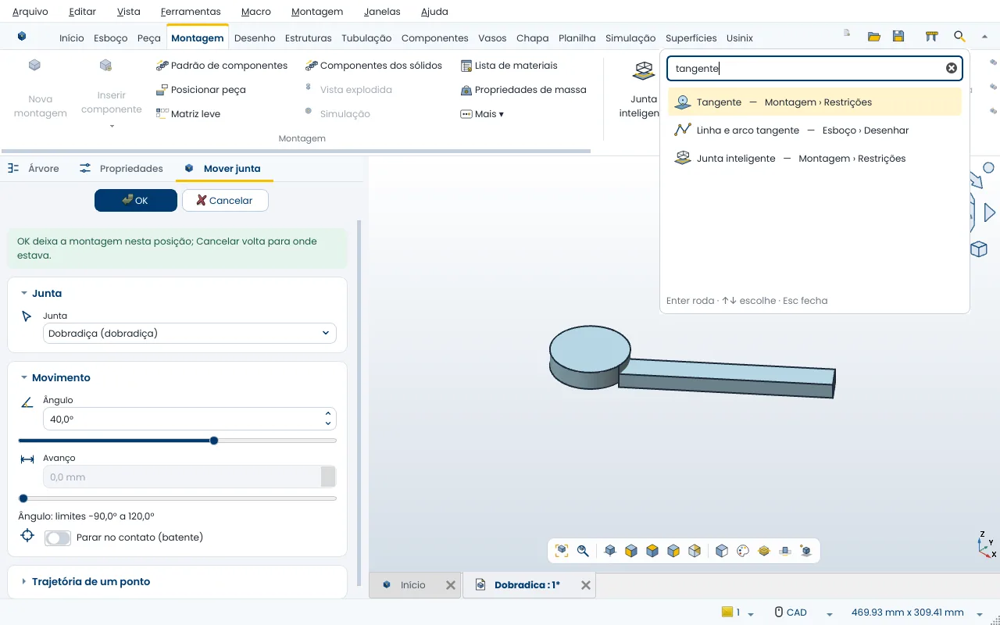

### Novidades

- **Montagem com as restrições do SolidWorks:**
  - **Tangente:** face curva (cilindro, esfera, cone) encostada em outra face, plana ou curva. Confere as faces
    e avisa se as duas forem planas (aí é Coincidente).
  - **Coincidente** e **Distância** em botões separados (antes era um botão só).
  - **Padrão de componentes** linear e circular: repete um componente em linha ou em volta de um eixo (aresta,
    face ou eixo da montagem); as cópias acompanham o original e o padrão se edita com duplo clique.
  - **Nova peça aqui:** cria uma peça nova já dentro da montagem.
  - **Mover junta:** gira uma dobradiça ou desliza um deslizante por um controle, vendo a montagem mexer.
    Respeita os limites da junta, e o que está preso à peça vai junto. Cancelar volta tudo para onde estava.
  - **Travar juntos:** prende dois ou mais componentes uns nos outros onde estão (grupo rígido), sem mexer em
    nada.
  - **Verificar interferência com folga mínima:** além das peças que se invadem, lista os pares que ficam mais
    perto que a folga pedida, com a distância.
- **Faixa que mostra o que serve agora:** sem documento aberto, só aparece o que começa um trabalho (Novo,
  Abrir…). Nas abas que dependem de "estar dentro" de algo, aparece só o primeiro passo e uma dica: Desenho
  sem folha aberta (Folha ABNT, Paleta de vistas, Abrir folha), Montagem sem montagem aberta (Nova montagem,
  **Abrir montagem**), Simulação sem estudo (Assistente, Novo estudo) e Planilha sem planilha aberta. As ferramentas raras de cada grupo ficam no botão
  **Mais**. Para ver tudo como antes: Preferências do Usinix, ou botão direito na faixa → desmarque "Mostrar só
  as ferramentas do momento".
- **Aba Desenho na ordem do trabalho:** Folha → Vistas → Cotas → Anotação → Entregar, com **Cotas gerais**,
  **Salvar PDF** (com o número do desenho no nome do arquivo) e **Exportar DXF** em um clique.
- **Cota a mais não deixa o esboço vermelho:** uma cota que sobraria (ou entraria em conflito) vira **cota de
  referência** na hora: continua na tela, mostrando a medida, sem comandar. Um aviso diz o que aconteceu, com
  o botão "Aplicar mesmo assim" para quem quiser. (Restrição geométrica a mais continua com o painel do
  esboço, que avisa e oferece apagar a mais recente.)
- **Erros que já trazem o conserto:** na Tangente com duas faces planas, o aviso tem o botão "Usar
  Coincidente", que grava na hora; numa montagem sem peça fixa, o painel da restrição oferece "Fixar" a
  primeira peça.
- **Lista de materiais com tipo de item:** em Propriedades da peça, "Na lista de materiais" pode ser
  Fabricado (o normal), Comprado (uma linha só, sem as peças de dentro: motor, redutor, cilindro) ou
  Referência (não entra: gabarito, máquina vizinha).
- **Componentes dos sólidos** (aba Montagem): um STEP (ou objeto) com vários sólidos vira uma peça para cada
  sólido, no lugar, prontas para receber restrições.
- **Preferências:** liga e desliga "Faixa só com as ferramentas do momento" (vale na hora) e "Cota a mais vira
  cota de referência".
- **Procurar comando (Ctrl+K ou a lupa no alto da faixa):** digite parte do nome (furo, tangente, cota…) e
  tecle Enter. A faixa vai para a aba da ferramenta, para você aprender onde ela fica. Entende também nomes
  de outros programas (fillet, mate, drive…).
- **Desenho com vistas prontas:**
  - **Paleta de vistas** (aba Desenho): escolha a peça e clique em Frontal, Superior, Lateral esquerda ou
    direita, Inferior, Posterior ou Isométrica. A vista entra na folha na hora, alinhada no 1º diedro, sem
    duplicar. A escala normalizada e a posição das vistas se ajustam para tudo caber, e a legenda acompanha.
    Sem folha aberta, a paleta cria uma folha ABNT A3.
  - **Cotas gerais:** um clique põe o comprimento, a altura e a profundidade totais da peça.
  - **Folha ABNT com arranjos prontos:** frontal, superior, lateral e isométrica; frontal, lateral e
    isométrica; frontal e superior; frontal e isométrica; ou só a isométrica.
- **Vasos: pés de chapa, como nos reservatórios de compressor.** Quatro pés de chapa dobrada (4,75 mm) em
  perfil U, um em cada canto, abertos para as pontas do vaso, recortados no costado e com sapata e furo de
  fixação. Entram também no teste de pressão por elementos finitos, com o apoio nas sapatas.

### Mudanças

- **Painel lateral:** com a aba Árvore fechada, o painel que sobra continua com o nome em português.
- **Sem a aba BIM:** o Usinix passa a focar na engenharia mecânica. A bancada BIM (arquitetura) sai de vista;
  quem precisar pode religá-la em Preferências → Geral → Bancadas.

### Correções

- **Vasos: todo suporte oferecido aparece no modelo.** No vaso deitado, escolher saia ou pernas não construía
  nada. Agora a lista de suportes só mostra o que serve para a posição do vaso (deitado: selas, pés de chapa ou
  pernas; em pé: saia ou pernas), e o vaso deitado ganhou pernas: quatro tubos sob o costado, nas posições das selas.

## 1.0.2 — 28/10/2026

### Novidades

- **Esboço 3D: comprimento durante o desenho.** O comprimento do trecho aparece junto ao cursor enquanto se
  desenha. Para uma medida exata, é só digitar o número (com o cursor na vista) e teclar Enter: o ponto vai
  na direção do cursor (exatamente no eixo, se o cursor estiver alinhado com X, Y ou Z) e o trecho já fica
  cotado. Vírgula decimal e Backspace funcionam; Esc apaga o número digitado. O painel também mostra o
  comprimento ao vivo e aceita o valor digitado.

### Ajustes

- **Testes automáticos (aba Usinix):** a dica dizia "cerca de 1 minuto", mas a bateria completa leva perto de
  uma hora. Agora o botão avisa antes, pede para fechar os projetos abertos e mostra onde fica o relatório.

## 1.0.1 — 28/10/2026

### Correções

- **Atualização automática que parava em "Não foi possível apagar a pasta":** o instalador aberto pelo
  Usinix herdava a pasta de trabalho do programa (dentro da pasta de instalação), e o Windows não deixa
  renomear uma pasta que algum programa usa como pasta de trabalho, nem mostra esse programa na lista. Agora
  o instalador abre a partir da pasta do download e, por garantia, sai sozinho da pasta antiga antes de
  trocá-la. Também tenta de novo por alguns segundos (antivírus) antes de perguntar.
- **Nome da versão no instalador:** mostrava "Usinix 1.1.4" (a versão do FreeCAD de base); agora mostra a
  versão do Usinix.

## 1.0.0 — 28/10/2026

Primeira versão final do Usinix, depois das versões de teste (0.1 a 0.9.12): faixa de ferramentas
só com abas, comandos em cartões no painel lateral, esboço com pontos-ímã, estruturas metálicas calculadas
pela NBR 8800:2024 e NBR 8681:2025, detalhe de ligação por elementos finitos, vasos de pressão (ASME VIII-1),
tubulação de PVC Tigre, chapa metálica, folhas ABNT, BIM e superfícies, tudo em português e com atualização
automática.

### Ajustes

- **Menus em português:** os menus Superfície e Malha (da Simulação) ainda apareciam em inglês.
- **Página do projeto:** imagens novas de todas as abas (tela inicial, esboço, peça, desenho, estruturas,
  simulação, tubulação, vasos, chapa, BIM e superfícies).
- **Tela inicial em tela baixa:** conferida em 1366 × 680 px; a janela não passa da tela e a tela inicial rola.

## 0.9.12 beta — 27/10/2026

### Novidades

- **Tudo em abas, sem o menu de bancadas:** o botão de trocar bancada ao lado da marca saiu. Cada área tem a sua
  aba; entraram duas novas:
  - **BIM:** projeto (terreno, edifício, nível), paredes, lajes, pilares, vigas, portas, janelas, escadas,
    telhados, cotas, cortes, folhas e quantitativos/IFC.
  - **Superfícies:** preencher por arestas ou seções, estender face, curva de concordância, curva sobre malha e
    sólido a partir de faces (loft, varredura e regrada ficam na aba Peça).
- **Esboço › Inserir** (o que antes só a bancada Draft fazia):
  - **Texto:** escreve um texto como linhas e curvas do esboço, pronto para extrudar, cortar ou gravar. Fonte
    Poppins ou qualquer fonte instalada, altura da letra maiúscula em mm, espaço entre letras, posição e giro.
  - **Importar DXF:** traz linhas, arcos, círculos e curvas de um DXF para o esboço, com a unidade do desenho
    (mm, cm, m, pol), escala e opção de levar para a origem. Pontas que se tocam já saem ligadas.
  - **Matriz em caminho:** repete uma peça ao longo de um esboço, arame, hélice ou arestas, com quantidade,
    orientação e recuos no início e no fim.
  - Texto e DXF vão para o esboço em edição (sem tirar o esboço do lugar), para o esboço selecionado ou para um
    esboço novo.
- **Aba Peça › Sólidos completo:** primitivas soltas (cubo, cilindro, esfera, cone, toro, tubo), extrudar, girar,
  loft, varredura, superfície regrada, face de esboços, arredondar, chanfrar, casca, espelhar e booleanas.
- **Bancadas fora de vista:** Desenho 2D (Draft), Malhas, Usinagem (CAM) e Engenharia reversa não aparecem mais.
  Quem usa alguma delas religa nas Preferências (página das bancadas) e abre pelo menu Vista › Bancada; ela
  ganha uma aba enquanto estiver em uso.

### Correções

- **Abas da faixa com o nome inteiro em tela de notebook:** em vez das setas de rolagem, a linha das abas se
  compacta por etapas (menos espaço entre as abas, marca só com o ícone, letra um pouco menor e, por último,
  Desfazer/Refazer/Medir saem do acesso rápido). Conferido com 1100, 1280, 1366, 1440 e 1600 px de largura,
  em todas as abas. As setas ficam só para janela pequena demais.
- **Aba Peça:** o Sólido (primitivas de adicionar material) passa para o grupo Sólidos, com ícone grande; o
  Subtrair fica com ícone pequeno, como Unir e Interseção.
- **Painel lateral voltava para a aba errada ao fechar um comando:** se a aba era trocada logo depois de fechar
  outro comando, a troca não era lembrada. Agora vale sempre a última aba olhada.
- **Aba BIM sem janela de boas-vindas** (em inglês, com predefinições do FreeCAD) na primeira vez, e sem
  fechamento do programa ao fechar um documento depois de usar a aba BIM.

## 0.9.11 beta — 27/10/2026

### Correções

- **Instalador não quebra mais a instalação anterior:** ele apagava a pasta antiga arquivo por arquivo; se algum
  arquivo estivesse preso (antivírus, Explorer, outro programa rodando de dentro da pasta), parava no meio e
  deixava o Usinix inutilizável. Agora: espera também qualquer programa rodando de dentro da pasta (e diz qual,
  se não fechar); renomeia a pasta antiga de uma vez (se algo estiver preso, nada é apagado e a versão
  instalada continua funcionando); instala a nova numa pasta limpa e só então apaga a antiga (o que estiver
  preso sai na próxima reinicialização). Se a instalação for interrompida, a versão anterior volta ao lugar.

## 0.9.10 beta — 27/10/2026

### Correções

- **Esboço preso no modo construção:** o "Alternar construção" (no menu da Linha) é global no FreeCAD e ficava
  ligado para os esboços seguintes; o retângulo saía como construção e a extrusão falhava sem explicação.
  Agora todo esboço abre no modo normal. Clicar duas vezes seguidas em "Linha de construção" também
  deixava o modo preso; corrigido.
- **Tubulação, tubos cruzando pelo meio:** dois trechos que se cruzam no mesmo plano, sem que nenhum termine ali,
  agora recebem a cruzeta (antes um atravessava o outro sem peça e sem aviso).
- **Tubulação, tubos encostados sem conexão:** quando dois tubos se encostam ou se atravessam sem nó em comum
  (por exemplo, cruzando a poucos milímetros de altura), aparece o aviso com os trechos e a sobreposição.
- **Estruturas, diagonal chegando no meio de outra barra (treliça em K/N):** a diagonal entrava dentro da barra
  principal (material sobreposto). Agora encosta na face dela, e as diagonais que chegam no mesmo ponto se
  recortam entre si.
- **Estruturas, linhas que se cruzam no meio:** as barras passavam uma por dentro da outra sem aviso; agora a
  estrutura avisa (na janela e no objeto) para dividir uma das linhas no cruzamento.
- **Aviso de curva sem peça mais claro:** "a linha muda de direção em 60°" no lugar do ângulo entre os trechos.

### Testes

- **Roteiros de uso automáticos:** 17 traçados comuns de tubulação (T pela ponta e pelo meio, cruzeta, joelhos,
  reduções, esgoto, Aquatherm, cruzamentos) 5 roteiros de esboço feitos com o mouse (linha entre quadrantes,
  quadrante a ponto livre, ponto médio, interseção, polilinha), uma peça feita do zero pela faixa
  (extrusão, cavidade, furo, arredondamento, chanfro, padrão, revolução) e 10 esqueletos comuns de estrutura
  (sem material sobreposto entre barras) e uma chapa dobrada do zero (base, aba, planificação, DXF) passam a
  rodar em toda versão, no mesmo programa que vai para a página de versões.

## 0.9.9 beta — 26/10/2026

### Correções

- **Tubulação, ramal no meio do trecho sem tê:** quando o ramal terminava no meio da linha principal (desenhada
  como um trecho só), o tubo do ramal só encostava no principal, sem conexão. Agora a linha principal é
  dividida nesse ponto e entra o tê (ou a junção, no esgoto); diâmetros, registros, torneiras e caixas
  continuam com a numeração dos trechos do traçado.

## 0.9.8 beta — 26/10/2026

### Correções

- **Esboço, linha ligada a pontos-ímã ficava solta:** uma linha entre dois quadrantes (por exemplo, a de baixo
  de dois círculos) passa quase tangente a um deles; o esboço sugeria também essa tangência, que sobrava
  junto com os pontos fixos, e o FreeCAD descartava todas as restrições automáticas da linha. Agora ponto
  capturado por ímã (quadrante, ponto médio, interseção) não ganha tangência sugerida, e a linha sai
  totalmente definida quando os círculos estão.
- **Notebook com escala de 150–200 %:** a janela pedia no mínimo ~1500 px de largura (a linha das abas da
  faixa não encolhia, e cresceu com a aba Tubulação), mais que a tela útil, e o Windows avisava "Unable to
  set geometry". Agora as abas rolam com setas quando falta espaço e a janela cabe em telas a partir de
  ~600 px de largura.

## 0.9.7 beta — 26/10/2026

### Correções

- **Atualização automática quebrava a instalação:** da 0.9.5 para a 0.9.6 o instalador abriu (pelo pedido
  de permissão do Windows), mas o Usinix ainda estava terminando de fechar. O instalador começou a apagar a
  pasta antiga, encontrou arquivos presos, parou no meio e deixou a instalação incompleta. Agora o
  instalador espera o Usinix sair de vez (até 60 s) antes de mexer na pasta e, se algum arquivo ainda
  estiver preso, oferece "Tentar de novo" em vez de abortar.

## 0.9.6 beta — 25/10/2026

### Correções

- **Tubulação, medidas conferidas:** a junção a 45° de esgoto estava com o ramal curto (a cota c vai até o
  fundo da bolsa, não até a face: confirmado porque, nas junções de diâmetros iguais, montante = c + bolsa
  em todas as bitolas). Joelho 45° e tê de esgoto conferidos pela geometria; caixas conferidas com a ficha
  atual da Tigre. Joelho 45° Aquatherm com as cotas do site da Tigre (o catálogo de 2011 repetia o 90°),
  conectores Aquatherm com o comprimento real, e três buchas soldáveis com erro de impressão corrigidas
  (110 × 85, 50 × 25 e 75 × 50). Normas dos tubos conferidas na ABNT: NBR 5688:2018 (esgoto) e
  NBR 15884-1/-2 (CPVC), em vigor. Seguem avisando só o joelho 45° e a junção de DN 200 de esgoto, o joelho
  45° Aquatherm de 35, 42 e 54 e o conector Aquatherm 28 × 1".
- **Junções desenhadas sempre válidas:** com caimento, algumas junções saíam com sólido inválido.

### Melhorias

- **Peças com mais volume na vista 3D:** iluminação nova, com luz principal de cima, preenchimento da
  esquerda e uma luz lateral mais fraca da direita, presas à câmera. Cada face fica com um tom e o
  acabamento padrão das peças novas passou a acetinado, com brilho visível em furos, tubos e
  arredondamentos. Peças já existentes mantêm o acabamento salvo no arquivo.

## 0.9.5 beta — 25/10/2026

### Correções

- **Atualização automática (de novo):** da 0.9.3 para a 0.9.4 o Usinix baixou o instalador e fechou, mas o
  instalador não abriu (o processo que esperava o Usinix fechar não chegou a abri-lo). Agora o instalador é
  aberto pelo próprio Windows (com o pedido de permissão) logo depois que você aceita fechar o Usinix; o
  caminho antigo fica só como reserva. Cada passo fica anotado em `atualizacao.log`, na pasta temporária
  `Prumo3D-atualizacao`, para achar o motivo se algo falhar.
- **Mensagens de erro das operações em português:** o FreeCAD mostrava o erro cru em inglês (ex.: "Failed to
  make thick solid" na casca). 121 mensagens de Peça, Sólidos e esboço agora aparecem em português,
  algumas com a dica do que tentar (casca: espessura menor, outra junção ou outras faces).

## 0.9.4 beta — 25/10/2026

### Melhorias

- **Aba Tubulação:** a ferramenta saiu da aba Estruturas e ganhou aba própria, com Traçado (Esboço 3D e
  esboço plano), Tubos e conexões, e Conferir (verificar interferência, medir, lista de materiais).
- **Tubulação: trechos escolhidos na vista**, como na estrutura soldada: clique nas linhas do traçado
  (Ctrl para várias) e aplique o diâmetro a todas de uma vez; "Escolher todos", "Mesmo diâmetro" e a
  tabela marcam os trechos na vista, e o que se escolhe na vista aparece marcado na tabela.
- **Torneiras na tubulação:** na ponta solta (luva com bucha de latão seguindo o tubo, ou joelho com bucha
  saindo para cima, para baixo ou para o lado) ou no ponto clicado do trecho (tê com bucha de latão, que
  corta o tubo em dois e desconta as bolsas). A torneira aparece em volume simplificado e entra na lista
  de materiais. Medidas das peças com bucha: catálogo Tigre de água fria (2008).
- **Linha de esgoto série normal (Tigre, DN 40 a 200)** na Tubulação: tubos, joelhos 90° e 45°, tê, luva,
  redução excêntrica e cap do catálogo de esgoto (2008). Caimento automático nos trechos horizontais, no
  sentido em que foram desenhados: 2 % até DN 75 e 1 % a partir de DN 100 (ABNT NBR 8160:1999, 4.2.3.2);
  aviso acima de 5 % (4.2.5.2) e em curva na horizontal com joelho 90° (4.2.3.3). Joelho 45° e tê de esgoto
  saem com aviso "a conferir" (rótulos trocados na tabela do catálogo).
- **Linha de água quente CPVC Aquatherm (Tigre, 15 a 114 mm)**: tubos em barras de 3 m, joelhos, tê, luva e
  cap do catálogo técnico Aquatherm (mai/2011); torneira na ponta com conector ou joelho de transição. O
  joelho 45° sai "a conferir" (o catálogo repete a tabela do joelho 90°).
- **Junção a 45° no esgoto:** ramal chegando a 45° pelo lado de montante vira junção simples (DN 40 a 200,
  inclusive 75 × 50, 100 × 50, 100 × 75 e 150 × 100), com o tubo cortado pelas medidas da junção. Centro até
  a face tirado do desenho do catálogo, por isso "a conferir".
- **Caixas de esgoto:** caixa sifonada (100 × 100 × 50, 150 × 150 × 50, 150 × 185 × 75), caixa de inspeção e
  caixa de gordura no nó de uma ponta do traçado; os trechos que chegam ali param na parede da caixa, e o
  Usinix avisa quando o diâmetro do tubo passa da saída ou das entradas da caixa. Medidas do catálogo de
  esgoto (2008); inspeção e gordura "a conferir" (letras sem legenda na tabela).

### Correções

- Clicar numa aba logo ao abrir o programa não volta mais sozinho para a aba Início.

## 0.9.3 beta — 25/10/2026

### Melhorias

- **Verificar geometria:** resumo em cartões acima da lista do FreeCAD — geometria válida ou com defeito,
  sólidos, cascas, faces, arestas, vértices, volume e área.
- **Peso próprio com painel:** criar pelo botão da faixa (ou editar com duplo clique) abre cartões com a
  direção da gravidade (−Z, +Z, ±X, ±Y) e a aceleração em m/s². Cancelar na criação desfaz.
- **Abre na aba Início:** sem documento aberto, a faixa começa na aba Início (antes caía em Peça).
- **Relatório e console Python fechados por padrão**, em qualquer tela. Quem programa liga em
  Preferências → "Para quem programa".

### Correções

- **Atualização automática:** depois de baixar, o Usinix fechava e o instalador não abria (o instalador pede
  permissão de administrador e era aberto por um caminho que não mostra esse pedido). Agora um processo
  à parte espera o Usinix fechar e abre o instalador com o pedido de permissão do Windows. Desistir de
  fechar (na pergunta de salvar) não abre nada.
- O último trecho que lia os quadros do jeito antigo (rolagem de janelas grandes) foi trocado, como o do
  botão OK na 0.9.2.

### Testes

- Verificar geometria de uma caixa (6 faces, 12 arestas, 1.000 mm³); peso próprio criado pela faixa, em −Y
  e 9,81 m/s², e reaberto para editar.
- Atualização: comando que espera o Usinix fechar e abre o instalador pelo Windows; desistir de fechar não
  abre nada. Abertura na aba Início; Relatório e console fechados e ligados pela Preferência.

## 0.9.2 beta — 24/10/2026

### Melhorias

- **Preferências do Usinix:** botão "Preferências" (abas Início e Usinix) abre uma janela em cartões com o
  que importa: tema claro/escuro, tela inicial, faixa contextual, painel lateral (único, propriedades e
  comandos em cartões, abas compactas), esboço (retirar relações automáticas que não cabem, referências
  automáticas, enquadrar ao sair), unidades (sistema em português e casas decimais) e atualizações. Cada
  opção grava na hora; as preferências completas do FreeCAD continuam a um clique.
- **Multitransformação em cartões:** operações a repetir e a lista de transformações em ordem, com
  "+ Espelhar", "+ Padrão linear", "+ Padrão circular", "+ Escala", Editar, Excluir, Subir e Descer (antes
  só pelo menu do botão direito). Ao editar uma transformação, o quadro dela aparece com "Concluir esta
  transformação".
- **Varredura: orientação e seções em cartões.** Os quadros "Orientação da seção" (padrão, fixa, Frenet,
  auxiliar, binormal) e "Transformação da seção" (constante, várias seções, …) ganharam cartões próprios,
  como o resto do painel.
- **Sólidos em cartões:** deslocamento 3D/2D e espessura (faces abertas, distância, modo e cantos),
  transição (loft) e varredura (perfis em ordem com Usar/↑/↓/✕, caminho escolhido na vista, sólido e
  Frenet).
- **Desenho:** texto formatado (texto, editor completo, largura e moldura) em cartões; a hachura ganhou a
  escolha do padrão pelo nome (Madeira, Concreto, Aço…), outro arquivo SVG e a cor.
- **Simulação:** deslocamento imposto (por eixo: livre ou com valor; 0 trava), mola (rigidez normal e
  tangencial em N/mm) e o quadro "Onde vale" (material, espessura de casca, seção de viga…) em cartões,
  com Adicionar na vista e ✕ para tirar.
- **Montagem → Inserir componente em cartões:** procurar pelo nome, peças de cada documento com
  "Inserir" (o botão conta quantas já entraram), abrir outro arquivo e as opções.

### Correções

- Às vezes o Usinix deixava de "enxergar" o botão OK (ou outro botão) do painel de tarefa logo depois de
  fechar outra tarefa: um resto de leitura antiga do layout era confundido com o botão novo no mesmo
  lugar da memória. A leitura dos quadros do painel, da faixa e do guia foi trocada por uma que não deixa
  esse resto.

### Testes

- Preferências: abre pelo comando, grava na hora, unidades com nomes em português.
- Multitransformação: adicionar um padrão linear pelos cartões, concluir e gravar.
- Varredura: orientação Frenet e várias seções pelos cartões.
- Leitura dos quadros de um layout em ordem, sem guardar itens do layout.
- Sólidos: deslocamento com canto vivo, espessura com face aberta, transição entre dois círculos e
  varredura com caminho escolhido (volume conferido: π·10²·40 mm³).
- Desenho: hachura com padrão Madeira e cor vermelha; texto formatado com moldura.
- Simulação: deslocamento imposto em Z, mola em N/mm, Onde vale do material (sólido inteiro).
- Montagem: inserir peça filtrando pelo nome; o link entra na montagem.

## 0.9.1 beta — 24/10/2026

### Correções

- **Linha ligando dois círculos ainda quebrava o esboço** (relatado na 0.8.1, com círculos de Ø50 e
  Ø30): ao desenhar, o FreeCAD punha tangente e duas "Vertical" (alinhamento com os centros), que não
  cabiam juntas; no primeiro recálculo, ele jogava os círculos a bilhões de mm, e o Usinix retirava a
  relação a partir desse desenho já estragado. Agora o Usinix guarda o desenho do instante em que as
  relações entram, testa cada opção de retirada sem mexer no esboço e fica com a que menos move o que já
  estava desenhado, preferindo tirar alinhamentos do cursor e manter a tangente. A retirada entra no
  desfazer (Ctrl+Z).

### Testes

- O caso relatado (Ø50, Ø30, tangente + duas verticais) virou teste: os círculos não podem sair do
  lugar e a tangente tem de ficar.

## 0.9.0 beta — 24/10/2026

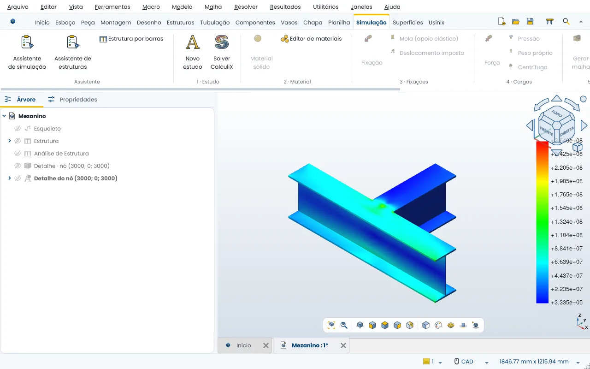

### Melhorias

- **Desenho em cartões, parte 2:**
  - **Vista em corte:** letra do corte, para onde ele olha (← Esquerda, → Direita, ↑ Cima, ↓ Baixo), por
    onde passa o plano (X, Y, Z), escala e atualização.
  - **Vista de detalhe:** letra, "Arrastar o círculo na folha", centro (X, Y), raio e escala.
  - **Editar cota:** casas decimais, cota de referência (entre parênteses), teoricamente exata, texto
    livre, tolerância (simétrica ou superior/inferior), tamanho do texto, inverter as setas e estilo.
  - **Editar balão:** texto (nº da peça), forma, tamanho, ponta e linha de chamada.
  - **Hachura:** escala, rotação e deslocamento do padrão.
- **Fixação em cartões:** o quadro "Fixação" do FreeCAD (planos, linhas e pontos auxiliares, primitivas e
  Editar fixação) virou cartões: onde a peça se prende (só as referências usadas e a próxima livre),
  o modo numa lista e o deslocamento (X, Y, Z e rotações), com "Inverter o lado".
- **Sólidos em cartões:** Extrusão (direção, a favor/oposto/simétrica, ângulo de saída, sólido), Revolução
  (eixo X/Y/Z ou aresta, centro, ângulo), Espelhar (plano XY/XZ/YZ ou face, ponto), Escala (igual nos 3
  eixos ou um por eixo) e Arredondar/Chanfrar arestas (forma, Todas/Nenhuma, constante ou variável). Em
  todos, as formas da operação aparecem como interruptores.
- **Montagem → juntas em cartões:** os 13 tipos numa grade com nomes em português (Fixa, Rotação,
  Cilíndrica, Deslizante, Esférica, Distância…), o que foi escolhido na vista, só as medidas do tipo
  escolhido, "Inverter o sentido", os limites (distância e ângulo mínimo/máximo) e como as outras peças
  aparecem enquanto escolhe. A aba do comando se chama "Junta".
- **Simulação em cartões:** Material (o escolhido e densidade, E e ν na unidade usual), Fixação (faces
  presas), Força (valor em N, direção, inverter), Pressão (valor em MPa, inverter) e Gerar malha (tipo,
  tamanhos e ordem). O quadro "Onde vale" do FEM, que estava em inglês, foi traduzido.

### Testes

- Corte (letra e direção), detalhe (raio e letra), cota (casas e referência), balão (texto e forma) e
  hachura (escala): cada painel abre em cartões e o OK grava o que foi mudado.
- Fixação: deslocamento e modo escolhidos nos cartões ficam no plano auxiliar; nas primitivas aparecem
  os dois painéis (medidas e fixação).
- Sólidos: extrusão de 25 mm, revolução de 90°, espelho no plano XZ, escala 2× e arredondar/chanfrar as
  12 arestas de uma caixa, pelos cartões.
- Junta da montagem: trocar o tipo na grade muda a junta e as medidas mostradas.
- Simulação: força de 250 N e pressão de 0,5 MPa pelos cartões ficam gravadas certo (o FreeCAD guarda
  internamente em mN e kPa).

## 0.8.1 beta — 24/10/2026

### Melhorias

- **Desenho → Vista e Grupo de projeção em cartões:** as vistas são escolhidas numa grade que já segue o
  1º diedro (a vista de baixo fica em cima, como na folha), com a direção da frontal dita em palavras
  ("de frente", "de cima"), a escala (da folha, automática ou escolhida, ex.: 1:5) e o arranjo do grupo.
- **Atualização com janela de progresso:** barra, MB baixados, velocidade e tempo que falta, com
  Cancelar. No fim, a mesma janela diz o próximo passo ("Fechar o Usinix e instalar" ou onde ficou o
  arquivo) ou o erro, com "Tentar de novo". "Verificar atualizações" mostra "Procurando…" enquanto consulta.

### Correções

- **"Atualizar agora" não fazia nada** quando a atualização era procurada por Ajuda → Sobre: a janela do
  aviso abria, mas o botão não respondia. Na verificação automática ao abrir já funcionava.

### Testes

- Painel de vistas (grupo com vista inferior no 1º diedro, vista avulsa com escala 1:5) e janela de
  atualização (progresso, próximo passo, erro, e o clique que antes não respondia).

## 0.8.0 beta — 24/10/2026

### Melhorias

- **Mais comandos em cartões:** Ângulo de saída, Casca, Hélice (aditiva e subtrativa), Loft e Varredura
  (aditivos e subtrativos) ganharam o mesmo painel de cartões da Extrusão e do Furo: o que foi escolhido
  na vista, as medidas, interruptores e botões no lugar das listas. O formulário completo do FreeCAD
  continua a um clique.
- **Primitivas e Booleana em cartões:** cubo, cilindro, esfera, cone, elipsoide, toro, prisma e cunha
  (aditivos e subtrativos) mostram as medidas em cartão; a Booleana mostra os corpos e Unir / Cortar /
  Interseção.
- Títulos de quadros que ainda apareciam em inglês na Hélice, no Loft e na Varredura foram traduzidos.
- **Cotas do esboço em cinza escuro:** o azul das cotas se confundia com as linhas do desenho.

### Correções

- **Linha ligando dois círculos quebrava o esboço:** ao desenhar, o FreeCAD põe relações automáticas
  (tangente, vertical, horizontal) que às vezes não cabem juntas. Agora o Usinix retira na hora as
  automáticas que não cabem e avisa quais foram; o esboço continua resolvido. Relações postas à mão
  nunca saem sozinhas: o painel avisa o conflito e oferece apagar a mais recente.
- **Assistentes de estruturas e de simulação:** quando o resumo de uma etapa ocupava duas linhas (ex.:
  "Resultados"), o texto ficava cortado por cima do título.

### Testes

- Novo teste confere que nenhum painel do Usinix nem os assistentes têm texto cortado ou sobreposto.
- Testes dos novos painéis: cada um abre em cartões e o OK grava o que foi mudado.

## 0.7.1 beta — 24/10/2026

### Correções

- **Esboço que não fecha** (ex.: dois círculos e uma linha ligando os dois, com as restrições automáticas
  de tangência e horizontal): o painel do esboço avisava "Totalmente definido". Agora mostra em vermelho
  "O esboço não fecha" ou "Restrições em conflito: Tangente · Linha 3 / Círculo 2…", põe as restrições
  com problema no topo da lista (⚠) e oferece "Apagar a restrição mais recente do conflito".
- **Esboço 3D:** depois de fechar o painel sem OK/Cancelar, qualquer clique de seleção dava erro.
- **Desenho → Preencher campos da folha:** o botão dava erro interno (`false` em vez de `False`) e
  não mostrava quando estava disponível.

### Testes

- Testes de ponta a ponta: todas as ferramentas da faixa (cerca de 270) abrem e fecham com uma peça
  pronta, as ferramentas do esboço ligam e cancelam, e o conflito de restrições aparece e se resolve.

## 0.7.0 beta — 23/10/2026

### Novo

- **Extrusão e Cavidade com painel no padrão Usinix:** ao criar ou editar, a aba do comando mostra os
  cartões Lados (Um lado, Dois lados, Simétrica), Direção 1 e 2 (até onde vai em botões com ícone,
  medida, afastamento, ângulo de saída, inverter), Perfil e Acabamento, no lugar do formulário do
  FreeCAD. Quando o modo pede escolher na vista (Até a face, Até a peça), o quadro do FreeCAD aparece
  embaixo para a escolha; "Formulário completo do FreeCAD" mostra tudo quando quiser.
- **Furo com painel no padrão Usinix:** cartões Furo (padrão de rosca, tamanho, diâmetro), Tipo (Passante,
  Para rosca, Modelada, com a folga), Profundidade (Medida ou Através, ponta cônica), Cabeça (rebaixo,
  escareado… com diâmetro e profundidade) e Acabamento.
- **Revolução e Ranhura** (eixo, até onde gira, ângulos, simétrico, inverter) e **Arredondar e Chanfro**
  (arestas escolhidas com "Escolher arestas na vista", todas as arestas, raio ou o tipo de chanfro com
  distâncias e ângulo) também com painel em cartões.
- **Padrão linear, Padrão circular e Espelhar** com painel em cartões: operações a repetir (Adicionar,
  Tirar), direção ou eixo, comprimento/ângulo total ou distância entre cópias, quantidade, inverter e a
  segunda direção ligada por chave; no Espelhar, o plano de espelho.

### Ajustes

- **Mais telas no padrão novo:** Estrutura soldada, Cantos da estrutura, Propriedades de massa, guia
  "Vem do SolidWorks", Esboço 3D e Tubulação agora em cartões, como o resto do sistema.
- **Assistentes, tutorial, guia "Vem do SolidWorks" e histórico do corpo viram abas do painel lateral**
  enquanto estão abertos (antes abriam num painel separado à direita), com um × no topo para fechar.
- **Cotas na tela** (duplo clique na operação) e **aviso de conferência do esboço** no padrão novo:
  cartão de cantos arredondados, campos com unidade sem setas, aviso em amarelo.
- **Avisos dos painéis voltaram a ter o fundo amarelo** (o estilo da letra apagava o fundo da caixa de
  instrução).

## 0.6.0 beta — 23/10/2026

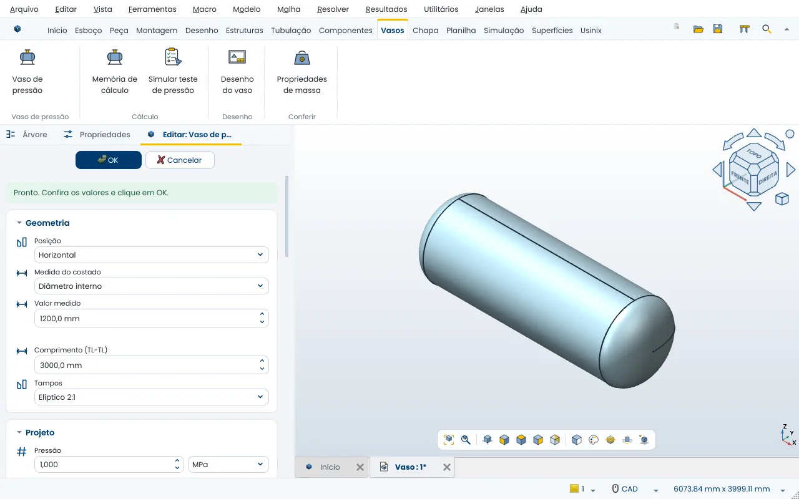

### Novo

- **Painel lateral único, com as abas no alto:** **Árvore**, **Propriedades** e, só enquanto um comando
  está aberto, a aba dele (ex.: "Esboço002", "Extrusão"). Ao concluir ou cancelar, a aba do comando some
  e o painel volta para a aba em que você estava. Acabaram os painéis Modelo, Tarefas e Dados empilhados
  com título repetido em cima de cada um. (Para voltar ao arranjo do FreeCAD: preferência
  `PainelLateralUnico` em Mod/Prumo3D, vale na próxima abertura.)
- **Propriedades em cartões:** a peça ou operação selecionada aparece com o nome editável, o botão
  **Editar** e cartões com o que importa (na Extrusão: Lados, Direção 1, Direção 2, Perfil, Acabamento),
  com chaves liga/desliga, botões com ícone (Medida, Até a face, Até o fim…) e campos com a unidade.
  Cada mudança entra no desfazer. A tabela completa do FreeCAD continua em **Avançado**.
- **Aba Aparência** (no lugar da antiga aba Vista): cor em amostras (ou outra cor), transparência,
  modo de exibição (Arestas, Sólido, Arame, Pontos), espessura da linha e se dá para selecionar na
  tela, para tudo o que estiver selecionado.
- **Aba do esboço no estilo do SolidWorks:** a situação numa frase ("Totalmente definido", "Faltam 2
  medidas para ficar definido", "Restrições em conflito"); **Relações** com o que está selecionado e os
  botões Horizontal, Vertical, Paralela, Perpendicular, Igual, Colinear, Tangente, Coincidente, Fixar,
  Simétrica e Cotar (só ficam ativos os que servem para a seleção); **Neste esboço** com as relações e
  cotas existentes e × para apagar; **Auxiliares**. As listas do FreeCAD continuam em "Lista completa".
- **Abas compactas:** com o painel estreito, só a aba aberta mostra o nome; as outras ficam com o ícone
  (o nome aparece ao parar o mouse em cima).
- **Atualização pelo próprio Usinix, sem obrigação:** em **Ajuda → Sobre**, o botão **Verificar
  atualizações** e a chave **Verificar ao abrir** (no máximo uma vez por dia). Com versão nova, aparece
  um aviso com "Atualizar agora", "Agora não" e "Pular esta versão". Ao atualizar no Windows, o Usinix
  baixa o instalador, confere o SHA-256 publicado, fecha (perguntando se quer salvar) e abre o
  instalador; no Linux, baixa o AppImage novo na mesma pasta. A consulta só lê a lista de versões
  públicas; nenhum dado é enviado. Primeira versão com o aviso: vale a partir da próxima atualização.

### Ajustes

- **Cotas do esboço em azul**, no tom do sistema (antes vermelhas); o vermelho fica só para erro.
- **Barra de cima da aba Esboço mais limpa:** o botão Restrição e o grupo Auxiliares foram para o painel
  lateral; Validar, Reorientar, Mesclar e Espelhar esboço ficaram num menu "Mais"; saiu o "Linha ↔
  construção" repetido (continua no menu do botão Linha).
- **Mesmo visual em todo o sistema:** caixas de marcar viraram chaves liga/desliga (nas listas e
  tabelas continua a caixa); os quadros dos comandos do FreeCAD e as seções dos painéis Usinix viraram
  cartões brancos de cantos arredondados; botões de opção marcados em azul claro; avisos sem a barra
  lateral. Nos painéis Usinix saiu o quadro com título repetido (a aba já diz o nome do comando).
- **Tela inicial com a área Ajuda**, logo abaixo de Novo projeto: tutorial da primeira peça, tutorial da
  estrutura soldada e "Vem do SolidWorks ou do ZW3D?", em cartões com ícone como os demais.
- **Painéis laterais não abrem mais junto com a tela inicial** quando o FreeCAD restaura o arranjo
  gravado logo depois de abrir.
- **Aviso de boa prática do esboço numa linha**, com "Por quê?" para ler o resto e × para dispensar.

## 0.5.0 beta — 23/10/2026

### Novo

- **Esboço 3D com restrições, cotas e linhas de construção**, no jeito do SolidWorks:
  - linha desenhada ao longo de X, Y ou Z ganha a restrição do eixo sozinha (aparece "X", "Y" ou "Z" ao
    lado dela); o ramal que começa num ponto do esboço fica preso nele;
  - na lista "Linhas e restrições" (ou clicando na linha na vista): **Cotar** o comprimento, **Ao longo de
    X/Y/Z**, **Paralelas**, **Perpendiculares**, **Iguais** e **Construção**; o esboço se ajusta na hora e
    avisa quando as restrições entram em conflito;
  - **linhas de construção** tracejadas: servem de referência para restrições e cotas, mas não entram na
    forma (a estrutura soldada e a tubulação não usam);
  - durante a edição, o resto do modelo fica transparente e os eixos X, Y e Z aparecem no ponto de partida.
- **Esboço 3D no Novo esboço:** fica no menu do botão Esboço da aba Peça (e no Novo esboço da aba
  Esboço); saiu da aba Estruturas.

### Ajustes

- **Modelo e Tarefas em abas no mesmo lugar**, e não mais lado a lado: em notebook os dois juntos
  pediam mais largura que a tela (o aviso "Unable to set geometry"). A aba Tarefas vem para a frente
  quando um comando abre e a Modelo volta quando ele fecha.
- **Na abertura, só a tela inicial:** Modelo e Tarefas começam fechados, também na primeira vez depois de
  instalar; aparecem ao abrir ou criar um arquivo.
- **Instalador do Windows com a marca do Usinix** (imagem lateral, cabeçalho e ícone), sem o logo do
  FreeCAD.

## 0.4.0 beta — 23/10/2026

### Novo

- **Referências automáticas no esboço:** ao abrir um esboço apoiado numa face, todas as arestas dela já
  entram como geometria externa; num plano da origem, entram as arestas do sólido que estão no plano.
  Ao concluir, as referências que não foram usadas saem sozinhas. As feitas à mão com Geometria externa
  ficam. Liga e desliga em Esboço → Referências automáticas.
- **Pressão do vaso em MPa, kgf/cm² ou psi:** escolha a unidade ao lado do campo; o painel, a memória
  de cálculo e o desenho mostram a pressão nessa unidade, com a equivalência em MPa (o cálculo continua
  em MPa).

- **Linha de construção:** no menu do botão Linha (aba Esboço) há a **Linha de construção**, uma linha só de
  referência que guia o desenho e não entra no perfil. Para transformar linhas já desenhadas, selecione e
  use **Linha ↔ construção** (no mesmo menu ou no grupo Desenhar).

### Ajustes

- **Peça e Sólidos juntas:** a aba Sólidos saiu; o que ela tinha sem igual na Peça (subtrair, unir,
  interseção, juntar/dividir formas, seção, projeção, escala, offset) virou o grupo **Sólidos** da aba
  Peça. As "Primitivas" de adicionar e remover material agora se chamam **Sólido** (caixa, cilindro,
  esfera… que se funde à peça ou é tirado dela).
- **Restrições num botão só:** coincidente, horizontal/vertical, paralela, perpendicular, tangente, igual,
  simétrica, bloquear e ativar/desativar viraram um botão grande com menu, como o da Cota.
- **Tela de abertura com a versão certa:** o selo da tela de abertura, o título da janela e o Sobre agora
  mostram a versão do pacote (antes ficavam em 0.1).
- **Régua de histórico** saiu da faixa da aba Peça: liga e desliga no menu Vista.
- **Régua de histórico na árvore do modelo:** a régua amarela agora fica na própria árvore, logo abaixo
  da última operação do corpo, e se arrasta para cima ou para baixo. Duplo clique volta ao modelo
  completo; o botão Régua de histórico liga e desliga.
- **Padrão linear e padrão circular** do esboço ganharam um grupo próprio, com botões grandes, na aba
  Esboço durante a edição (antes ficavam pequenos como "Mover / matriz" e "Rotacionar").
- **Painel de tarefas mais estreito:** listas, botões e campos numéricos não forçam mais o painel a
  alargar (alguns pediam de 400 a 700 px); textos longos quebram linha. O painel para de "pular" de
  largura ao abrir um comando.
- Menos trabalho em segundo plano: a troca de ícones do painel de tarefas procura só dentro dele.

## 0.3.0 beta — 22/10/2026

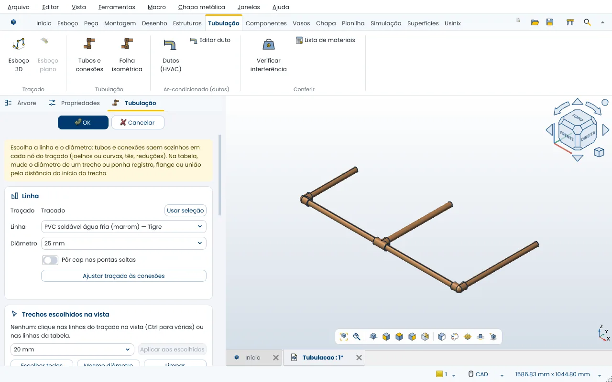

### Novo

- **Tubulação** (aba Estruturas): tubos e conexões automáticos sobre o traçado do Esboço 3D (ou de um
  esboço com linhas retas). Em cada nó entra a peça certa do catálogo: joelho 90° ou 45°, tê, tê de
  redução (ou tê com bucha), luva de redução, cruzeta e cap nas pontas soltas. O tubo de cada trecho sai
  cortado descontando o avanço das conexões, e a lista mostra as peças, as barras de 6 m necessárias
  (com emenda pela bolsa quando o trecho passa da barra) e os avisos (ângulo sem conexão, redução que
  não existe). O diâmetro pode mudar trecho a trecho. "Copiar lista de materiais" leva tudo para a
  planilha. Primeira linha: **PVC soldável água fria Tigre**, de 20 a 110 mm, com as medidas do catálogo
  técnico do fabricante.
- **Registro de esfera na tubulação:** na tabela do painel, informe a distância do início do trecho até o
  registro (20 a 60 mm). O tubo é dividido e cada metade entra numa bolsa do registro.
- **Tubulação na lista de materiais:** a Lista de materiais (e a tabela na folha ABNT) traz um item por
  diâmetro de tubo, em barras, e um por conexão, com o fabricante.

## 0.2.0 beta — 22/10/2026

### Novo

- **Esboço 3D** (abas Esboço e Estruturas): linhas no espaço, ponto a ponto. Clique em **Desenhar** e vá
  clicando na vista: o ponto cai no plano que passa pelo último ponto, e **Tab** troca o plano (XY → YZ
  → ZX). O cursor encaixa em vértices e pontas de arestas e anda de passo em passo (10 mm, ajustável).
  **Esc** termina o trecho e o próximo clique começa um ramal; Esc de novo para de desenhar. Para
  medidas exatas, digite o próximo ponto (absoluto ou ΔX, ΔY, ΔZ a partir do último) e tecle Enter.
  Os cantos podem ser arredondados (curva de tubo). Serve de esqueleto da estrutura soldada e de
  caminho de varredura.

## 0.1.1 beta — 22/10/2026

### Novo

- **Faixa contextual na aba Esboço:** só aparecem as ferramentas que servem no momento. Fora da edição,
  criar, editar, anexar e validar; dentro, desenhar, restrições e modificar. O que depende só da
  seleção continua visível, esmaecido. Para ver tudo, clique com o botão direito na faixa e desmarque
  "Mostrar só as ferramentas do momento".
- **Conferência do esboço ao sair:** pontas quase encostadas (contorno que parece fechado mas está
  aberto), pontas soltas num perfil de extrusão, elementos de tamanho zero e coincidências que faltam
  aparecem num aviso com o botão **Corrigir**, antes de a extrusão falhar.

### Ajustes

- O console Python começa fechado, para não confundir quem está começando (Início → Árvore do modelo e o
  menu Vista → Painéis continuam trazendo os painéis de volta).

## 0.1 beta — 22/10/2026

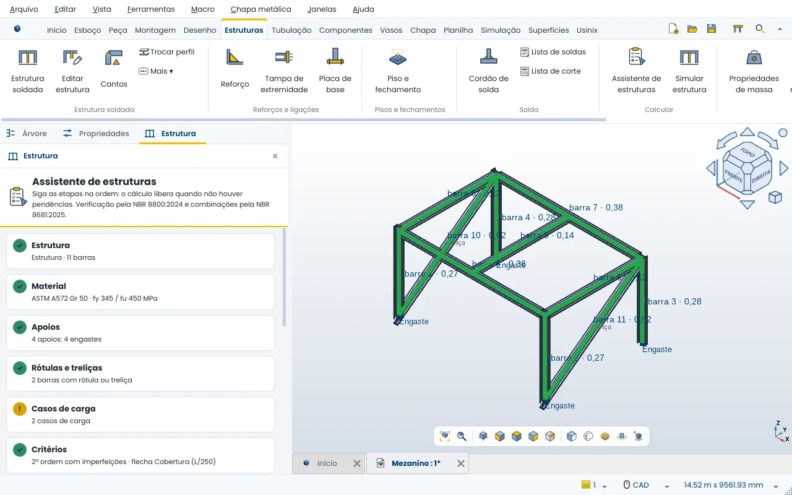

Primeira versão pública, para Windows e Linux. Baseada no FreeCAD 1.1.4.

### O que tem de novo em relação ao FreeCAD

- **Interface em português** com faixa de abas (Início, Esboço, Peça, Sólidos, Montagem, Desenho,
  Estruturas, Chapa, Planilha, Simulação), tema claro e escuro e tela inicial com exemplos. A faixa
  muda de altura arrastando a borda de baixo, e os grupos de botões se alargam pelos divisores.
- **Painéis de tarefa visuais** (como o PropertyManager do SolidWorks): mensagem no topo, seções com
  ícone, dica em cada campo e caixas de seleção que aceitam a seleção feita antes **ou depois** de
  abrir o comando. Subtrair, Unir e as outras booleanas também pedem a seleção se você chamar sem ela.
- **Árvore do modelo** com nomes em português (Extrusão, Cavidade, Corpo...) e seleção em azul.
- **Ícones do Usinix desde a primeira abertura**, sem precisar aplicar o tema e reiniciar.
- **Materiais usados no Brasil**: a biblioteca traz só aços estruturais (NBR 7007, NBR 6648, ASTM),
  chapas, aços para vaso de pressão, tubos, inox, construção mecânica, ferro fundido, alumínio e latão,
  com norma e fonte em cada um. Arquivos feitos no FreeCAD original abrem com o material certo
  (biblioteca "Compatibilidade", separada).
- **Tutoriais interativos**: "primeira peça" e "estrutura soldada". Cada passo é marcado sozinho
  quando você o faz, e "Mostrar onde" pisca o botão certo na faixa.
- **Esboço:** pontos-ímã em quadrantes, pontos médios e interseções; linhas de inferência
  (alinhamento com pontos existentes); ao concluir o esboço, a vista enquadra o modelo.
- **Régua de histórico** do corpo, como no ZW3D e no SolidWorks: arraste a régua amarela no painel
  Histórico do corpo para recuar o modelo até uma operação; as seguintes ficam em cinza e as novas
  entram naquele ponto. Desfazer volta a régua.
- **Cotas na tela:** duplo clique na peça mostra as cotas da operação para editar ali mesmo.
- **Menu do botão direito** pela seleção (extrusão, cavidade, arredondamento, medir, massa).
- **Propriedades de massa** (massa, centro de gravidade, inércia) e **lista de materiais** com tabela
  na folha.
- **Propriedades da peça** (código, denominação, revisão, acabamento, material): vão para a lista de
  materiais e para a legenda da folha, que acompanha quando a peça muda.
- **Variantes da peça** (P, M, G...) numa tabela de parâmetros ligada às cotas, como as configurações
  do SolidWorks, e **modelos com regras** (placa com furos, flange, suporte em L, eixo escalonado) que
  avisam quando o projeto não fecha.
- **Folhas A0 a A4 no padrão ABNT** (NBR 16752 e NBR 10068), com legenda brasileira (responsável
  técnico, CREA/CFT, ART), vistas no 1º diedro e escalas normalizadas.
- **Estruturas soldadas** com perfis brasileiros (W, HP, U, I, cantoneiras, tubos e metalon):
  grupos de perfis, ponto de fixação, cantos em meia-esquadria ou de topo, recorte pelo contorno,
  reforços (mão-francesa), tampas de tubo, placas de base, cordões de solda, lista de corte e lista
  de soldas. O diálogo Cantos mostra um desenho de cada tratamento. Como no SolidWorks, a estrutura
  começa sem grupo: crie o grupo, escolha o perfil e clique nas linhas do desenho. Cada linha ganha a
  barra na hora, e perfil, giro e ponto de fixação também atualizam a prévia. Aplicar grava e Cancelar
  desfaz. Os números das linhas aparecem sobre o desenho. Cada barra pode ter giro próprio (coluna
  "Giro da barra" ou botão Girar 90°). O lado do perfil ("Sup.", "Inf.") não depende mais do
  sentido em que a linha foi desenhada: num quadro, todas as barras ficam do mesmo lado.
- **Simulação de estruturas por barras** (aba Estruturas → Simular estrutura): clique nos nós para
  pôr apoios (engaste, rótula, rolete), monte os casos de carga (peso próprio automático, cargas
  distribuídas e concentradas nas barras, forças nos nós) e as combinações saem da NBR 8681:2025. Os
  esforços, as reações e a deformada são calculados na hora, e cada barra é verificada (tração,
  compressão com flambagem, flexão com FLT/FLM/FLA, cortante, esforços combinados e flecha), com a
  taxa de uso em cores na tela, os diagramas de N, V e M e a memória de cálculo em PDF. A análise é
  de 2ª ordem (P-Δ) nas combinações últimas e acusa quando a estrutura perde estabilidade (por
  exemplo, pórtico plano sem travamento fora do plano). Balanços e vigas contínuas desenhadas em
  vários pedaços são reconhecidos na flambagem e na flecha.
- **Assistente de estruturas** (abas Estruturas e Simulação): o passo a passo da simulação por barras,
  como o Assistente de simulação. Estrutura, material, apoios, rótulas, casos de carga, critérios,
  conferência de pendências (carga zero, apoio fora de nó, barra que sumiu, falta de vento), cálculo,
  resultados com deslocabilidade, detalhe das ligações e memória de cálculo em PDF.
- **NBR 8800:2024 e NBR 8681:2025**: a verificação foi refeita pelas edições vigentes, conferidas no
  texto da norma. Sem coeficiente K (flambagem com o comprimento real e estabilidade pela análise de
  2ª ordem), forças nocionais de 0,3 % da carga gravitacional em ±X e ±Y, rigidez de 80 % quando a
  estrutura é de média deslocabilidade e aviso na grande, flambagem local pela área efetiva, Cb dentro
  de λr e sem o teto de 3,0, kv = 5,34 e os novos coeficientes de ponderação (equipamentos 1,25,
  industrializados 1,30, temperatura gerada por equipamentos 1,50). Arquivos com os tipos de caso
  antigos abrem com os nomes novos.
- **Molas, contraventamento só de tração e modos de vibrar**: apoio elástico (kN/mm) clicando no nó,
  barras de contraventamento que saem do modelo quando comprimem, e as frequências naturais da
  estrutura com a forma de cada modo desenhada na tela.
- **Detalhe da ligação por elementos finitos**: no painel da simulação, escolha "Detalhar nó" e clique
  numa ligação ou apoio. O Usinix recorta o nó, aplica nos cortes os esforços da análise por barras e
  calcula as tensões no sólido (CalculiX), com a zona de perigo comparada a fy/γa1 e a conferência
  com a teoria de barras. O resultado abre no Assistente de simulação (malha, convergência, relatório).
  As soldas das barras que chegam no nó (filete em todo o contorno: perna necessária, mínima e taxa
  do metal-base) e os chumbadores da placa de base (tração, corte e interação) também são verificados
  pela NBR 8800:2024.
- **Rótulas e treliças**: no painel da simulação, o modo "Rótula" solta o momento na ponta clicada
  da barra (ligação flexível, viga Gerber) ou transforma a barra em treliça (só força normal). As
  rótulas aparecem na tela e na memória de cálculo.
- **Carga variável ou parcial**: carga distribuída trapezoidal ou triangular, em toda a barra ou num
  trecho dela.
- **Seção personalizada** (aba Estruturas): um esboço fechado vira perfil da estrutura soldada
  (chapas compostas, perfis dobrados, perfis fora do catálogo), com área, inércias e constante de
  torção calculadas pelo contorno. O empenamento é resolvido por elementos finitos na própria seção
  (centro de cisalhamento, Cw e J), com flexo-torção e FLT gerais, e as chapas são reconhecidas
  sozinhas para a flambagem local (mesas em balanço, almas, paredes) e o cortante.
- **Vasos de pressão** (aba própria, "Vasos"): formulário com prévia ao vivo para casco, tampos
  (elíptico 2:1, torisférico, hemisférico), diâmetro, comprimento, material, corrosão, bocais e
  suportes (selas, saia ou pernas, na horizontal ou na vertical). Calcula espessuras e PMTA pelo
  ASME VIII Div. 1, a pressão do teste hidrostático ou pneumático, simula o teste por elementos finitos
  de casca e gera a folha A3 com vistas cotadas e a tabela de dados de projeto.
- **Vídeo do comportamento**: grava um MP4 (ou GIF) da estrutura com cargas e apoios, a deformada
  colorida pela taxa de uso, o momento fletor e as barras críticas; no estudo de elementos finitos,
  a peça deformando com as cores de tensão (vermelho = atingiu o limite).
- **Prévia ao vivo** também no reforço, tampa, placa de base, solda e fixadores: o resultado aparece
  no desenho enquanto se mexe no painel, com "Início" e "Fim" marcados nas barras. Os avisos aparecem
  no painel antes de aplicar. Duplo clique na árvore (estrutura, barra, reforço, tampa, placa, solda,
  fixador) abre o mesmo painel, editando o objeto. Cantos, Trocar perfil, Modelos com regras e
  Propriedades da peça também mostram o resultado na hora; o diálogo Cantos marca na tela os cantos
  da linha escolhida.
- **Chapa metálica** (bancada SheetMetal embutida): paredes, dobras e planificação, com **fator K por
  material** (aço, inox, alumínio, DIN 6935) e **planificação em DXF num clique** (contorno e dobras).
- **Montagem:** restrições com os nomes do SolidWorks (coincidente, concêntrica...), **verificar
  interferência** e **copiar projeto** (como o Pack and Go: copia montagem e peças renomeando).
- **Guia "vindo do SolidWorks / ZW3D"**: onde fica cada comando que você já conhece.
- **Peças padronizadas:** parafusos, porcas e arruelas métricas.
