# Usinix

### O CAD 3D da metal-mecânica, em português

[Baixar](https://github.com/usinix/usinix/releases/latest) •
[Novidades](NOVIDADES.md) •
[Problemas e sugestões](https://github.com/usinix/usinix/issues) •
[Como contribuir](CONTRIBUTING.md) •
[Documentação do FreeCAD](https://wiki.freecad.org)

O Usinix é um CAD 3D paramétrico livre e gratuito, em português, feito para a **metal-mecânica**:
quem projeta, fabrica e inspeciona peças, máquinas, caldeiraria e estruturas de aço. Peças e montagens,
chapa dobrada, estruturas soldadas, tubulação e dutos, vasos de pressão, parafusos e porcas pela norma e
desenho técnico ABNT para a fabricação, com cálculo onde o ofício pede (estruturas metálicas pelas
normas brasileiras, teste de pressão do vaso).

É baseado no [FreeCAD](https://www.freecad.org), mas escolhe um lado: o que não é do ofício (arquitetura
e BIM, usinagem CNC, robótica, nuvem de pontos) fica de fora, e cada ferramenta que fica já chega com a
medida comercial, a norma e o jeito de trabalhar de quem faz metal-mecânica no Brasil.

> [!NOTE]
> O Usinix não é um projeto oficial do FreeCAD nem é mantido pela comunidade do FreeCAD.

> [!TIP]
> Até a versão 1.3.1 o Usinix se chamava **Prumo 3D**. Ao instalar a 1.4.0, as configurações do Prumo 3D
> vêm junto e os arquivos feitos nele abrem normalmente.

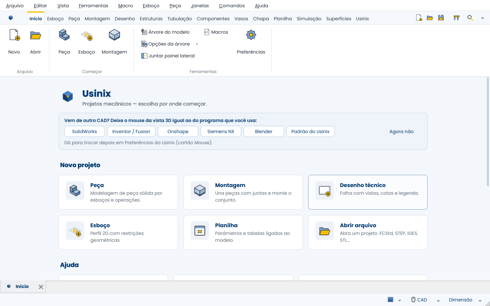

Novidades
---------

**Versão atual: 1.17.0** (14/11/2026)

- **Reservatórios e torres de resfriamento na aba Componentes:** caixa d'água, reservatório tipo taça, tipo
  coluna e sobre torre metálica, tanque horizontal, galões, bombonas, tambores, IBC e torres de resfriamento
  retangular e circular, em escala real.

Na 1.16.0: Padrão de estrutura (repete a estrutura inteira, contada nas listas) e símbolo de solda arrastável,
sem cadeado.

Na 1.15.2: vários enrijecedores de uma vez, com quantidade e espaçamento como no padrão linear.

| Escada com patamar e pés de apoio | Enrijecedores em série na placa de base |
|---|---|
| 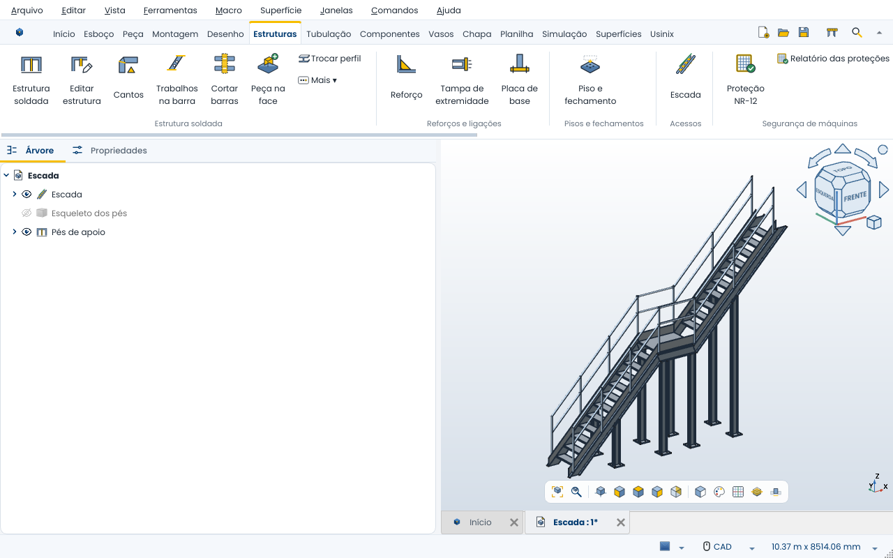 | 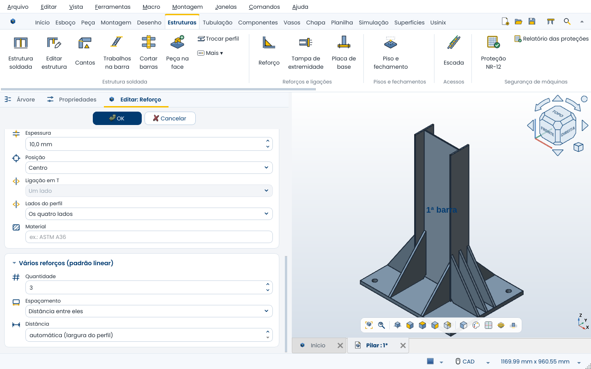 |

Na 1.15.1: escada apoiada nas pontas ou com pés de apoio (perfil à escolha, chapa de base com furos).

Na 1.15.0: enrijecedor entre a barra e a placa de base; escada com patamar (NR-12) e chapas de fixação;
estrutura sobre arestas de um corpo; furo-padrão da NBR 8800:2024 e perfis I e U da NBR 15980:2024;
componentes redesenhados, Içamento e Combate a incêndio.

Na 1.14.0: peça na face; estrutura apoiada no corpo; dados das pranchas nas Preferências; botão Grade na barra
de vistas; esboço novo sem tranco.

Na 1.13.0: Cortar barras (corte ou furo em várias barras de uma vez, tudo ligado à ferramenta).

Na 1.12.0: escada industrial num objeto só, conferida pela NR-12 (Anexo III).

Na 1.11.0: proteção de máquina NR-12 conferida pela ABNT NBR ISO 13857:2021; memorial NR-13 do vaso em PDF.

Na 1.10.0: classes de parafuso e porca, rolamentos, barras redondas, quadradas e chatas da NBR 16683.

Na 1.9.0: grade na área de trabalho, menu Comandos e barra que acompanha a face de outra peça.

Na 1.8.0: do modelo para a fábrica — DXF de todas as chapas e lista de materiais e de corte em Excel.

Na 1.7.0: folha pronta — cotas gerais com a furação, balões, folhas das barras e folha da chapa planificada.

Na 1.6.0: Conectar IA — o Claude Desktop e outros assistentes compatíveis com MCP usam as ferramentas do Usinix.

Na 1.5.0: Trabalhos na barra (cortes de ponta, furos e parafusos) e Tabela de furos.

Na 1.4.0: o Prumo 3D passou a se chamar Usinix (nome, logotipo e endereço novos; configurações vêm junto).

[Todas as novidades, versão por versão](NOVIDADES.md) • [Baixar a versão atual](https://github.com/usinix/usinix/releases/latest)

O que o Usinix tem de diferente
---------------------------------

### Fluxo de trabalho que se explica

A faixa mostra o que serve no momento: sem documento, só o que começa um trabalho; no Desenho, a folha
primeiro e depois vistas, cotas, anotação e entrega, nessa ordem; na Montagem, as restrições aparecem com a
montagem aberta. As ferramentas raras ficam no **Mais** de cada grupo, e **Ctrl+K** procura qualquer
comando pelo nome (até pelo nome em inglês de outros programas). Cota a mais no esboço vira cota de
referência em vez de deixar tudo vermelho, e os avisos já trazem o botão que conserta.

| Desenho: Paleta de vistas e cotas gerais | Montagem: Mover junta |
|---|---|
| 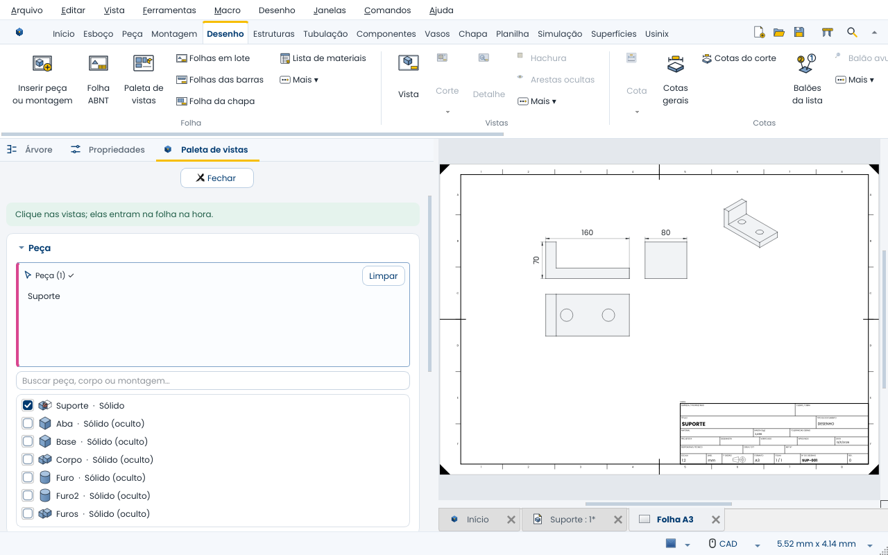 | 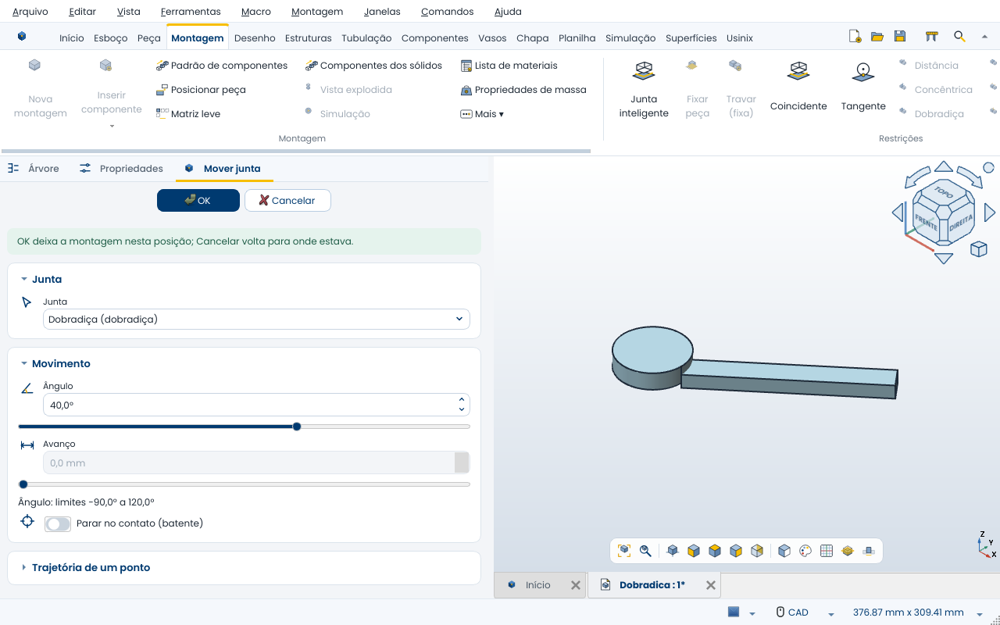 |

| Procurar comando (Ctrl+K) | Reservatório com pés de chapa |
|---|---|
| 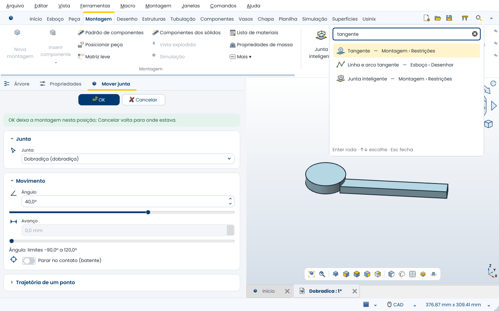 | 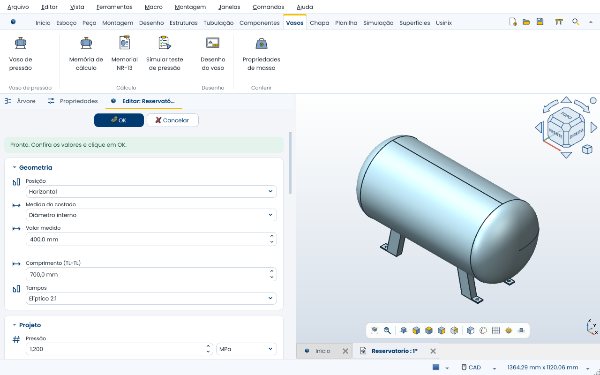 |

### Comandos em cartões e programa que se atualiza sozinho

Mais de 50 comandos do FreeCAD abrem num painel lateral único, em cartões: botões com ícone no lugar de
listas, chaves liga/desliga, campos com unidade (mm, N, MPa, N/mm, m/s²) e o que foi escolhido na vista
sempre à mostra. Vale para Peça, Montagem, Desenho e Simulação; o formulário original continua a
um clique. As **Preferências do Usinix** reúnem numa janela o que importa: tema claro ou escuro, painel
lateral, esboço, unidades em português e atualizações.

**Atualização automática:** ao abrir (no máximo uma vez por dia), o Usinix procura versão nova na página
de versões. Se houver, mostra as novidades e, com um clique em "Atualizar agora", baixa o instalador com
barra de progresso, velocidade e tempo que falta, confere o arquivo pelo código SHA-256, fecha o programa
(perguntando se quer salvar) e abre a instalação. Também dá para procurar na hora em Ajuda → Sobre o Usinix → "Verificar atualizações"
ou desligar a procura nas Preferências.

### Estruturas metálicas calculadas pelas normas brasileiras

Desenhe o esqueleto, escolha os perfis (W, HP, U, I, cantoneiras, tubos e metalon de catálogos
nacionais) e calcule a estrutura por barras no próprio modelo: apoios clicando nos nós, rótulas e
treliças, casos de carga e combinações da **ABNT NBR 8681:2025**, análise de 2ª ordem com
imperfeições e verificação de cada barra pela **ABNT NBR 8800:2024**. A taxa de uso aparece em cores
na deformada, e a memória de cálculo sai em PDF.

O **Assistente de estruturas** conduz o cálculo em etapas e só libera quando não há pendências: carga
com valor zero, apoio fora de nó, barra que sumiu do desenho, falta de caso de vento, deslocabilidade
alta.

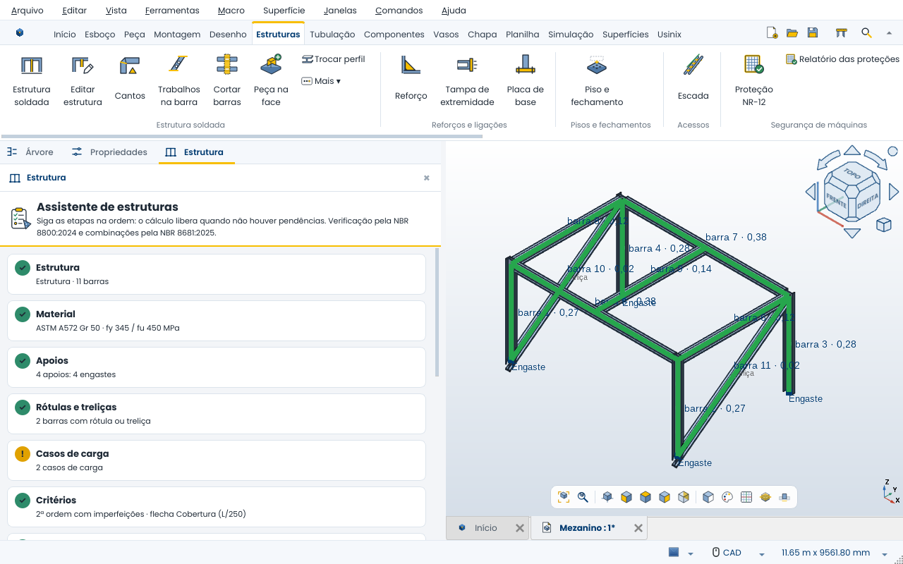

### Detalhe da ligação por elementos finitos

Um clique num nó recorta a ligação, aplica nos cortes os esforços da análise por barras e calcula as
tensões no sólido (CalculiX). As soldas de filete (perna necessária, mínima e máxima) e os chumbadores
da placa de base são verificados pela NBR 8800:2024. O Assistente de simulação acompanha malha,
convergência e relatório.

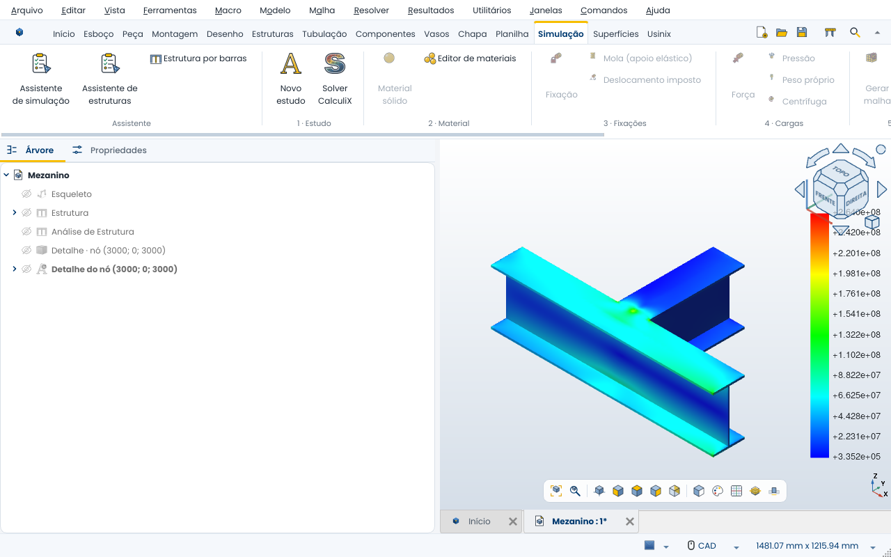

### Vasos de pressão do formulário ao desenho

Aba própria com formulário e prévia ao vivo: casco, tampos (elíptico 2:1, torisférico, hemisférico),
material, corrosão, bocais e suportes (selas, pés de chapa como nos reservatórios de compressor, saia ou
pernas). Espessuras e PMTA pelo ASME VIII
Div. 1, pressão de teste hidrostático ou pneumático, teste simulado por elementos finitos de casca e
folha A3 com vistas cotadas e tabela de dados de projeto.

| Formulário com prévia | Desenho gerado |
|---|---|
| 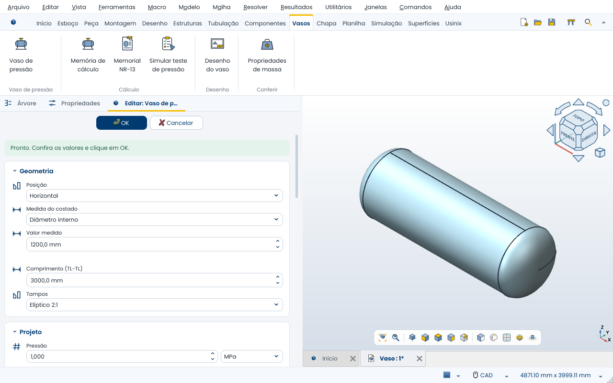 | 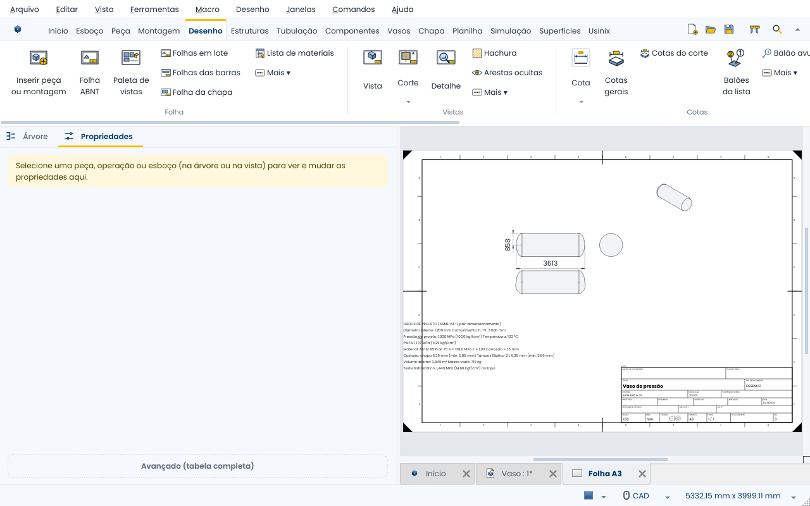 |

### Desenho técnico no padrão ABNT e chapa metálica

Folhas A0 a A4 com legenda brasileira (responsável técnico, CREA/CFT, ART, 1º diedro) e arranjos de
vistas prontos, Paleta de vistas (um clique por vista), cotas gerais, Salvar PDF com o número do desenho,
lista de materiais ligada ao modelo (com itens comprados e de referência), e chapa metálica com fator K por
material e planificação em DXF num clique.

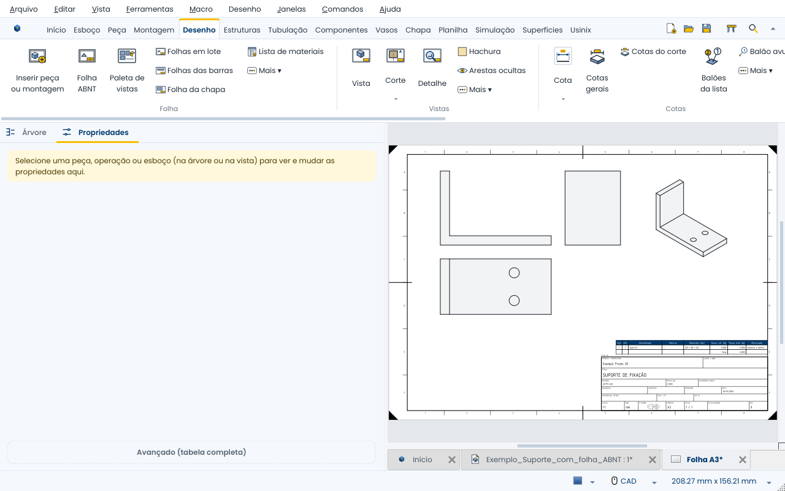

### Todas as abas, em português

Cada área tem a sua aba na faixa de ferramentas: não há menu de bancadas para trocar.

| Esboço com relações em cartões | Peça |
|---|---|
| 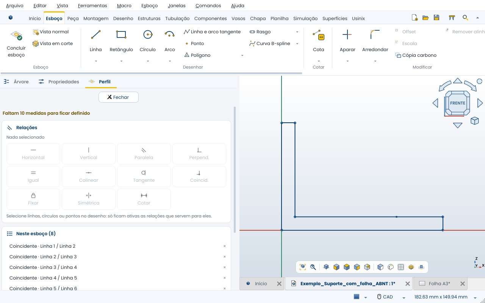 | 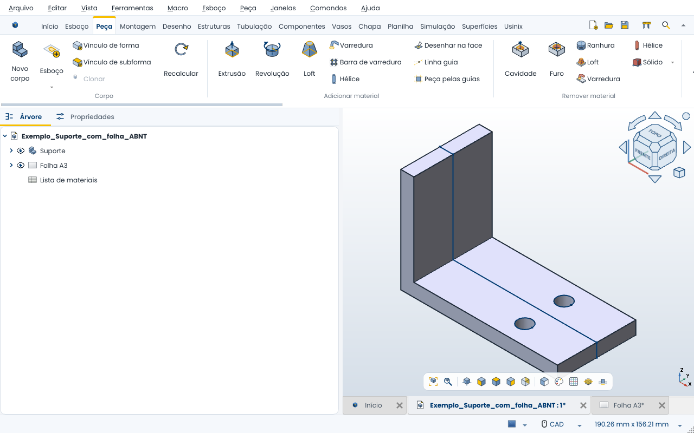 |

| Tubulação de PVC com tês e joelhos | Superfícies |
|---|---|
| 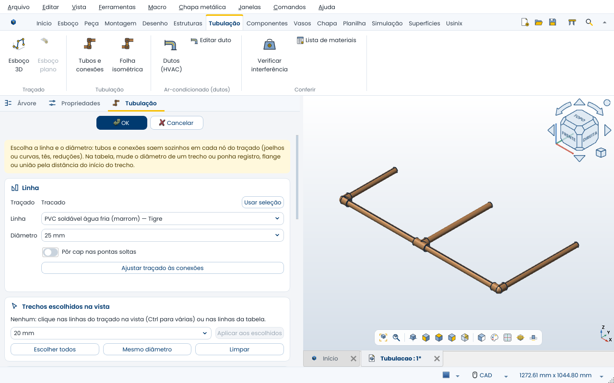 | 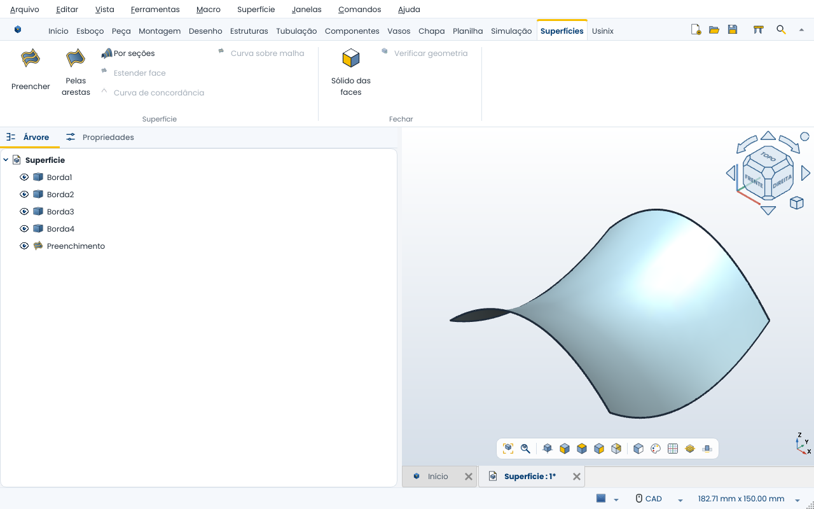 |

| Chapa metálica | Componentes |
|---|---|
| 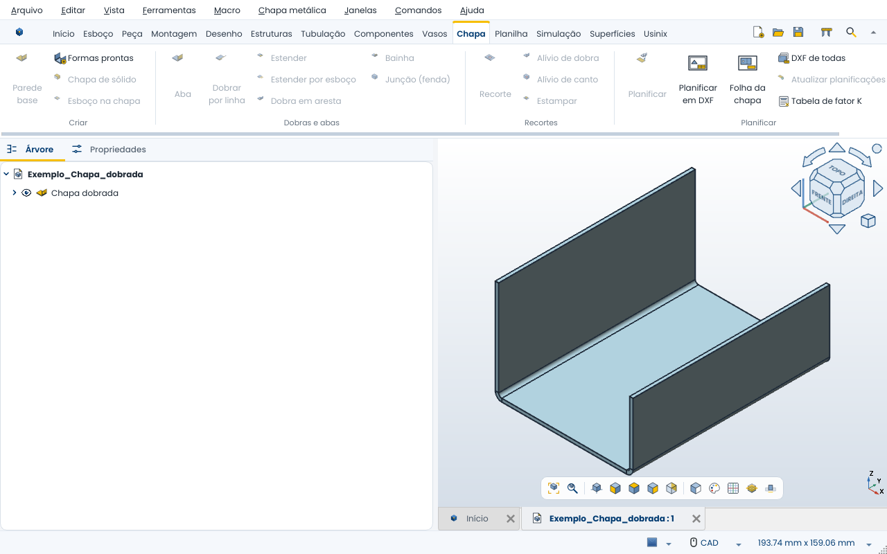 | 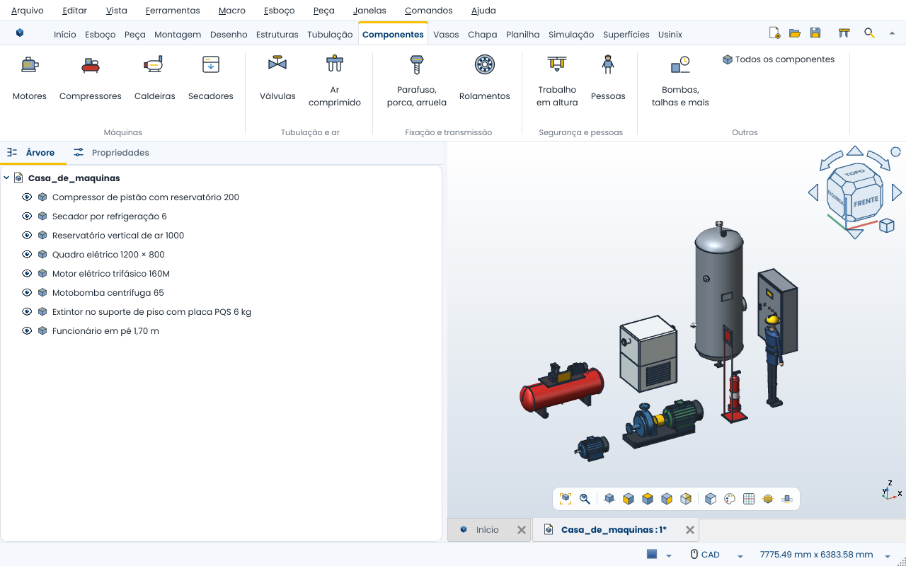 |

### Em resumo

| | Usinix |
|---|---|
| Idioma | Tudo em português, inclusive propriedades e listas |
| Interface | Faixa de ferramentas por abas, comandos em cartões no painel lateral, tela inicial, tutoriais e guia para quem vem do SolidWorks ou ZW3D |
| Atualização | Avisa quando sai versão nova, baixa com barra de progresso, confere o arquivo e instala ao fechar |
| Estruturas | Perfis brasileiros, cantos, reforços e enrijecedores em série, soldas, trabalhos na barra, escada e proteções pela NR-12, lista de corte, cálculo pela NBR 8800:2024 e NBR 8681:2025 |
| Simulação | Assistentes passo a passo para elementos finitos e para estruturas, com pendências e relatório em PDF |
| Vasos | Formulário ASME VIII-1, teste de pressão, desenho cotado, memorial NR-13 |
| Desenho | Folhas ABNT com legenda brasileira e lista de materiais |
| Materiais | Aços e ligas usados no Brasil, com norma e fonte em cada um |
| Componentes | Motores, compressores, válvulas, caldeira, reservatórios, torres de resfriamento, içamento, combate a incêndio, pessoas e mais, em escala real |
| IA | Conectar IA: o Claude Desktop e outros assistentes MCP comandam o Usinix |
| Base | FreeCAD 1.1: OpenCASCADE, Coin3D, Qt e Python, com tudo o que o FreeCAD oferece |

> [!IMPORTANT]
> Os cálculos ajudam no projeto, mas não substituem a análise e a
> responsabilidade técnica de um profissional habilitado (com ART). Itens fora do escopo de cada
> verificação aparecem como aviso no próprio programa e na memória de cálculo.

Todos os recursos
-----------------

* **Tudo em português** Menus, painéis, nomes de propriedades e opções de listas traduzidos, inclusive termos
  que a tradução oficial do FreeCAD ainda não cobre.

* **Faixa de ferramentas** Os comandos principais organizados em abas (Início, Esboço, Peça, Montagem,
  Desenho, Estruturas, Tubulação, Componentes, Vasos, Chapa, Planilha, Simulação, Superfícies e Usinix), com ícones
  grandes e rótulos claros, sem menu de bancadas. A aba Esboço aparece sozinha ao editar um esboço, e em
  tela de notebook a linha das abas se compacta para mostrar os nomes inteiros.

* **Tela inicial** Começa uma peça, montagem, desenho técnico, esboço ou planilha com um clique e mostra os
  arquivos recentes.

* **Assistente de simulação** Análise por elementos finitos em etapas guiadas: peça, material, fixações,
  cargas, malha, verificação de pendências, resultados e relatório em PDF.

* **Assistente de estruturas** Cálculo por barras em etapas guiadas: estrutura, material, apoios (inclusive
  molas), rótulas, treliças e contraventamentos só de tração, casos de carga, critérios, conferência de
  pendências, resultados, detalhe das ligações e memória de cálculo. Também calcula as frequências
  naturais e grava vídeo do comportamento da estrutura.

* **Seção personalizada** Um esboço fechado vira perfil da estrutura, com centro de cisalhamento, J e Cw
  calculados por elementos finitos na própria seção e verificação completa pela NBR 8800:2024.

* **Vasos de pressão** Formulário com prévia, espessuras e PMTA (ASME VIII-1), teste de pressão simulado
  por elementos finitos de casca e desenho cotado em folha A3.

* **Biblioteca de materiais** Aços estruturais, inoxidáveis, para vasos de pressão, para construção mecânica,
  tubos, forjados e alumínio, com as especificações usadas no Brasil.

* **Tutoriais interativos** "Primeira peça" (esboço, cotas, extrusão, furo, arredondamento e salvar) e
  "Estrutura soldada" (esqueleto, grupos de perfis, cantos, reforço, solda e lista de corte). O painel
  acompanha o que você faz na tela e marca cada passo sozinho.

* **Guia ilustrado** Ao editar extrusão, cavidade, furo, arredondamento, chanfro, padrões e outras operações,
  o painel de tarefas mostra um desenho do que a operação faz no modo escolhido. O diálogo Cantos da
  estrutura soldada mostra o desenho de cada tratamento (meia-esquadria, de topo, recorte pelo contorno).

* **Árvore do modelo** Se o painel da árvore for fechado sem querer, o botão Início → Árvore do modelo
  traz de volta. Objetos novos ganham nome em português (Extrusão, Cavidade, Corpo).

* **Painel lateral único** Árvore, Propriedades e a aba do comando em andamento num só painel, com as abas
  no alto. A peça ou operação selecionada aparece em cartões, com o nome editável e as medidas que
  importam.

* **Comandos em cartões** Mais de 50 comandos do FreeCAD ganharam painel no padrão Usinix: extrusão,
  cavidade, furo, revolução, arredondar, chanfro, padrões e multitransformação, hélice, loft, varredura,
  primitivas e booleana (Peça); extrusão, revolução, espelhar, escala, arestas, deslocamento, espessura,
  transição, varredura e verificar geometria (grupo Sólidos da Peça); juntas e inserir componente (Montagem); vistas, corte, detalhe, cota,
  balão, hachura e texto formatado (Desenho); material, fixação, força, pressão, deslocamento imposto,
  mola, peso próprio e malha (Simulação). O formulário original continua a um clique.

* **Painéis visuais e seleção nos dois sentidos** Caixas de seleção que aceitam selecionar antes ou depois
  de chamar o comando; booleanas e comandos do Usinix pedem a seleção quando chamados sem ela.

* **Propriedades da peça, variantes e modelos com regras** Código/denominação/revisão/material na lista
  de materiais e na legenda (que acompanha a peça); tabela de variantes P/M/G ligada às cotas; placa
  com furos, flange, suporte em L e eixo escalonado gerados por formulário, com regras de projeto.

* **Chapa e montagem** Fator K por material e planificação em DXF; verificar interferência; copiar
  projeto (Pack and Go). Guia "vindo do SolidWorks / ZW3D" com a equivalência dos comandos.

* **Tubulação** Aba própria, com três linhas do catálogo Tigre: água fria (PVC soldável), água quente
  (CPVC Aquatherm) e esgoto (série normal). Joelhos, tês, junções a 45°, reduções, cruzetas, caps,
  registros, torneiras e caixas de esgoto saem sozinhos sobre o traçado; o tubo é cortado descontando as
  bolsas, o esgoto ganha caimento pela NBR 8160 e a lista de corte em barras vai para a lista de materiais.
  Os trechos se escolhem clicando na vista, como na estrutura soldada.

* **Esboço 3D** Linhas no espaço, ponto a ponto: clique na vista (Tab troca o plano XY, YZ, ZX) ou
  digite as coordenadas; encaixa em vértices, faz ramais e curvas nos cantos. Restrições ao longo de
  X/Y/Z, cotas, paralelas, perpendiculares e linhas de construção. Vira esqueleto da estrutura soldada ou
  caminho de tubo e varredura.

* **Esboço com ímãs e inferência** Ao desenhar, aparecem pontos-ímã nos quadrantes de círculos e arcos, no
  meio das linhas e nas interseções; o cursor é atraído e o ponto já recebe as restrições. Linhas tracejadas
  de inferência alinham o cursor na horizontal ou na vertical com pontos existentes.

* **Régua de histórico** Uma régua amarela na própria árvore do modelo, logo abaixo da última operação do
  corpo: arraste para cima e o modelo recua até ali (as operações de baixo ficam esmaecidas); as novas
  operações entram no ponto da régua. Duplo clique volta ao modelo completo.

* **Relações automáticas que não cabem** Ao cotar, se uma relação posta sozinha pelo esboço (vertical,
  horizontal, tangente) entra em conflito, o Usinix retira a que menos mexe no desenho, avisa qual foi e
  deixa desfazer. Conflito posto à mão aparece destacado para você decidir.

* **Conferência do esboço** Ao concluir um esboço, o Usinix avisa de pontas quase encostadas, pontas soltas
  num perfil e elementos de tamanho zero, e corrige com um clique (o problema do "esboço aberto").

* **Cotas na tela** Duplo clique numa face mostra as cotas da operação que a criou (comprimento da extrusão,
  raio do arredondamento, diâmetro do furo, cotas do esboço) para mudar o valor ali mesmo.

* **Menu de contexto pela seleção** O botão direito oferece o que faz sentido para o que está selecionado:
  esboço na face, extrudar, cavidade, arredondar, chanfro, medir e propriedades de massa.

* **Propriedades de massa e lista de materiais** Massa, centro de gravidade e momentos de inércia com o
  material de cada peça; lista de materiais da montagem em planilha e como tabela na folha de desenho.

* **Folhas ABNT** Folhas A0 a A4 no padrão da ABNT NBR 16752 (e no da NBR 10068), com legenda brasileira
  (responsável técnico, CREA/CFT, ART, 1º diedro) preenchida a partir do documento e das Preferências (dados
  das pranchas) e vistas no 1º diedro.

* **Estruturas soldadas** Barras de perfis brasileiros (W, HP, U, I, cantoneiras, tubos e metalon, de
  catálogos de fabricantes) sobre um esqueleto de linhas, em grupos (perfil, giro, ponto de fixação e
  espelhamento por grupo). Cantos em meia-esquadria ou de topo (escolhendo qual barra passa), corte reto ou
  recorte pelo contorno nas ligações em T, nós com três ou mais barras, e cantos parecidos tratados de uma
  vez. Reforços (mão-francesa) e enrijecedores da placa de base, vários de uma vez com espaçamento como no
  padrão linear, tampas de tubo, placas de base com furação, cordões de solda com perna, processo e eletrodo,
  lista de corte e lista de soldas. A estrutura também sai sobre as arestas de um corpo.

* **Trabalhos na barra e Cortar barras** Cortes de ponta, furos e parafusos sem a barra deixar de ser barra;
  corte ou furo em várias barras de uma vez com qualquer sólido ou esboço; Tabela de furos com o furo-padrão
  da NBR 8800:2024.

* **Padrão de estrutura** Repete a estrutura inteira em linha ou em volta de um eixo, com quantidade e
  espaçamento; as cópias acompanham a original e entram nas listas de materiais e de corte.

* **Escada industrial** Desnível, ângulo e largura num objeto só: degraus calculados, patamares, guarda-corpo,
  chapas de fixação e pés de apoio, com conferência ao vivo pela NR-12 (Anexo III).

* **Proteções de máquina** Grade ou enclausuramento com quadro de tubo e tela, verificado pela ABNT NBR ISO
  13857:2021, com relatório e item na lista de materiais.

* **Componentes** Biblioteca em escala real para leiautes: motores IEC, compressores, secadores, válvulas,
  caldeira, talhas e trole, extintores, hidrantes e abrigos, caixas d'água e reservatórios (taça, coluna,
  torre), tambores e IBC, torres de resfriamento, rolamentos, quadros, paletes e pessoas.

* **Do modelo para a fábrica** Folhas das barras e da chapa planificada, balões, cotas gerais com a furação,
  DXF de todas as chapas e lista de materiais e de corte em Excel.

* **Conectar IA** O Claude Desktop e outros assistentes compatíveis com MCP usam as ferramentas do Usinix
  (estruturas, escada, folhas, exportações), com instalação num clique.

* **Chapa metálica** Parede base, abas, dobras, recortes, alívios e planificação (bancada SheetMetal embutida).

* **Peças padronizadas** Parafusos, porcas e arruelas métricas para inserir no modelo.

* **Visual próprio** Temas claro e escuro, ícones redesenhados e tela de abertura do Usinix.

* **Preferências do Usinix** Uma janela em cartões com o que importa (tema, aparência, painel lateral,
  esboço, unidades em português e atualizações), cada opção gravando na hora.

* **Atualização automática** Procura versão nova ao abrir (no máximo uma vez por dia, pode desligar nas
  Preferências) ou na hora, em Ajuda → Sobre o Usinix → "Verificar atualizações". "Atualizar agora" baixa com barra de progresso, velocidade
  e tempo que falta, confere o arquivo (SHA-256), fecha o Usinix perguntando se quer salvar e abre o
  instalador. No Linux, baixa o AppImage novo e indica onde ficou.

* **Testes automatizados** Mais de 800 testes conferem, a cada versão, tradução, aparência, os painéis
  em cartões, as ferramentas de ponta a ponta (esboço, peça, estruturas, simulação) e os cálculos.

* **Base sólida** Tudo o que o FreeCAD oferece continua disponível: núcleo geométrico OpenCASCADE, cena 3D
  Coin3D, interface Qt e programação em Python.

Instalação
----------

Baixe a versão mais recente na [página de versões](https://github.com/usinix/usinix/releases/latest):

| Sistema | Arquivo | Como usar |
|---|---|---|
| Windows 10/11 (64 bits) | `Usinix_…-installer.exe` | Rode o instalador. |
| Windows (portátil) | `Usinix_…-Windows-….7z` | Descompacte e abra `bin\Usinix.exe`. |
| Linux (64 bits) | `Usinix_…-Linux-….AppImage` | Marque como executável e abra. Em algumas distribuições é preciso instalar o pacote `libfuse2`. |

O Usinix tem pasta de configurações própria e pode ser instalado ao lado do FreeCAD, sem interferir nele.

Código
------

| Pasta | Conteúdo |
|---|---|
| [`src/Mod/Prumo3D/`](src/Mod/Prumo3D/) | Módulo da interface do Usinix, parte do programa: faixa, tradução, tela inicial, assistentes, tema, ícones e identidade (`extras/branding.xml`) |
| [`src/Gui/PreferencePacks/Usinix Claro/`](src/Gui/PreferencePacks/) | Tema Usinix Claro, embutido como pacote de preferências |
| [`src/Mod/SheetMetal/`](src/Mod/SheetMetal/) | Bancada de chapa metálica (SheetMetal, LGPL), embutida |
| [`prumo-build/`](prumo-build/) | Roteiro de compilação no Windows e ferramentas que geram ícones, tema de ícones e materiais |
| [`prumo-patches/`](prumo-patches/) | Correções aplicadas ao código do FreeCAD |
| [`package/`](package/) | Instalador Windows e empacotamento (Windows e AppImage) |
| [`.github/workflows/publicar.yml`](.github/workflows/publicar.yml) | Geração e publicação automática das versões |

O ramo `main` tem como base o FreeCAD 1.1.4 (estável).

Compilação
----------

**Automática:** cada tag `v*` enviada ao GitHub dispara o fluxo
[Publicar versão](.github/workflows/publicar.yml), que compila no Windows e no Linux (AppImage) nas
máquinas do GitHub e publica os arquivos na página de versões. Tags com hífen (por exemplo
`v0.1-beta`) saem como pré-lançamento. O fluxo também pode ser rodado à mão pela aba *Actions*, para
testes.

**No Windows, localmente:** o roteiro [`prumo-build/compilar.ps1`](prumo-build/compilar.ps1) confere os
pré-requisitos e compila. É preciso:

- Visual Studio 2022 com a carga de trabalho *Desenvolvimento para desktop com C++*;
- Git for Windows;
- [pixi](https://pixi.sh);
- pelo menos 40 GB livres em disco.

Rode `prumo-build\compilar.ps1 -SomenteVerificar` para conferir o ambiente e depois sem o parâmetro para
compilar. Detalhes em [`prumo-build/LEIA-ME.md`](prumo-build/LEIA-ME.md). Para a compilação do FreeCAD em
geral, veja o [Manual do Desenvolvedor do FreeCAD](https://freecad.github.io/DevelopersHandbook/gettingstarted/)
(em inglês).

Como relatar problemas
----------------------

- Procure nos [problemas já abertos](https://github.com/usinix/usinix/issues) para não repetir um relato;
- Informe a versão em `Ajuda > Sobre` (botão de copiar para a área de transferência);
- Descreva passo a passo como reproduzir o problema;
- Se puder, anexe um arquivo de exemplo (o `.FCStd` compactado em ZIP);
- Se o problema também acontece no FreeCAD, ele provavelmente deve ser relatado no
  [repositório do FreeCAD](https://github.com/FreeCAD/FreeCAD/issues).

Uso e ajuda
-----------

Por ser baseado no FreeCAD, a documentação dele vale para o Usinix (wiki em inglês; muitas páginas têm
versão em português pelo seletor de idioma):

- [Primeiros passos](https://wiki.freecad.org/Getting_started)
- [Lista de recursos](https://wiki.freecad.org/Feature_list)
- [Perguntas frequentes](https://wiki.freecad.org/FAQ)
- [Bancadas de trabalho](https://wiki.freecad.org/Workbenches)
- [Programação em Python](https://wiki.freecad.org/Power_users_hub)

Assinatura digital e privacidade
--------------------------------

- **Assinatura:** os instaladores ainda não têm assinatura digital; o Windows mostra o aviso de "editor
  desconhecido" (clique em **Mais informações → Executar assim mesmo**). Cada arquivo tem o código
  SHA-256 ao lado, para conferir que veio daqui.
- **Privacidade:** o Usinix não envia informação sobre você nem sobre seus arquivos. A única conexão
  automática é a procura de versão nova (uma vez por dia, na página pública de versões no GitHub), que
  pode ser desligada em Preferências.

Detalhes: [assinatura e privacidade](docs/assinatura-de-codigo.md).

Licença
-------

O Usinix é distribuído sob a mesma licença do FreeCAD, a
[GNU LGPL versão 2.1 ou posterior](LICENSE). O texto da licença é mantido no original em inglês, que é a
versão com validade jurídica.

Créditos
--------

O Usinix existe graças ao trabalho de milhares de pessoas da comunidade do
[FreeCAD](https://www.freecad.org), que desenvolvem e mantêm o programa. Se o FreeCAD é útil para
você, considere [apoiar o projeto original](https://wiki.freecad.org/Donate).
